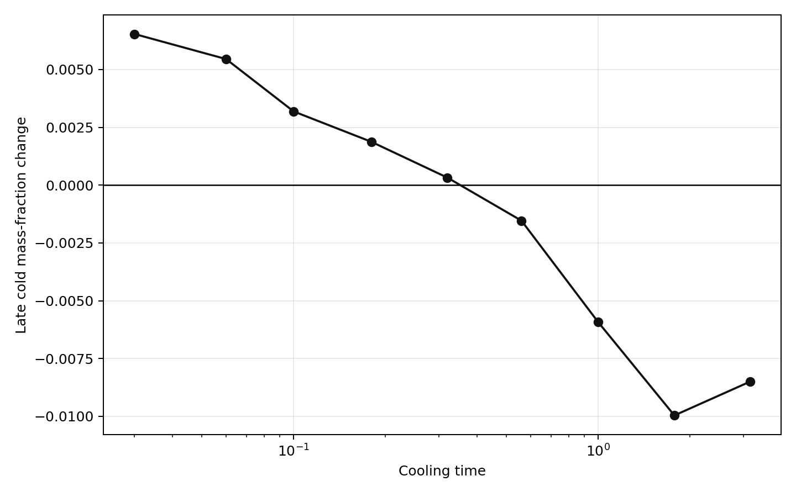
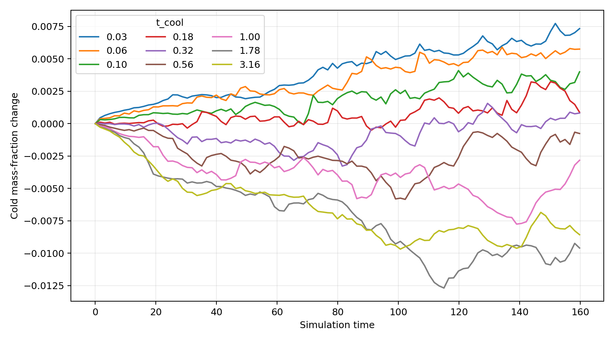
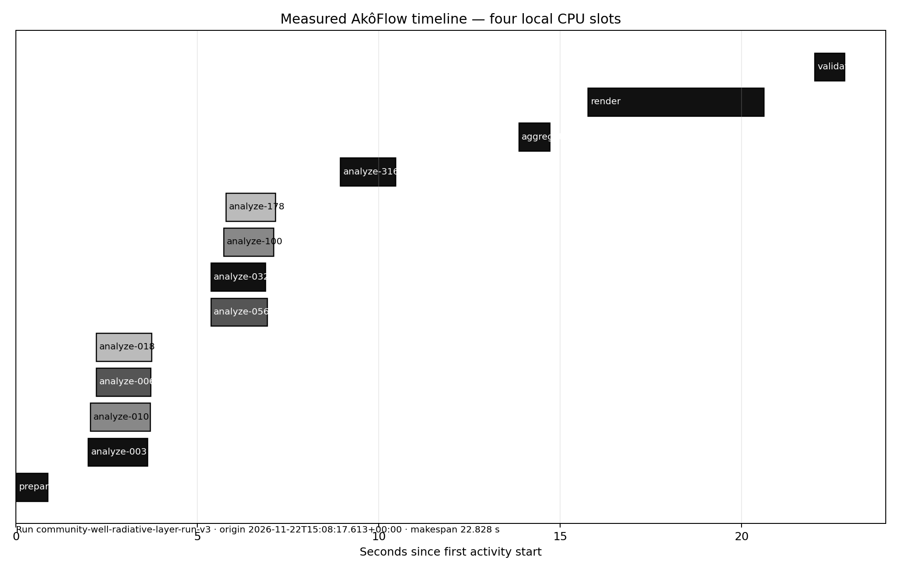

# The Well radiative mixing-layer phase-transfer audit

This CPU workflow audits the nine official test trajectories in The Well
`turbulent_radiative_layer_2D` dataset, one for each cooling time. It measures
density-weighted phase fractions from `T = pressure / density`, RMS speed, and
discrete-mass drift. This is a bounded 2D dataset adaptation—not a reproduction
of the domain paper's 3D scaling experiment or a seed-ensemble estimate.

## Paper and authors

Dataset source: **Ruben Ohana** et al., “The Well: a Large-Scale Collection of
Diverse Physics Simulations for Machine Learning,” NeurIPS 2024 Datasets and
Benchmarks Track, DOI [`10.52202/079017-1430`](https://doi.org/10.52202/079017-1430),
arXiv [`2412.00568`](https://arxiv.org/abs/2412.00568). Authors in proceedings
order: Ruben Ohana, Michael McCabe, Lucas Meyer, Rudy Morel, Fruzsina J. Agocs,
Miguel Beneitez, Marsha Berger, Blakesley Burkhart, Stuart B. Dalziel,
Drummond B. Fielding, Daniel Fortunato, Jared A. Goldberg, Keiya Hirashima,
Yan-Fei Jiang, Rich R. Kerswell, Suryanarayana Maddu, Jonah Miller, Payel
Mukhopadhyay, Stefan S. Nixon, Jeff Shen, Romain Watteaux, Bruno
Régaldo-Saint Blancard, François Rozet, Liam H. Parker, Miles Cranmer, and
Shirley Ho.

Physical context: Drummond B. Fielding, Eve C. Ostriker, Greg L. Bryan, and
Adam S. Jermyn, “Multiphase Gas and the Fractal Nature of Radiative Turbulent
Mixing Layers,” *ApJL* 894, L24 (2020), DOI
[`10.3847/2041-8213/ab8d2c`](https://doi.org/10.3847/2041-8213/ab8d2c), arXiv
[`2003.08390`](https://arxiv.org/abs/2003.08390). AkôFlow adaptation:
Community Explorer contributors.

## Scenario and frozen acceptance

The dataset revision is `2ee7756575ff6f90981d0308cbcb6a2ab5995bdc`.
The initial equilibrium temperatures are 0.01 and 1.0; log-space thirds fix
phase boundaries at 0.04641588833612779 and 0.21544346900318834. The late
window is the final 21 of 101 frames. The validator requires every late cold
fraction change to match the qualified float64 reference within `1e-10`, phase
closure within `1e-12`, all object hashes, and the sign transition between
cooling times 0.32 and 0.56.

The pinned repository contains 27 files and 72 trajectories: six train, one
validation, and one test trajectory at each of nine cooling times. This
conflicts with the upstream README's 90-trajectory statement and is reported
rather than hidden.

## Workflow and DAG

`prepare` freezes provenance and the protocol. Nine independent
`analyze-*` activities verify and process the test HDF5 objects. `aggregate`
joins all branches, `render` produces the figures and animation, and
`validate` checks the frozen metrics and artifact hashes. Four one-core,
2 GiB local Docker slots execute the scientific branches in parallel.

## Run with Docker and AkôFlow

`prepare-inputs.sh` copies only checksum-verified inputs from the local cache.
`build.sh` is the dependency step that may use network access. Scientific
containers run without network, credentials, or the host Docker socket.

```sh
./build.sh
./preflight.sh
./run.sh
```

Reference image:
`akoflow/community-well-radiative-layer:v1@sha256:527390b8a7549846dd752ddfbba39ae6ec09a3922d6366336ceaeb78a052b082`.
The nine input HDF5 objects have 101 frames on a 128×384 grid and are verified
against their pinned LFS SHA-256 identities before construction.

## Measured result gallery



The late cold mass-fraction change decreases across cooling time and changes
sign between `t_cool=0.32` and `0.56`, as predeclared.



The curves show all 101 stored frames rather than only the late summary.



Four independent analyses start within 0.23 s on four distinct slots. The
scientific animation is [phase-evolution.gif](evidence/gallery/phase-evolution.gif).

## Result files and validation

The recorded outputs are [`aggregate.csv`](evidence/results/aggregate.csv),
[`aggregate.json`](evidence/results/aggregate.json), and
[`validation.json`](evidence/results/validation.json). The validator passed
20 frozen checks. Its checksums exactly match these materialized result and
gallery files. The full daemon record is
[`daemon-run.json`](evidence/daemon-run.json).

## Recorded execution

Reference run `community-well-radiative-layer-run-v3`, workflow version
`community-well-radiative-layer-v1-v1`, completed 13/13 activities from
2026-11-22 15:08:17 to 15:08:40 UTC. Measured makespan was 22.828 s, compute
total 21.005 s, transfer total 13.347 s, and transferred data 1,175,921 bytes.
No speedup is claimed because a matching one-slot run was not made.

## Provenance and limitations

Dataset metadata is CC BY 4.0. The Well code/schema revision
`aac88c0b5eb9cbe4b7b2797eaaa550a43706fb44` is BSD-3-Clause. Input HDF5 files
are not committed. There is only one test trajectory per cooling time, so no
confidence interval is claimed. Fractions use discrete density sums because
cell-edge conventions are not explicit. The open y boundary makes mass drift
a diagnostic, not an assumed conservation failure. No power-law exponent or
parallel speedup is an acceptance target.
