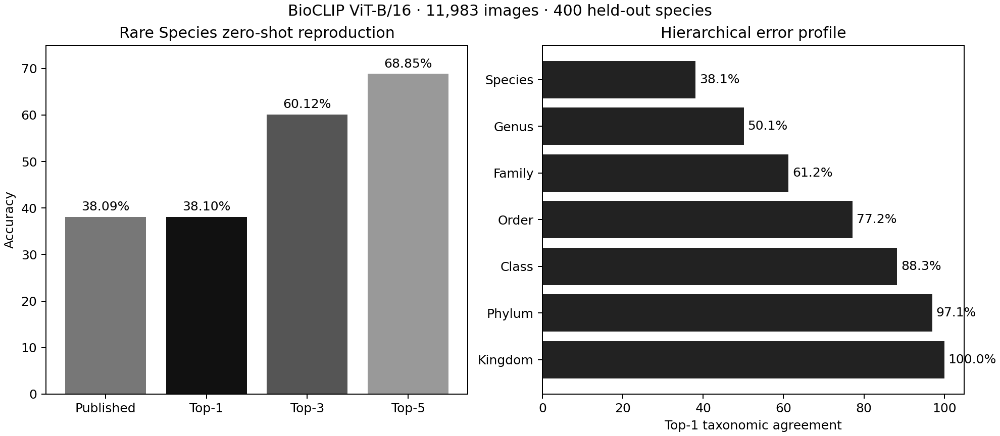
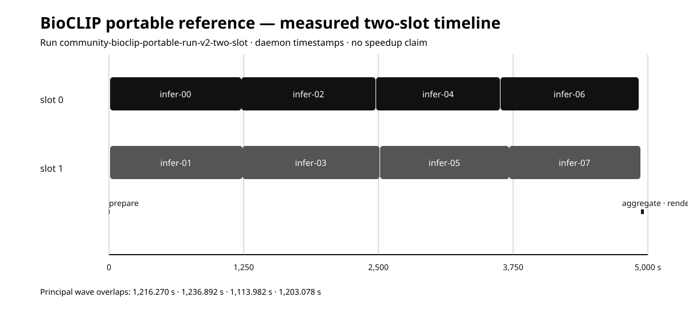
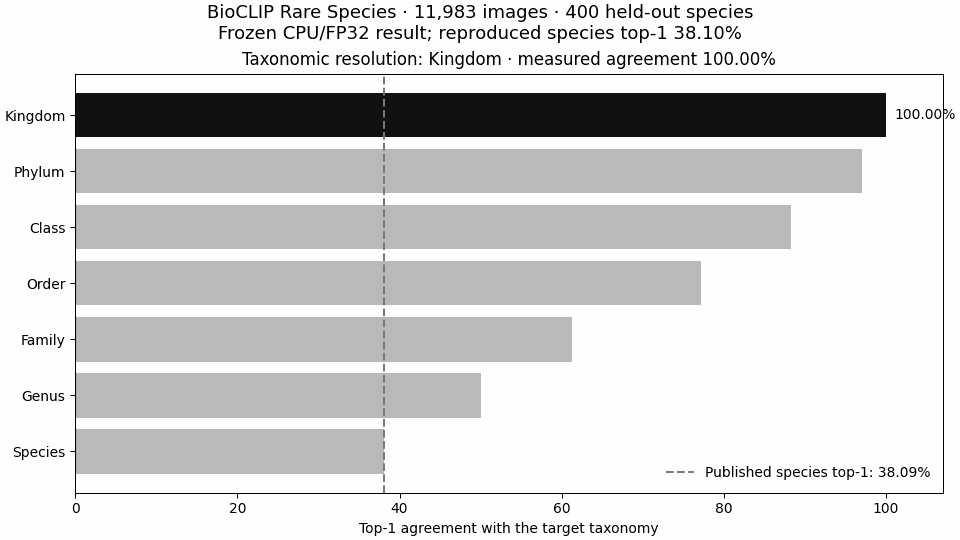

# BioCLIP rare-species hierarchical zero-shot evaluation

This workflow reproduces BioCLIP's zero-shot result on the official Rare Species benchmark and extends it with taxonomic-rank agreement. It evaluates 11,983 images from 400 held-out animal species with a frozen ViT-B/16 checkpoint, the authors' seven-rank-taxonomy-plus-common-name labels, and the 81-template OpenAI ImageNet prompt ensemble.

This is a bounded image-classification benchmark. It is not a species survey, conservation-status reassessment, ecological abundance estimate, or substitute for expert identification. Predictions may be wrong even when a higher taxonomic rank is correct.

## Authors and scientific sources

BioCLIP was developed by Samuel Stevens, Jiaman Wu, Matthew J. Thompson, Elizabeth G. Campolongo, Chan Hee Song, David Edward Carlyn, Li Dong, Wasila M. Dahdul, Charles Stewart, Tanya Berger-Wolf, Wei-Lun Chao, and Yu Su. The source is pinned to Imageomics/BioCLIP revision `7555b4e00583687b128a12df2e0b70e6a7bc1522`; see “BioCLIP: A Vision Foundation Model for the Tree of Life,” CVPR 2024 ([paper](https://openaccess.thecvf.com/content/CVPR2024/html/Stevens_BioCLIP_A_Vision_Foundation_Model_for_the_Tree_of_Life_CVPR_2024_paper.html)). The model is MIT-licensed.

The Rare Species dataset was curated by Samuel Stevens, Jiaman Wu, Matthew J. Thompson, and Elizabeth G. Campolongo from Encyclopedia of Life imagery for species selected from IUCN Red List categories. The compilation is CC0, while each photograph retains the license and attribution recorded in `licenses.csv`; the frozen table contains 15 license labels. This workflow does not republish source photographs.

## Frozen protocol

- Model: `imageomics/bioclip@799f1d9eb01abf82c9353de5951967755315725f`, `ViT-B-16`, weight SHA-256 `e380384f…f0ef4`.
- Dataset: `imageomics/rare-species@59689732c07819c9472b6a2ef5b9da9b473f7c27`.
- Catalog SHA-256 `96c458bd…b8fa`; per-image license/MD5 table SHA-256 `8cd23a63…c754`.
- Class order is first occurrence in the authors' metadata. Each class is the capitalized kingdom-through-species taxonomy followed by ` with common name ` and its common name.
- Every class expands through all 81 `openai_imagenet_template` prompts. Each text embedding is L2-normalized; the class mean is normalized again.
- Images use the pinned OpenCLIP 224-pixel validation transform, RGB conversion, and L2-normalized image embeddings. Logits are `exp(logit_scale) × image @ classifier`.
- CPU/FP32, seed 0, deterministic PyTorch algorithms. The reusable 512×400 classifier has SHA-256 `7ca30fa6…2f42`.

The eight inference shards partition rows by `row_index mod 8`. Each shard retrieves only its paper-era raw objects, validates the historical MD5 and Pillow decode, evaluates them, then deletes the photographs. The aggregate requires an exact 0–11,982 row partition before computing top-1/3/5 and rank-level agreement.

## Qualification result

The independent full-asset qualification reproduced the published result almost exactly:

| Metric | Result |
|---|---:|
| Published top-1 | `38.09%` |
| Reproduced top-1 | `38.095635%` |
| Reproduced top-3 | `60.118501%` |
| Reproduced top-5 | `68.847534%` |
| Macro species top-1 | `38.068797%` |

Taxonomic top-1 agreement was 100.00% kingdom, 97.07% phylum, 88.27% class, 77.18% order, 61.25% family, 50.10% genus, and 38.11% species. The gate is top-1 within ±1 absolute percentage point of 38.09%.

All 11,983 images passed their frozen MD5 and decoded successfully. There were no byte-exact duplicate groups. A 64-bit pHash audit at Hamming distance ≤4 found 648 candidate near-duplicate pairs, including 299 cross-taxon pairs. These candidates are disclosed as sensitivity rather than removed after results are known. The authors' `unseen_in_training.json` exactly covers all 400 benchmark taxa and 11,983 content IDs and has no species-name or content-ID overlap with their 4,000-entry `seen_in_training.json`; that verifies the version-controlled construction exclusion, not absence from every external pretraining source.

Qualification artifacts are under `evidence/`. The evaluation JSON is `dab54553…cb2c`; the image audit is `2cb4da3a…525d`.

The portable reference run `community-bioclip-portable-run-v2-two-slot` completed all 12 activities through the AkôFlow daemon in 4,955.142 seconds with 9,820.150 compute-seconds, 11.256 transfer-seconds, 9,279,173 transferred bytes, and zero configured cost. Two independent inference activities overlapped in each of four principal waves; the measured overlaps were 1,216.270, 1,236.892, 1,113.982, and 1,203.078 seconds. These measurements prove scientific activity overlap, not parallel speedup: no matching one-slot run was used. Final validation passed every frozen-asset, benchmark-completeness, eight-shard, top-k, publication-policy, output, and scientific-reference gate. The portable image digest is `sha256:85a5cd9a696fecc79884e83e8066fab9bbde774719df6cd65851320f45a5b087`; the validator SHA-256 is `1baa4383…639d`, and the retained figure remains byte-identical at `7d19307a…b39c`.





The timeline uses daemon start and finish timestamps from the portable reference
run. The eight scientific inference branches alternate between the two measured
local slots; aggregation, rendering, and validation follow only after all
inference outputs are complete.

## Build and run

The image build retrieves and hashes the pinned source, model, tokenizer, catalog, and license table. Workflow execution requires network access only for the frozen image objects:

```sh
docker build -t akoflow/community-bioclip-rare-species:v1 -f docker/Dockerfile .
./preflight.sh
```

For a rate-limited or air-gapped reference site, `--build-arg BIOCLIP_DATA_MIRROR=http://host/path` may point to a local byte mirror laid out by taxonomic directory. Mirror objects are never trusted by location: every file must still match the paper-era per-image MD5 and decode successfully, otherwise the activity fails or retries the official immutable URL.

Submit `environment.yaml`, `scope.yaml`, `topology.yaml`, `workflow.yaml`, and `plan.yaml` to a running AkôFlow daemon with `./run.sh`. The portable reference plan uses two two-core resources for four overlapping inference waves, followed by aggregation, a metrics-only figure, and final validation.

## Limitations

The benchmark includes only 400 animal species selected partly by image availability, uses historical EOL/ITIS labels that may change, and contains strong class imbalance for five short species. Near-duplicate candidates and visually ambiguous or mislabeled images can influence results. The model's held-out manifests do not prove universal training-data absence. Hierarchical agreement can make an error look biologically closer, but it does not make the species prediction correct. No source photograph is suitable for Hub display without applying its individual license and attribution.

## Measured result gallery



The animation traverses the frozen top-1 agreement result from kingdom through
species. Each frame highlights one successively finer taxonomic rank; the bars
are the committed 11,983-image CPU/FP32 measurements, not interpolated values.
The dashed line is the paper's 38.09% species top-1 reference. The GIF contains
no benchmark photographs. Its seven-frame provenance, dimensions, source hash,
and artifact SHA-256 are recorded in
[`evidence/visual-backfill.json`](evidence/visual-backfill.json).
