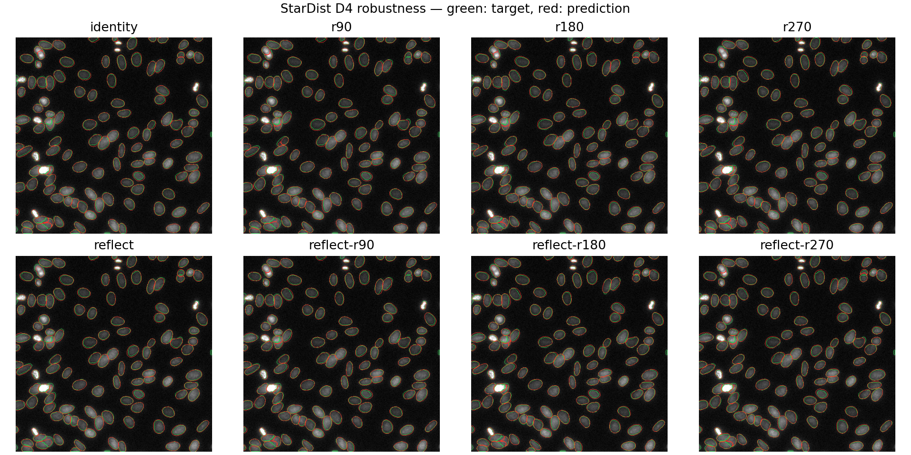
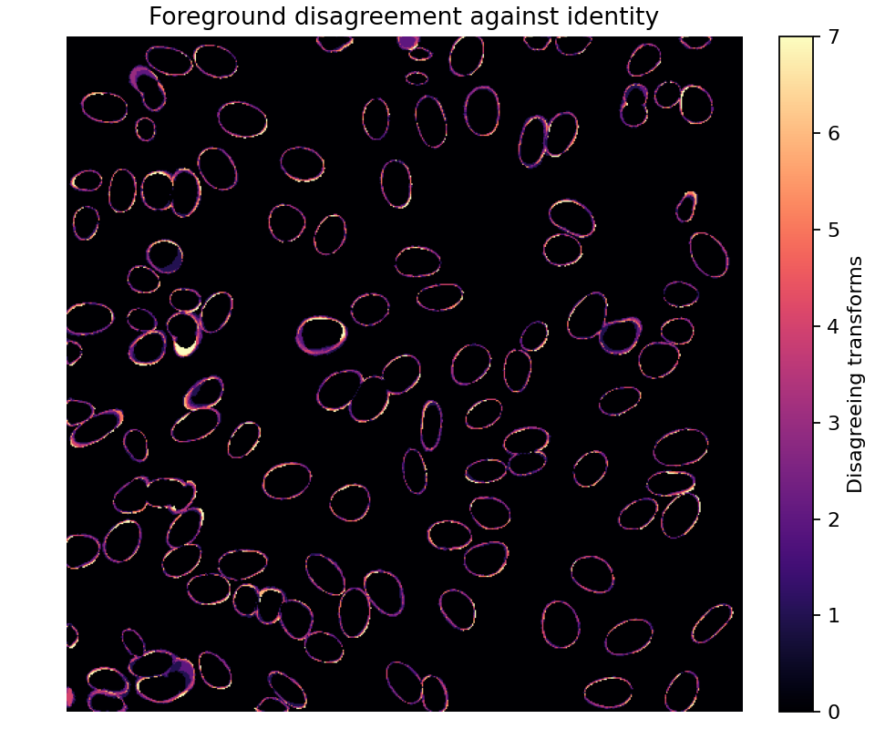
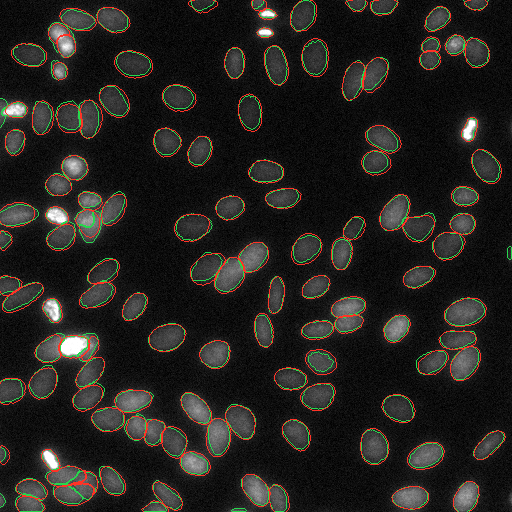
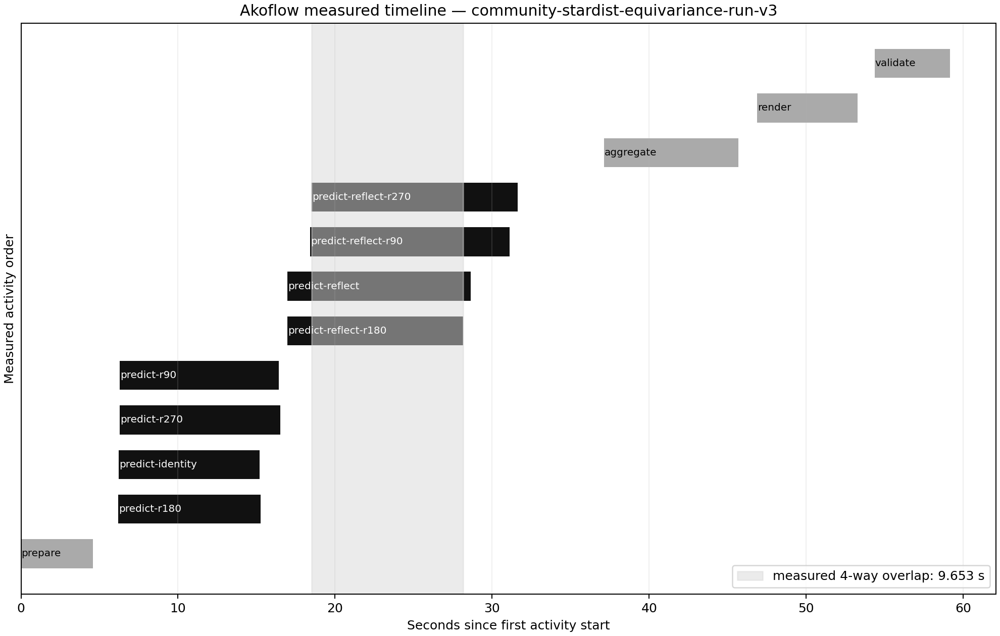

# StarDist under rotation and reflection

This CPU workflow measures how the official MICCAI 2018 StarDist 2D paper model behaves under the eight rotations and reflections of the square dihedral group D4. It is a one-image robustness adaptation, not a reproduction of the full MICCAI benchmark and not evidence of biomedical validity.

The workflow normalizes the official 512 x 512 nuclei image once, runs eight independent transformed inferences, maps every instance-label image back without interpolation, and evaluates each result against the 125-instance target mask and the identity prediction. Aggregation enforces the qualification-time non-degradation, identity-consistency, object-count, completeness, and finite-value gates. Rendering produces an overlay grid, a disagreement map, and an eight-frame animation.

## Import from AkôFlow Hub

```text
akoflow://hub/publications/38a33bff-bfbe-414d-85dc-e88f741a77e2/versions/2
```

The published workflow includes the Docker build context. Reference run
`community-stardist-portable-run-v2` completed all 12 activities and passed
scientific validation.

## Scientific source and credit

Uwe Schmidt, Martin Weigert, Coleman Broaddus, and Gene Myers, “Cell Detection with Star-Convex Polygons,” MICCAI 2018, pp. 265–273, DOI [10.1007/978-3-030-00934-2_30](https://doi.org/10.1007/978-3-030-00934-2_30). The implementation and paper model are from the [StarDist repository](https://github.com/stardist/stardist), pinned to revision `e80c6de700693bc228ed3c9ba1dc19c3785667ee` under BSD-3-Clause. The bundled image and mask originate from the 2018 Data Science Bowl / BBBC038 and are CC0/public domain.

## Reproducibility

The image pins Python 3.10.14, TensorFlow CPU 2.15.1, Keras 2.15.0, NumPy 1.26.4, SciPy 1.11.4, scikit-image 0.22.0, CSBDeep 0.8.2, and StarDist 0.9.2 at the revision above. Runtime uses one CPU/thread per activity, deterministic TensorFlow operations, seed `20261122`, and no network. The source image, mask, model configuration, thresholds, and weights are checked against SHA-256 values in `scripts/workflow.py` before inference.

Build is the only networked preparation step:

```sh
docker build -t akoflow/community-stardist-equivariance:v1 -f docker/Dockerfile .
./preflight.sh
```

`preflight.sh` executes the complete scenario offline and writes `validation.json`, metrics, label arrays, figures, animation, and checksums under `outputs/`. Run it twice with separate output directories and compare their files to verify deterministic science outputs.

Submit the checked-in environment, scope, topology, workflow, and four-slot manual plan to a running Akoflow daemon with `./run.sh`. The eight inference activities are scientifically independent after preparation. Measured overlap must come from the completed daemon run; no parallel speedup is claimed without a matching one-slot run.

## Measured result gallery

The reference execution produced the eight inverse-mapped overlays below.
Green boundaries are the 125-instance target mask and red boundaries are the
StarDist prediction.



The disagreement map counts transformed predictions whose foreground mask
differs from identity at each pixel.



The animation steps through the same eight measured prediction maps.



## Recorded AkôFlow execution

Reference run `community-stardist-equivariance-run-v3` completed all 12
activities with workflow version `community-stardist-equivariance-v1-v1`,
plan `community-stardist-equivariance-plan-v1`, and image digest
`sha256:a8f0586b1feaaf5d60e1df754f503e4765e9f082754cce8c606000d3b0fb1b49`.
Measured makespan was 59.144 seconds, compute time was 111.404 seconds, and
14,236,040 bytes were transferred at zero configured cost.

The second prediction wave achieved a measured four-way overlap of 9.653
seconds, from Unix timestamp `1795335297.688502` through
`1795335307.341782`. This proves concurrent scientific inference; it is not a
speedup claim because no matched one-slot run was performed.



The final validator passed and explicitly retained 24 files (5,801,722
created bytes), including all eight label maps and metric bundles. Its
SHA-256 is
`1698e098af08ed5a45e121461dc77e6a69946efb2c72271f1d41de9ba85191e0`.
The gallery hashes are `f1ce1cc6…` (overlay PNG), `a764e980…`
(disagreement PNG), and `09c03c5d…` (GIF). The label-array hashes match both
clean qualification runs bitwise.

The final retained package is rooted at `results/` in the recorded execution:
`aggregate.json`, `metrics.csv`, `input-manifest.json`, `gallery.json`, the
three gallery files, and `branches/<transform>/{labels.npy,metrics.json}`.

## Frozen acceptance gates

- Every inverse-mapped label image is 512 x 512 and all eight transforms occur exactly once.
- Each transformed object count is within two of identity.
- Identity-consistency F1 at IoU 0.50 is at least 0.95.
- Ground-truth F1 and panoptic quality at IoU 0.50 may not fall more than 0.03 below identity.
- Ground-truth F1 at IoU 0.75 may not fall more than 0.05 below identity.
- All metrics are finite, all gallery files are nonempty, and the GIF contains eight frames.

## Limitations

The analysis uses one bundled microscopy image and one pretrained model. Rotation/reflection stability on this image does not establish performance on other microscopes, tissues, organisms, acquisition settings, or clinical tasks. Small output changes can also occur if the pinned CPU, TensorFlow, compiler, or postprocessing stack is changed.

The measured gallery above is part of the reference result: it includes the
scientific overlays, disagreement map, animation, and daemon timeline rather
than decorative or placeholder media.
