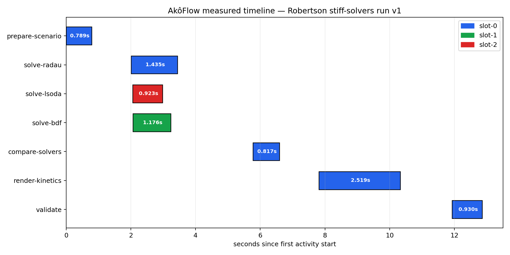
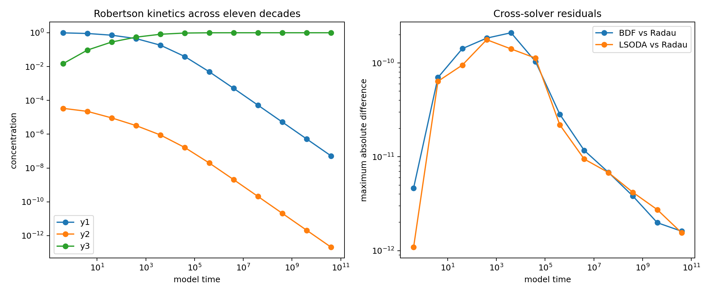
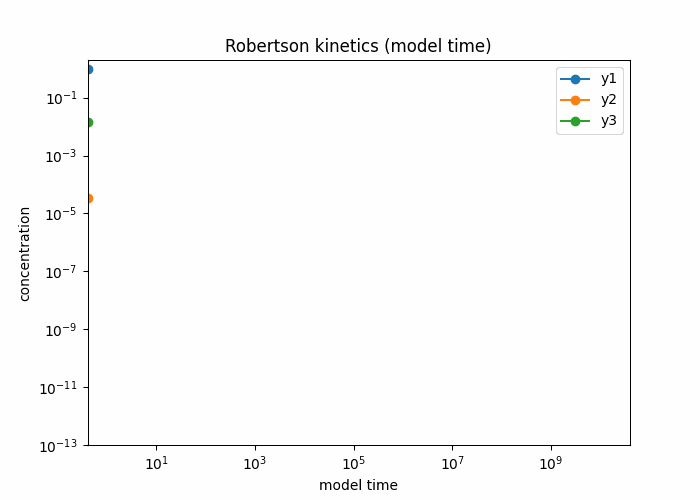

# Robertson stiff chemical-kinetics solver agreement

This CPU-only workflow reproduces the canonical three-species Robertson kinetics problem from time 0 to `4e10`. Three independent implicit methods—SciPy Radau, BDF, and LSODA—solve the same equations with an exact Jacobian, then a join activity checks threshold events, conservation, non-negativity, and final-state agreement. The workflow is a bounded reproduction of the standard benchmark, not a calibrated laboratory model.

## Scientific reference and attribution

H. H. Robertson, “The solution of a set of reaction rate equations,” in J. Walsh (ed.), *Numerical Analysis: An Introduction*, Academic Press, 1966, pp. 178–182. The threshold references come from the SUNDIALS 7.6.0 Robertson examples. Scientific attribution belongs to Robertson and the referenced solver projects; the workflow packaging and validation were prepared by AkôFlow Community Explorer contributors.

SUNDIALS, NumPy, and SciPy are BSD-3-Clause. This workflow source is BSD-3-Clause. It redistributes no paper text, upstream source, or external dataset; all arrays are generated from the equations and fixed parameters.

## Pinned scenario

`y(0)=(1,0,0)`, `rtol=1e-10`, `atol=(1e-12,1e-16,1e-12)`, with evaluation at 0 and `4×10^k` for `k=-1,…,10`. The image uses Python 3.11.14, NumPy 1.26.4, SciPy 1.13.1, Matplotlib 3.9.2, and Pillow 10.4.0. Local image digest: `sha256:22360c7b5cfbfb1b23dc019201469cd7f6a96ab52a55b8833eb4eac531be6dd9`.

## Measured AkôFlow execution

The reference run `community-robertson-stiff-solvers-run-v1` completed 7/7 activities through the AkôFlow daemon on the three-slot local Docker environment. Measured makespan was 12.8625 s. The independent integrations overlapped: Radau ran 1.4352 s, BDF 1.1762 s, and LSODA 0.9235 s, with all three simultaneously active from epoch `1795376570.1327` to `1795376571.0498` (0.9171 s). This proves scientific activity overlap; no parallel speedup is claimed because no matched one-slot run was performed.

## Validated results

| Method | `t(y3=0.01)` | `t(y1=1e-4)` | final `y3` | max conservation error |
|---|---:|---:|---:|---:|
| Radau | 0.2640190782 | 20,795,496.873 | 0.999999947916 | 3.33e-15 |
| BDF | 0.2640190782 | 20,795,498.105 | 0.999999947915 | 1.55e-15 |
| LSODA | 0.2640190782 | 20,795,498.402 | 0.999999947915 | 3.77e-15 |

All concentrations are finite and non-negative at recorded points. The maximum final pairwise concentration difference is below `2e-11`. The daemon-recorded artifact SHA-256 values match the repeated isolated preflight outputs byte-for-byte. The SUNDIALS event values are rounded; the fixed acceptance tolerance is `2.5e-5` relative.

The gallery animation [`kinetics-logtime.gif`](outputs/daemon-v1/kinetics-logtime.gif) traverses logarithmic model time and does not represent wall-clock execution.

## Reproduce

Build with `./build.sh`, run two network-isolated deterministic checks with `./preflight.sh`, and daemon-preflight with `./run.sh`. Set `AKOFLOW_SUBMIT=1` only to submit the idempotent run ID. Scientific containers receive neither network access, the host Docker socket, nor Hub credentials.

Machine-readable evidence is in `evidence/`; validated outputs and checksums are in `outputs/daemon-v1/`. Function/Jacobian/LU evaluation counts are reported rather than accepted as invariant across platforms. Cross-solver agreement is strong numerical evidence, not a formal global-error proof.

## Animation

