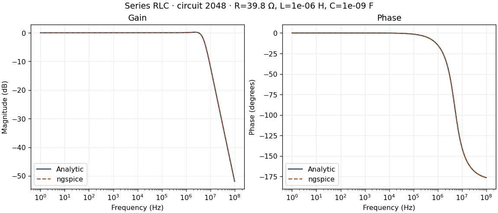
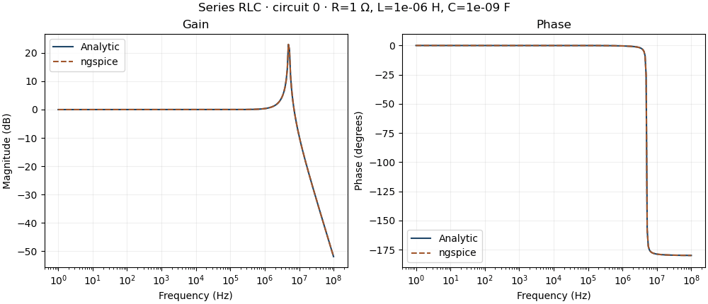
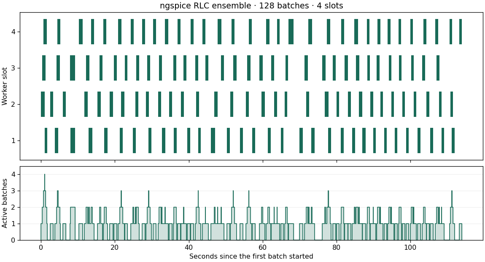
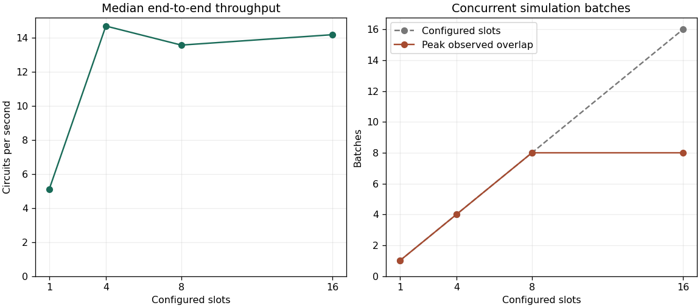

# ngspice RLC AC response ensemble

This workflow checks a passive series RLC circuit against its analytic
small-signal response and measures how the same 128 simulation batches
execute across AkôFlow slots.

## Sources

Laurence W. Nagel and Donald O. Pederson, *SPICE (Simulation Program with
Integrated Circuit Emphasis)*, University of California, Berkeley, 1973.
The workflow uses ngspice 45.2, the maintained SPICE simulator. AkôFlow
implementation and the synthetic circuit grid are by the Community Explorer.
[Original report](https://www2.eecs.berkeley.edu/Pubs/TechRpts/1973/22871.html)
[ngspice documentation](https://ngspice.sourceforge.io/docs.html)
[Package license notices](NGSPICE-COPYRIGHT)

## Circuit and validation

The circuit connects the resistor, inductor, and capacitor in series and
measures the output voltage across the capacitor. The AC input is 1 V.
For angular frequency ω, the transfer function is
`H(jω) = 1 / (1 − LCω² + jRCω)`.

The manifest fixes 16 log-spaced values each for resistance (1 to 1,000 Ω),
inductance (1 µH to 100 mH), and capacitance (1 nF to 100 µF). The 4,096
circuits form 128 deterministic batches of 32. Each circuit has 257
logarithmic samples at 32 per decade from 1 Hz to 100 MHz, plus one
sample at its exact natural frequency.

Each batch starts a fresh ngspice process per circuit and verifies both
real and imaginary responses with a combined tolerance of
`1e-10 + 1e-6 × abs(expected)`. The reducer independently checks the
manifest, batch digests, frequency grids, and all 1,056,768 samples before
generating the Bode plots and validation report.

## Workflow and measurements

The preparation activity records circuit parameters and netlist digests.
The independent batch activities produce deterministically compressed
frequency-response tables and separate timing records. The final activity
produces a per-batch summary, a representative frequency-response table,
a Bode figure and animation, and validation checksums.

A no-sweep subprocess control estimates startup and parsing wall time.
The actual simulation records solver-reported analysis time and total
subprocess wall time separately. Parsing and validation are timed outside
ngspice. These measurements cover different scopes and should be interpreted
independently.

## Build and run

The portable recipe pins the Ubuntu base manifest and verifies the ngspice
package digest before installation.

```sh
docker build -f docker/Dockerfile -t community-rlc-ac-ensemble:v1 .
./run.sh
AKOFLOW_SUBMIT=1 ./run.sh
```

The default plan uses four local slots. The 1-, 8-, and 16-slot plans
assign the same circuit batches to different numbers of logical slots.
The inputs are generated fixtures and have no external data dependencies.

The profiling driver reuses the four-slot reference run and runs three
repetitions per slot count, sequentially.

```sh
python3 profile.py profile-evidence
```

Save the aggregate activity's `rlc-timing.csv` from each run as
`profile-evidence/<run-id>-process.csv`, then summarize the results and
render the comparison using Matplotlib in the workflow image.

```sh
python3 summarize-profiles.py profile-evidence profile-results
python3 render-profiles.py profile-results/profile-summary.csv profile-results/profile.png
```

The summary reports elapsed time, throughput, artifact size, queue delay,
observed overlap, and the maximum parent process RSS of a single batch.

## Four-slot reference run

The reference run completed all 130 activities and validated 4,096 circuit
cases and 1,056,768 frequency samples. The maximum error fraction against
the analytic response was 1.48 × 10⁻⁶.







[Batch summary](outputs/rlc-batches.csv) ·
[Representative frequency responses](outputs/rlc-representative.csv) ·
[Process timings](outputs/rlc-timing.csv) ·
[Validation](evidence/validation.json) ·
[Activity trace](evidence/reference-run.json)

## Scheduling comparison

All twelve executions processed the same 4,096 circuit cases and completed
all 130 activities. The batch CSV, representative CSV, figure, and animation
had identical SHA-256 digests across runs.

| Slots | Median end-to-end (s) | Median circuits/s | Median after preparation (s) | Speedup after preparation | Peak concurrent batches | Median artifacts (MB) |
| ---: | ---: | ---: | ---: | ---: | ---: | ---: |
| 1 | 803.0 | 5.10 | 772.1 | 1.00× | 1 | 47.83 |
| 4 | 279.0 | 14.68 | 258.7 | 2.98× | 4 | 47.82 |
| 8 | 302.0 | 13.56 | 277.4 | 2.78× | 8 | 47.82 |
| 16 | 289.0 | 14.17 | 263.9 | 2.93× | 8 | 47.82 |

These measurements use a shared eight-CPU host. The hourly validation
daemon also ran during part of the campaign. Elapsed times and overlap
describe the observed workflow on this host. Configuring 16 slots can
oversubscribe its CPUs.



[Per-run results](outputs/profile-runs.csv) ·
[Summary by slot count](outputs/profile-summary.csv)
