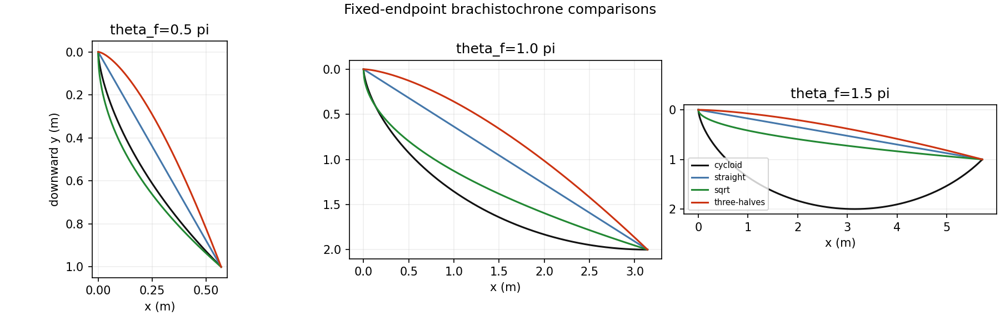
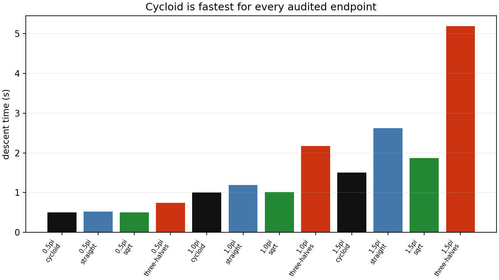
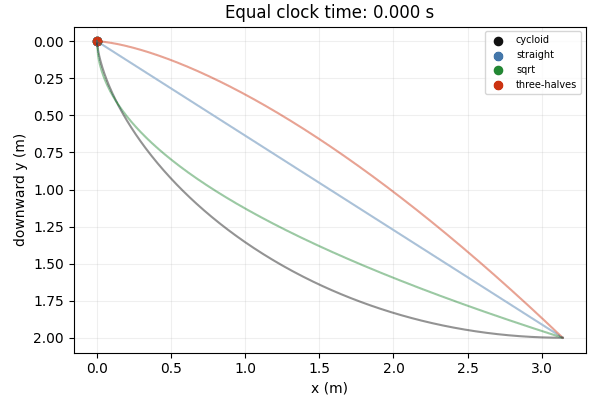
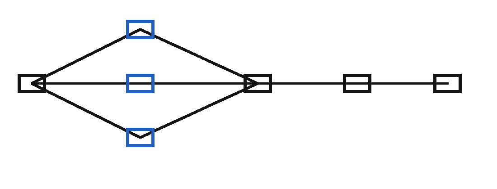
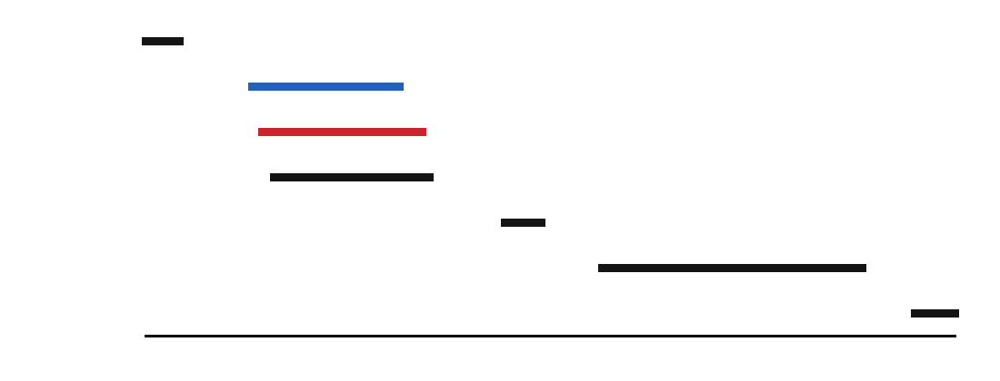

# Bernoulli brachistochrone quickest-descent audit

This deterministic CPU workflow evaluates Johann Bernoulli's cycloidal quickest-descent result at three fixed endpoints. It numerically integrates the frictionless travel-time functional for the cycloid and three admissible comparison tracks after analytic changes of variable remove the zero-speed start singularity.



The three panels show the cycloid, straight chord, square-root track, and power-3/2 track joining identical endpoints. Downward distance is positive and plotted downward.



The measured travel times reproduce `T = theta_f sqrt(a/g)` for the cycloid and show a strictly positive margin for every fixed comparison family.



The animation advances beads at a shared clock time for the `theta_f = pi` endpoint. It is a visualization of the audited elapsed times, not a separate dynamics claim.

## Reproduce

```sh
./build.sh
./preflight.sh
./run.sh
AKOFLOW_SUBMIT=1 ./run.sh
```

The image pins Python 3.11.14, NumPy 2.2.6, SciPy 1.15.3, Matplotlib 3.10.3, and Pillow 11.2.1. Image preparation may use the network to obtain pinned wheels; all scientific activities execute with no network, Hub credential, or host Docker socket. A local run is only a deterministic preflight. The recorded daemon run is the execution evidence.

The imported workflow resolves all seven activities from one immutable AkôFlow
build recipe. Its archived context contains the Dockerfile, pinned requirements,
license, and workflow source; every `COPY` source is contained and the base
image is digest-pinned. From an unmaterialized state, preflight reported
`Build required`, and AkôFlow reconstructed and verified the OCI image before
running the DAG.

## Scientific result

With `g = 9.80665 m/s²`, `a = 1 m`, and endpoint angles `pi/2`, `pi`, and `3pi/2`, all numerical cycloid times agree with the analytic law to displayed binary64 precision. The smallest measured advantage over a comparison track is `0.001246155486470224 s`; the largest 128-to-256-node quadrature change is `5.995204332975845e-15 s`. Validation also checks endpoints, finite geometry, nondecreasing `x`, nonnegative `y`, media signatures, checksums, and byte-identical repeated aggregation.

The square-root, straight, and power-3/2 comparisons use `x = X s^4`, which yields finite transformed integrands at `s = 0`. The cycloid uses `theta = theta_f u²`. No clipping or singular endpoint approximation is used.

## Measured AkôFlow execution

Portable daemon run `community-brachistochrone-run-v2` rebuilt the missing
image and completed all seven activities in `16.807282 s`. Its three independent
endpoint activities ran on distinct declared resources and overlapped for
`2.612858 s`. The matched one-slot run
`community-brachistochrone-one-slot-v2` completed in `21.152427 s`. No
generalized speedup is claimed. The portable context digest is
`sha256:d9bc0a4141fadf4225b5c2c9ee49fb2ed3275abe269d66a961f78df5a8946cb1`;
the recipe digest is
`sha256:58a6577dce3ef50024d2e8fd37896235d4a515ba5afbee4fc03116641137fa20`.



The DAG separates the three endpoint calculations after frozen inputs and joins them before aggregation, rendering, and validation.



The timeline is rendered from the recorded daemon start and finish timestamps. Full daemon responses, image digest, overlap calculation, scientific validation, and result checksums are committed in `evidence/` and `outputs/reference/`.

## Interpretation and limitations

The workflow audits three comparison families; it does not offer a standalone numerical proof of global minimality over every admissible curve. The bead is a frictionless point mass under constant gravity. Drag, rolling inertia, roughness, and Earth curvature are excluded. The `3pi/2` cycloid rises after its lowest point at `pi`, so its valid geometry invariant is nonnegative `y`, not monotonic `y`.

## Citation, authorship, and license

Scientific source: Johann Bernoulli, “Curvatura radii in diaphanis non uniformibus, Solutioque Problematis … de invenienda Linea Brachystochrona,” *Acta Eruditorum*, May 1697, pp. 206–211. Method cross-check: C. E. Mungan, “Review of the Brachistochrone Problem” (2012).

The original workflow code and generated artifacts are maintained by UFFeScience for AkôFlow Community Explorer and licensed under the MIT License. The 1697 article is public domain by age; the modern review is cited but not redistributed. Python, NumPy, SciPy, Matplotlib, and Pillow retain their upstream licenses.

## Public Community Explorer version

[Open the publication and measured results](https://hub.akoflow.com/o/akoflow/community-explorer-issue-43-brachistochrone-v1). Import the immutable workflow version with:

```text
akoflow://hub/publications/412e389d-5df6-4a9f-96a7-e4326a57d7ba/versions/2
```
