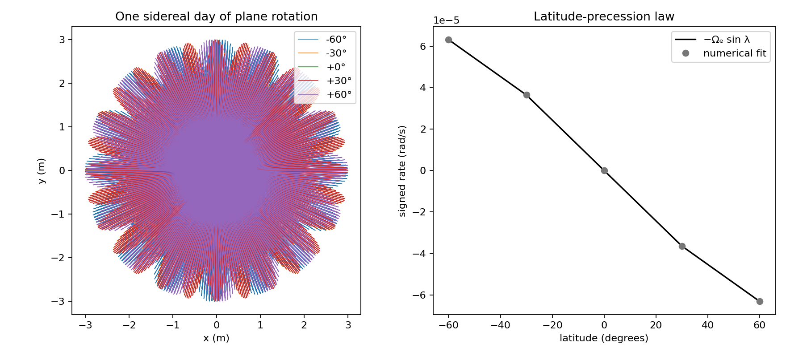
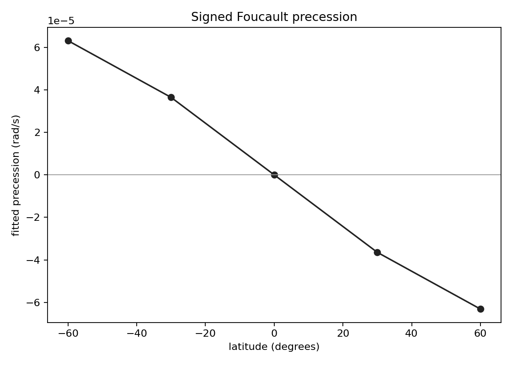
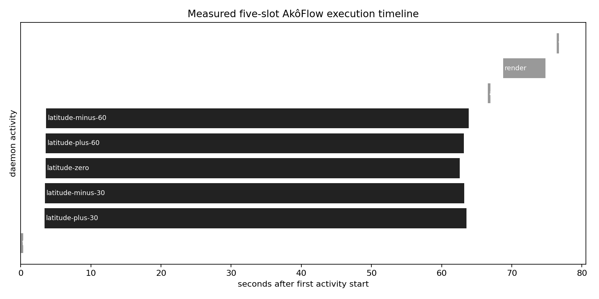
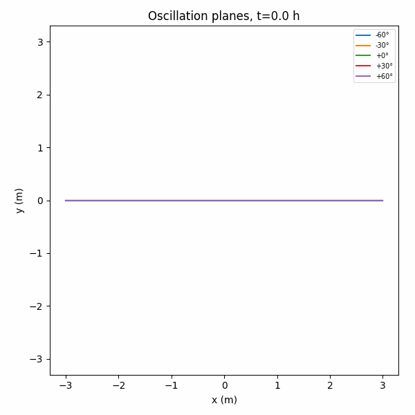

# Foucault pendulum latitude-precession audit

This deterministic CPU workflow tests whether the linear small-angle Cartesian Foucault-pendulum equations recover the signed latitude law

`ωp = −ΩE sin(λ)`.

It integrates one sidereal day independently at `−60°`, `−30°`, `0°`, `+30°`, and `+60°`, compares every numerical trajectory with the exact complex-mode solution, repeats at half the integration maximum step, and fits the oscillation-plane angle from radial maxima using a doubled-angle unwrap. The latter is essential because a plane is π-periodic.

## Validated result

The five-slot AkôFlow daemon run `community-foucault-run-v1` completed in 76.73 s. Its five latitude activities overlapped for 58.96 s. The matching one-slot run `community-foucault-one-slot-run-v1` completed in 266.38 s, a measured makespan ratio of 3.47. This comparison concerns this host and workflow only; it is not a general scaling claim.

All fixed checks passed. Maximum coordinate disagreement with the exact modal solution was `2.18e-8 m`. The fitted rates were `+6.3151575803e-5`, `+3.64605792895e-5`, `0`, `−3.64605792895e-5`, and `−6.3151575803e-5 rad/s`, in latitude order. Step-refinement rate changes were below `1e-16 rad/s` and final-orientation changes below `9e-12 rad`.



*Numerical trajectories over one sidereal day and the fitted signed rates against `−ΩE sin(λ)`.*



*The equator remains stationary while the precession direction reverses across hemispheres.*



*Daemon timestamps show the independent latitude integrations overlapping on five local Docker resources.*



*Time-synchronized oscillation-plane rotation over one sidereal day; the line orientation is shown modulo π.*

## Reproduce

Build and perform the isolated, network-disabled two-repeat preflight:

```sh
./build.sh
./preflight.sh
```

With the official daemon available at `http://127.0.0.1:8080`, preflight and submit the five-slot run:

```sh
AKOFLOW_SUBMIT=1 ./run.sh
```

Run the matching serial plan with `AKOFLOW_PLAN_FILE=plan-one-slot.yaml` and a distinct `AKOFLOW_RUN_ID`.

## Provenance

- Image digest: `sha256:8386ab8b1681b533f280433bfe583a308d3797e92c17f5fe0c8389876063d0ea`
- Workflow version: `community-foucault-precession-v1-v1`
- Parallel run: `community-foucault-run-v1`
- One-slot run: `community-foucault-one-slot-run-v1`
- Frozen constants: `g = 9.80665 m/s²`, `L = 67 m`, `x0 = 3 m`, sidereal day `86164.0905 s`
- Runtime: Python 3.11.14, NumPy 1.26.4, SciPy 1.14.1, Matplotlib 3.9.2, Pillow 10.4.0
- Source method: A. A. de Souza and C. A. M. de Melo, *Revista Brasileira de Ensino de Física* 42 (2020), e20190274, [doi:10.1590/1806-9126-RBEF-2019-0274](https://doi.org/10.1590/1806-9126-RBEF-2019-0274)
- Historical source: Léon Foucault, “Démonstration physique du mouvement de rotation de la Terre au moyen du pendule” (1851), public domain by age
- New code: MIT; dependency notices are in `THIRD_PARTY_NOTICES.md`

Machine-readable metrics, validation, checksums, daemon records, and the measured comparison are committed in [`evidence/`](evidence/).

## Limitations

This is an ideal linear planar small-angle model (`x0/L = 0.0448`). It omits damping, drive, suspension anisotropy, finite-amplitude Airy precession, vertical motion, local gravity variation, and apparatus measurement error. The measured timing applies only to the recorded host/container configuration.
