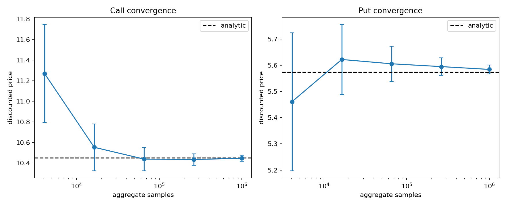
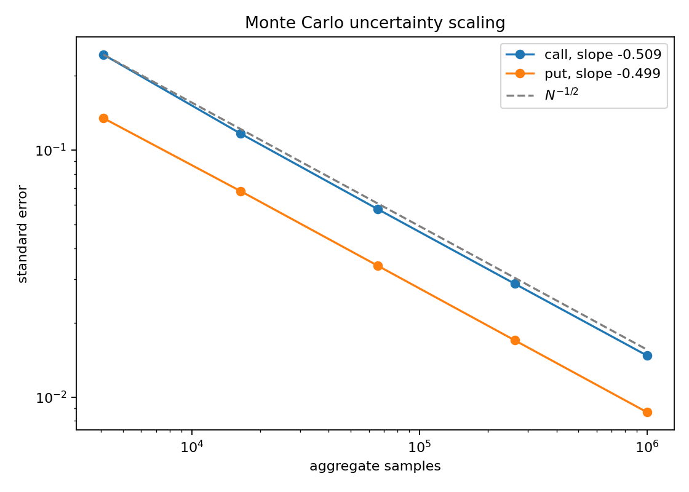
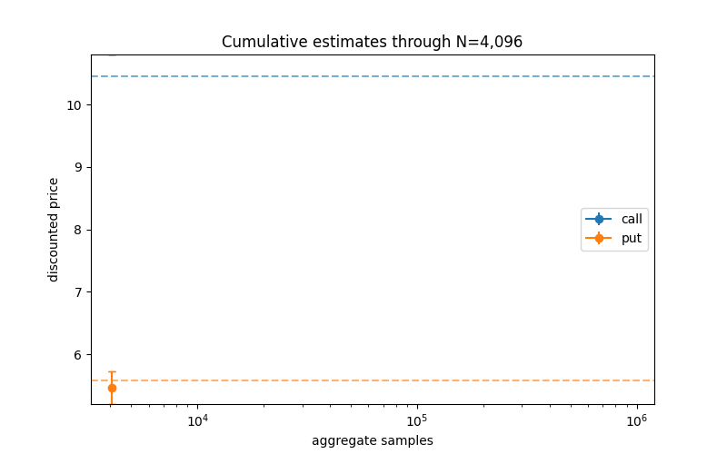
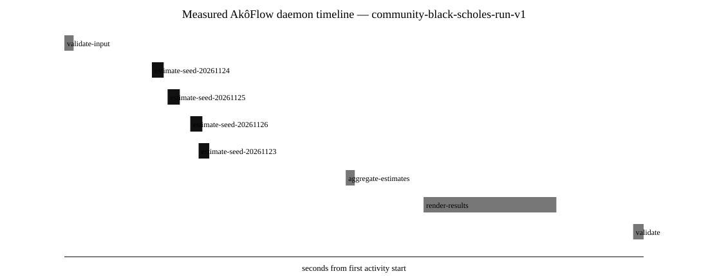

# Black–Scholes risk-neutral Monte Carlo convergence audit

This CPU workflow estimates a one-year European call and put by direct sampling
of the risk-neutral terminal lognormal distribution. It compares one million
discounted paired payoffs with the Black–Scholes analytic oracle, audits
put–call parity, and measures the expected inverse-square-root standard-error
law. It is a numerical audit of the stated model, not empirical market
validation or investment advice.

## Reference result

The fixed inputs are `S0=100`, `K=100`, `r=0.05 year^-1`, `sigma=0.20
year^-1/2`, and `T=1 year`. Four independent PCG64 branches use seeds
`20261123` through `20261126`, with 250,000 binary64 draws each.

| Quantity | Monte Carlo | Analytic | Error | Estimated SE |
|---|---:|---:|---:|---:|
| Call | 10.446802973446650 | 10.450583572185565 | -0.003780598738915 | 0.014710352726294 |
| Put | 5.584012103778135 | 5.573526022256971 | +0.010486081521164 | 0.008676440541814 |
| Paired parity | 4.862790869668513 | 4.877057549928594 | -0.014266680260081 | 0.020207557075928 |

The fitted standard-error slopes are `-0.5090001502` for the call and
`-0.4990100618` for the put; both pass the frozen `[-0.55, -0.45]` gate.
The terminal-price mean is `105.1121114890` versus `105.1271096376`, and its
sample variance is `451.2914196931` versus `451.0288078158`. The variance error
`0.2626118773` is below the pre-registered four-sigma tolerance
`2.9525643984`. All fixed scientific checks passed.



*Figure 1. Actual cumulative call and put estimates at the five fixed sample
counts; dashed lines are the analytic Black–Scholes values.*



*Figure 2. Log–log standard-error scaling from the retained numeric results,
including the measured slopes and the `N^-1/2` reference.*



*Animation 1. Five result-bearing frames show the real cumulative estimates
and uncertainty intervals from 4,096 through 1,000,000 aggregate draws.*



*Figure 3. AkôFlow daemon timestamps for all activities. Estimator branches
`20261126` and `20261123` overlapped for `0.0571579933 s` on distinct declared
resources, proving scientific activity overlap. Other estimator pairs were
serialized by preparation overhead and are not claimed to overlap.*

## AkôFlow execution evidence

The authoritative four-slot daemon run `community-black-scholes-run-v1`
completed all eight activities with a measured makespan of `8.8495821953 s`.
The identical one-slot run `community-black-scholes-one-slot-run-v1` completed
in `13.8210370541 s` (descriptive ratio `1.5617728328`). This workflow does not
claim parallel speedup: the comparison includes workspace and scheduling
overheads, and only one estimator pair measurably overlapped.

The daemon final manifest agrees with the committed reference artifacts for all
16 scientific inputs/results checked. The validation stage reports finite
values, no missing artifacts, passing science, and a five-frame GIF. Full run
records, the agreement check, and the measured comparison are in `evidence/`.

## Portable build and reproducibility

Every activity uses `source.type: build` with immutable build reference
`recipe-build-3813bf5e8fd053915fcd685ce4948e67662a022484d30fd0ceb6b244a5879302`.
The embedded archive contains only `docker/Dockerfile`, `requirements.txt`,
`data/input.json`, and `scripts/workflow.py`:

- context digest: `sha256:b78ece52089c87d6027d8b11222438b5e78ef80f8a054e539e84eae4e2a0bdb8`;
- recipe digest: `sha256:3b7670abfba77615adecada50b936ec53be36988ba48dcde7c52acd438b88dbb`;
- reconstructed OCI image: `sha256:2cd38df1cf969ada9c10c0296cce29f445935f71e41f09518efd01c8810c45f1`;
- base image: Python 3.11.14 slim Bookworm pinned by digest;
- runtime packages: NumPy 2.2.6, Matplotlib 3.10.3, Pillow 11.2.1.

An unmaterialized daemon preflight reported `Build required` and `ready: true`;
AkôFlow reconstructed and verified the OCI image before launching the run. No
network is available to scientific activities. `preflight.sh` performs two
isolated CPU runs and requires byte-identical numeric and media artifacts.

To run locally, start the official daemon and use:

```sh
./build.sh
./preflight.sh
AKOFLOW_SUBMIT=1 ./run.sh
AKOFLOW_PLAN_FILE=plan-one-slot.yaml \
  AKOFLOW_RUN_ID=community-black-scholes-one-slot-run-v1 \
  AKOFLOW_SUBMIT=1 ./run.sh
```

## Method, provenance, and limits

Terminal prices use
`S_T = S0 exp((r-sigma^2/2)T + sigma sqrt(T) Z)`, with `Z ~ N(0,1)`.
Discounted call and put payoffs share each draw; sufficient statistics are
merged by exact count, sum, and sum of squares with sample variance `ddof=1`.
No time-stepping approximation, market feed, upstream code, checkpoint, or
external dataset is used.

The original code is Apache-2.0 and the authored input is CC0-1.0. Third-party
terms are recorded in `THIRD_PARTY_NOTICES.md`. The analytic oracle adapts the
closed-form result from Fischer Black and Myron Scholes, “The Pricing of Options
and Corporate Liabilities,” *Journal of Political Economy* 81(3), 637–654
(1973), [doi:10.1086/260062](https://doi.org/10.1086/260062). The copyrighted
article is cited, not redistributed.

The audit assumes continuous trading, constant interest rate and volatility,
lognormal dynamics, no dividends, frictionless markets, and European exercise.
It does not test those assumptions, calibration, hedging, jumps, liquidity,
transaction costs, discrete trading, or observed prices.
