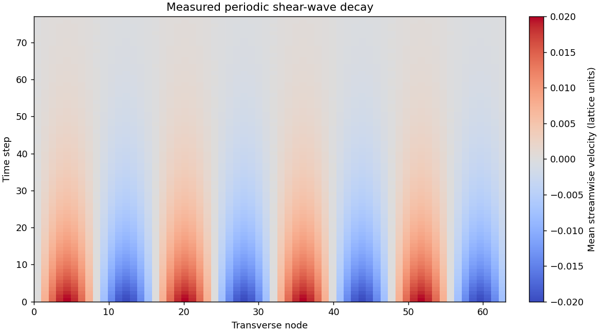
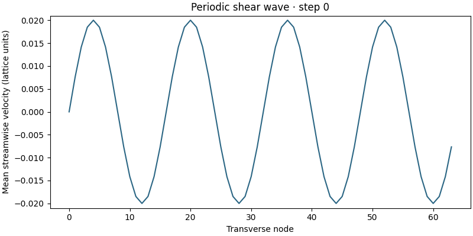

# Periodic shear-wave decay with lattice Boltzmann

A synthetic single-phase check of a D2Q9 BGK method, inspired by the
[SSCAD 2024 study](https://sol.sbc.org.br/index.php/sscad/article/view/31001) by
Thiago Teixeira, Frederico L. Cabral, Micaella Coelho, Luciano Leite, Rodrigo
Surmas, Marcio Borges and Carla Osthoff (LNCC, COPPE and CENPES). The
[linear dispersion model](https://doi.org/10.1103/PhysRevE.61.6546) is due to
Pierre Lallemand and Li-Shi Luo. The code and constructed inputs use the
[MIT license](LICENSE).

The periodic grid has eight streamwise nodes and eight possible transverse
sizes. The 1,024 cases cross size, relaxation time, initial wavenumber and
amplitude. Each case estimates the decay rate from steps 32 through the
declared endpoint, compares it with both the viscous continuum rate and an
independent three-group Fourier reference, and checks density and momentum.
Case 1024 is the equilibrium control.

```sh
g++ -std=c++20 -O2 -fopenmp -Wall -Wextra -Werror src/shear_wave.cpp -o shear-wave
OMP_NUM_THREADS=1 ./shear-wave 127 results
```

The local [thread-equivalence test](evidence/thread-equivalence.csv) verified
eight corner cases and the equilibrium control. Each trace and summary was
byte-identical for one and two OpenMP threads. This records equivalence of
the local kernel; the AkôFlow scheduling benchmark and Hub publication are pending.


The [frozen manifest](evidence/scenarios.csv) records the 1,024 scientific cases
and one equilibrium control. The 1,026-activity DAG passed all executable
checks in an isolated preflight. Case activities write a trace and conservation
summary. The aggregate validates complete coverage and returns a compressed
amplitude table, per-case metrics and the measured field of case 127.

```sh
recipe=$(./register-recipe.sh)
python3 generate.py "$recipe"
./run.sh
```

The default plan uses four logical slots. Set `AKOFLOW_SUBMIT=1` to submit
after preflight. Benchmark plans are generated for 1, 4, 8, 16 and 32 slots.





The pilot figures show the actual streamwise velocity averaged along each
transverse row. Both use a fixed velocity scale throughout decay.
