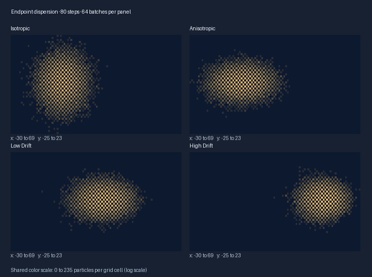
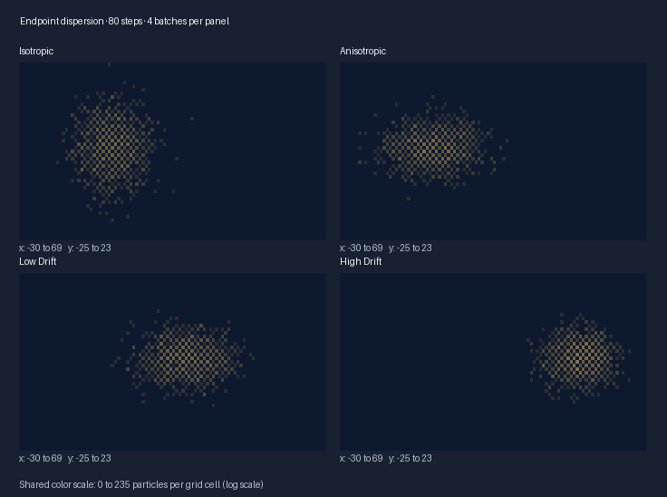

# Grid random walks for particle dispersion

This synthetic adaptation is inspired by the thermal dispersion workload
in the [WSCAD-SSC study by André L. de Oliveira, Inês Dutra, Alexandre
Plastino and Simone de L. Martins](https://sol.sbc.org.br/index.php/sscad/article/download/17388/17224/).
The experiment tests count conservation and analytic moments under a
homogeneous lattice walk.

Four step distributions each use 64 independent batches of 256 particles.
The reference has 80 steps and the longer workload has 320. Batch seeds
are fixed by scenario and index. Validation checks endpoints, lattice
parity, total counts, repeatability and reduction order. The mean uses
a six-standard-error tolerance. Each covariance entry uses 6% of the
product of the corresponding theoretical marginal standard deviations.

## Measured reference

The run `community-particle-walk-ensemble-v1-run-4` completed 256 independent batches and one
aggregation in 310 seconds. Up to
4 batches overlapped. All 264 artifact
checksums match the pinned offline execution. The aggregate covers 65,536 particles.

| Scenario | Measured mean endpoint | Expected mean endpoint |
| --- | --- | --- |
| Isotropic | (-0.13, 0.04) | (0.00, 0.00) |
| Anisotropic | (-0.03, -0.02) | (0.00, 0.00) |
| Low Drift | (23.99, -0.04) | (24.00, 0.00) |
| High Drift | (47.98, -0.00) | (48.00, 0.00) |

[Batch moments](evidence/reference/batch-moments.csv) ·
[Full moment validation](evidence/reference/moment-validation.json) ·
[Run and checksum evidence](evidence/reference/reference-run.json)

Endpoint histograms
[Isotropic](evidence/reference/isotropic-endpoints.csv) ·
[Anisotropic](evidence/reference/anisotropic-endpoints.csv) ·
[Low drift](evidence/reference/low-drift-endpoints.csv) ·
[High drift](evidence/reference/high-drift-endpoints.csv)

### Scheduling measurements

Both workloads ran four scheduling profiles and matched all 264 offline artifacts.

| Steps | Slots | Elapsed seconds | Observed overlap | Matching checksums |
| --- | --- | --- | --- | --- |
| 80 | 1 | 668 | 1 | 264 |
| 80 | 4 | 310 | 4 | 264 |
| 80 | 16 | 197 | 6 | 264 |
| 80 | 32 | 158 | 5 | 264 |
| 320 | 1 | 613 | 1 | 264 |
| 320 | 4 | 231 | 4 | 264 |
| 320 | 16 | 156 | 5 | 264 |
| 320 | 32 | 150 | 6 | 264 |

[Scheduling CSV](evidence/reference/scheduling-profiles.csv).
