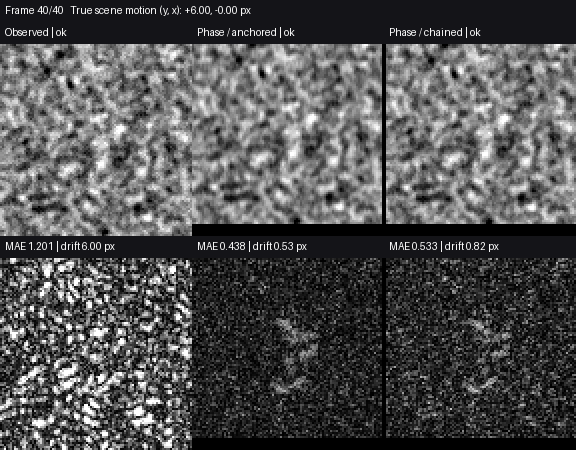

# Microscopy video stabilization

This synthetic experiment measures how anchoring frames to the first
observation and composing consecutive alignments affect trajectory drift.
It is motivated by preprocessing in Freire, Silva, Bernardes, Tavares,
Mello and Ferrari's [intravital microscopy study](https://sol.sbc.org.br/index.php/sbcas/article/download/29123/28928/).
It uses generated imagery and studies global translation under moving
foreground objects, without using imagery from the study.

The manifest crosses 64 seeds, four translation amplitudes and three
noise/foreground regimes. Each of the 768 independent cases generates
40 frames by cropping observations of a larger field. The trajectories
compare cross-correlation and phase correlation, with direct and composed
alignment, against an unregistered control. The ambiguity check evaluates
normalized spatial correlation over a fixed central tile. Ground truth
enters only the scoring step. The reported vector aligns a moving frame to
the reference and consequently has the opposite sign to the scene motion.

A local kernel check uses Python with NumPy 2.5.5.

```sh
python3 stabilize.py 0 sequence.csv
```

The CSV contains one row per frame and method, retaining explicit
ambiguity and unavailable states. Each frame records mean absolute intensity
error and pixel count for the intersection of valid bilinear footprints
across available methods, including the unregistered control. This entry
point checks the numerical
kernel locally. The AkôFlow execution, aggregate figures and publication
evidence are pending.

## Local visual pilot

Case 11 uses seed 532, a 6 px amplitude, and the strongest synthetic
noise/foreground regime. The final-frame plot and 40-frame animation compare
the observed image with both phase-correlation trajectories. Their lower
panels show absolute residuals against the first frame. Image intensities
use a fixed −3 to +3 range and residuals use a fixed 0 to 3 range. Black
pixels at the alignment boundary indicate missing values. The panel labels
report error on the shared valid pixels.




[Download case 11's per-frame pilot measurements](evidence/pilot-sequence.csv).

## Run in AkôFlow

The registered Linux amd64 build includes the Python scripts and pinned
wheel dependencies. Register the build recipe on the target daemon and
generate the workflow and schedule plans before running preflight.

```sh
recipe=$(./register-recipe.sh)
python3 generate.py "$recipe"
./run.sh
```

Set `AKOFLOW_SUBMIT=1` to submit after preflight. The full workflow has
768 independent sequences and one aggregation activity. Aggregation checks
the inventory and trajectory errors, then exports per-frame metrics,
condition summaries, and the representative PNG and GIF.

For the short benchmark, use `python3 generate.py "$recipe" --cases 48`.
The first four seeds cover all twelve conditions, with the same 48 cases
at all slot counts. Set
`AKOFLOW_WORKFLOW_ID=community-microscopy-stabilization-profile-v1` and
select `AKOFLOW_PLAN_FILE=plan-1.yaml`, `plan-4.yaml` or `plan-8.yaml`.
For one or eight slots set `AKOFLOW_PLAN_ID` to
`community-microscopy-stabilization-profile-v1-plan-1` or
`community-microscopy-stabilization-profile-v1-plan-8`, respectively.
Set a distinct `AKOFLOW_RUN_ID` for each run. Regenerate the full workflow
before returning to the production plan.

Run `python3 profile.py "$recipe" /path/to/evidence` to execute or resume
the four-slot reference and the three short profiles. It records the
daemon timings and observed peak concurrency, and requires identical
per-case and aggregate hashes across the short profiles.
