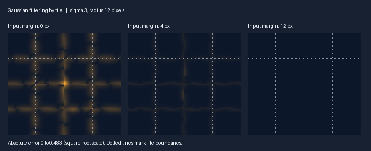
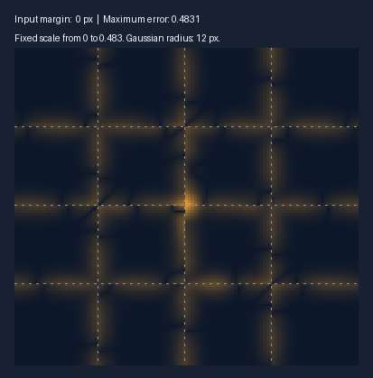
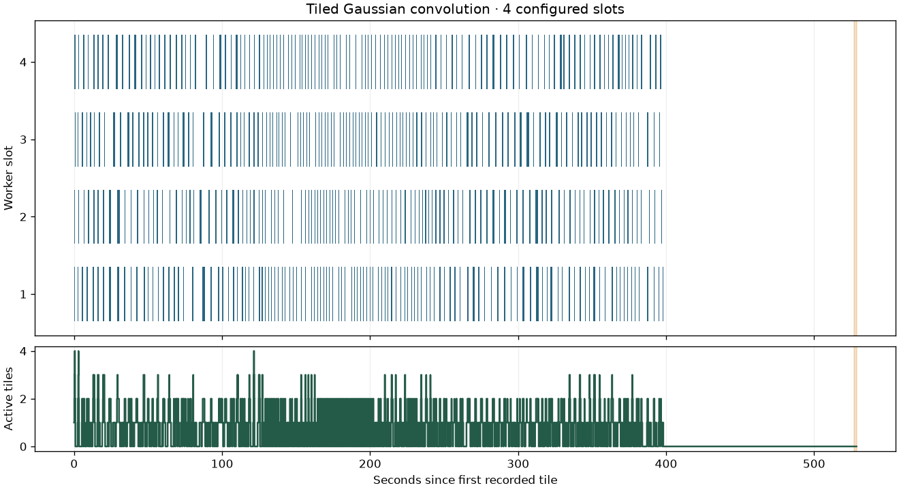

# Gaussian filtering across tile seams

The experiment takes inspiration from the Gaussian preprocessing in
[Oliveira and colleagues, SBCAS 2021](https://sol.sbc.org.br/index.php/sbcas/article/download/16057/15898/).
It uses eight synthetic images with diagonal edges, disks and impulses.
It studies convolution only and uses no clinical images or diagnostic tasks.

Four normalized kernels have explicitly fixed radii. A 4 by 4 grid assigns
each pixel to one core, including images whose dimensions are unevenly
divisible by four. Each of the 512 independent cases compares zero input
margin, one-third-radius margin and full-radius margin against the complete
image filtered with edge replication.

## Run from source

The launcher expects an AkôFlow daemon with local Docker. Set
`AKOFLOW_API_URL` and `AKOFLOW_API_TOKEN` for that daemon. Install the
hash-pinned requirements in a Python 3.11 environment before generating
the workflow. The registered recipe builds the activity image independently
on the daemon.

```sh
python3 -m pip install --require-hashes --only-binary=:all: -r requirements.lock
configuration="$(mktemp -d)"
recipe="$(./register-recipe.sh)"
python3 generate.py "$recipe" --output "$configuration"
AKOFLOW_CONFIG_DIR="$configuration" ./run.sh
AKOFLOW_CONFIG_DIR="$configuration" AKOFLOW_SUBMIT=1 ./run.sh
```

The first invocation checks readiness and the second submits the four-slot
reference. The generator also emits plans for one, 16 and 32 slots.
The halo I/O report counts numerical source pixels required by each
filter patch. It measures duplicate input coverage in a tiled reader.
The benchmark generates each synthetic image locally inside its tile activity.

## Measured reference

Run `community-tiled-gaussian-ensemble-v1-run-4` completed 512 independent tiles and one
aggregation in 535 seconds, with up to
4 concurrent tile activities.
All 516 artifact checksums matched the pinned offline image.







| Kernel radius (px) | Input margin (px) | Maximum absolute error | Duplicated input pixels across eight images |
| --- | --- | --- | --- |
| 5 | 0 | 0.322129 | 0 |
| 5 | 1 | 0.181830 | 12,234 |
| 5 | 5 | 0.000000 | 66,930 |
| 8 | 0 | 0.461633 | 0 |
| 8 | 2 | 0.042966 | 25,044 |
| 8 | 8 | 0.000000 | 114,000 |
| 12 | 0 | 0.533533 | 0 |
| 12 | 4 | 0.026841 | 52,392 |
| 12 | 12 | 0.000000 | 184,824 |
| 16 | 0 | 0.566999 | 0 |
| 16 | 5 | 0.038398 | 66,930 |
| 16 | 16 | 0.000000 | 264,864 |

[Error by seam distance](evidence/reference/seam-errors.csv) ·
[Input and output pixel counts](evidence/reference/halo-io.csv) ·
[Measured run and checksums](evidence/reference/reference-run.json) ·
[Independent direct 2D convolution check](evidence/reference/direct-2d-check.json)
