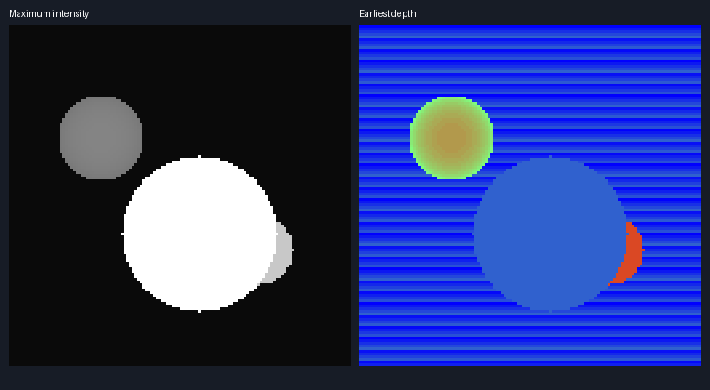
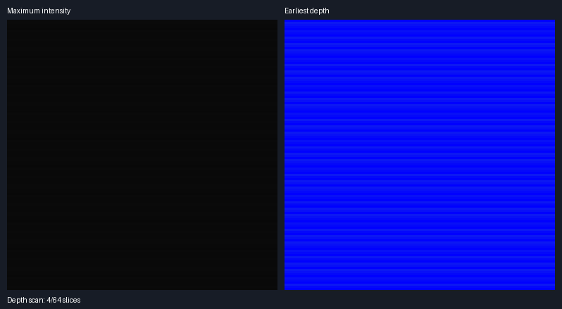
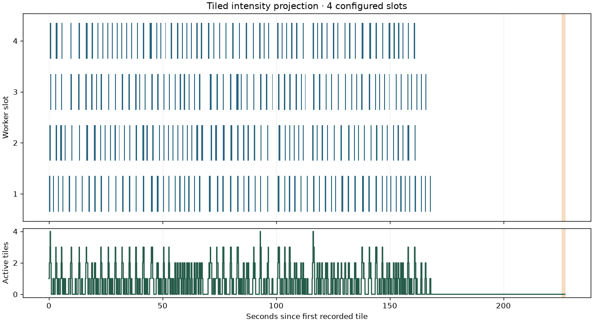

# Tiled maximum-intensity and depth projection

This synthetic experiment isolates maximum-intensity projection, motivated
by the marker visualization in the [SBCAS paper by Borges, Guliato and Machado](https://sol.sbc.org.br/index.php/sbcas/article/download/27706/27516/).
It operates on generated geometric volumes in `(z, y, x)` order.

Each independent tile emits the maximum intensity and earliest global
depth for each column. The reducer selects the greater intensity and
breaks ties by smaller depth. It checks that each 3D tile appears once,
including tiles clipped by the volume boundary.

The numerical kernel was compared against whole-volume NumPy maximum and
argmax for 64 × 128 × 128, 61 × 123 × 115 and 1 × 17 × 9 volumes.
Shuffled and reversed tile order gave exact results, including repeated
maxima and negative background values. Missing and duplicated tile inputs
were rejected.

## Measured AkôFlow reference

The four-slot reference completed all 257 activities. The reducer
validated 256 tiles and exactly matched the whole-volume maximum and
earliest-depth rasters at all 16,384 projection columns.







[Projection CSV](evidence/reference/projection.csv) ·
[Reference evidence](evidence/reference/reference-run.json).

## Run in AkôFlow

Register the recipe and generate the reference workflow and slot plans.

```sh
recipe=$(./register-recipe.sh)
python3 generate.py "$recipe"
./run.sh
```

After preflight, run `python3 profile.py /path/to/evidence` with
`AKOFLOW_API_URL` and `AKOFLOW_API_TOKEN` set for the target daemon.
It starts or resumes the four-slot reference, then runs the one-, sixteen-
and thirty-two-slot plans and compares all 259 output checksums. Slot
overlap is a lower bound when the daemon records unusable intervals.

For a published reference, run
`python3 verify-hub-import.py "$uri" /path/to/reference.json /path/to/clean-evidence`
on a daemon with empty workflow and image stores. It stages its own
schedule configuration, requires a cold build, and checks all 259 outputs.
