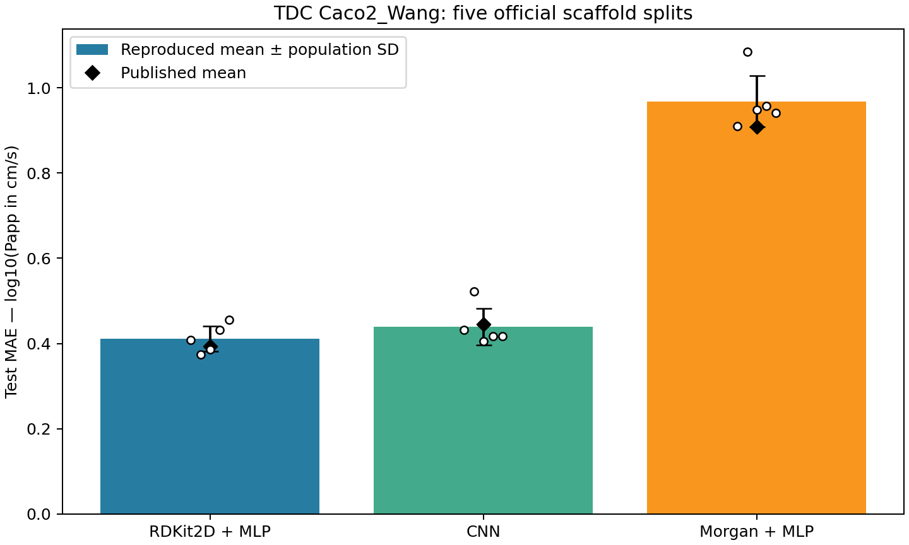

# Caco-2 permeability: five splits, three molecular representations

This workflow reproduces the three historical DeepPurpose baselines published for the Therapeutics Data Commons `Caco2_Wang` ADMET benchmark. It trains RDKit2D + MLP, a molecular-character CNN, and Morgan fingerprint + MLP on each of five official scaffold train/validation splits while keeping the 182-row scaffold-isolated test set fixed.

This is a machine-learning benchmark reproduction. It is not evidence that a molecule is safe, effective, bioavailable, or clinically useful.

## Scientific sources

The benchmark is from Kexin Huang, Tianfan Fu, Wenhao Gao, Yue Zhao, Yusuf Roohani, Jure Leskovec, Connor W. Coley, Cao Xiao, Jimeng Sun, and Marinka Zitnik, “Therapeutics Data Commons: Machine Learning Datasets and Tasks for Drug Discovery and Development,” NeurIPS 2021 Datasets and Benchmarks ([paper](https://datasets-benchmarks-proceedings.neurips.cc/paper_files/paper/2021/file/4c56ff4ce4aaf9573aa5dff913df997a-Paper-round1.pdf)). The upstream [TDC repository](https://github.com/mims-harvard/TDC) is pinned to `c310c35f27e3f506411018ac43d97b8ba23ca652` under MIT.

The source dataset is associated with N. N. Wang, J. Dong, Y. H. Deng, M. F. Zhu, M. Wen, Z. J. Yao, A. P. Lu, J. B. Wang, and D. S. Cao, “ADME Properties Evaluation in Drug Discovery: Prediction of Caco-2 Cell Permeability Using a Combination of NSGA-II and Boosting,” *Journal of Chemical Information and Modeling* 56(4), 763–773 (2016), DOI [10.1021/acs.jcim.5b00642](https://doi.org/10.1021/acs.jcim.5b00642). Stored responses are `log10(Papp)` with `Papp` expressed in cm/s.

Models use [DeepPurpose](https://github.com/kexinhuang12345/DeepPurpose) revision `866be98bad0b11e78d4363589b9ee59b5befa307` under BSD-3-Clause. The official PyTDC dataset page identifies `Caco2_Wang` as CC BY 4.0. The CSV files are not committed here; the build retrieves the attributed Dataverse object and verifies its hash.

## Frozen protocol and data audit

The Dataverse ADMET group archive is file `4426004`, SHA-256 `bd0005246cb6f1672333c28ad202112a8bf071ab65d847848715030308faf1f1`. Inside it, `train_val.csv` is `e0965b4a…ed6b2` and `test.csv` is `5380c15b…444df`.

The files contain 910 rows and 906 unique SMILES—not 906 rows as older TDC metadata suggests. There are four within-partition duplicate-SMILES groups with conflicting targets and no SMILES duplicated across train/test. All 910 SMILES parse under RDKit 2023.9.6. The fixed test partition has 72 Bemis–Murcko scaffolds; none occurs in train or validation for any seed. Each seed yields 637 training and 91 validation rows with no cross-partition scaffold overlap.

The historical TDC runner uses seeds 1–5 for the official scaffold partition but does not explicitly seed model initialization. This workflow makes each branch reproducible by applying its branch seed to Python, NumPy, and PyTorch and enabling deterministic algorithms. It uses 50 epochs, Adam, learning rate 0.001, batch 128, model selection by validation MSE, and a `[512]` prediction head. Morgan is a binary radius-2, 1024-bit fingerprint; RDKit2D uses 200 normalized Descriptastorus features; the CNN uses the upstream 63-character vocabulary, maximum length 100, filters `[32,64,96]`, and kernels `[4,6,8]`.

## Qualified result

The recorded AkôFlow daemon execution of all 15 branches produced population standard deviations (`ddof=0`):

| Model | Reproduced test MAE | Published test MAE | Acceptance interval |
|---|---:|---:|---:|
| RDKit2D + MLP | `0.411204 ± 0.029663` | `0.393 ± 0.024` | `[0.345, 0.441]` |
| CNN | `0.439004 ± 0.042642` | `0.446 ± 0.036` | `[0.374, 0.518]` |
| Morgan + MLP | `0.968052 ± 0.060293` | `0.908 ± 0.060` | `[0.788, 1.028]` |

Every mean passed the predeclared two-published-standard-deviation gate. The workflow independently recomputes raw MAE, retains one prediction per fixed test row, and also records TDC-style three-decimal values.

Run `community-caco2-tdc-baselines-run-v1` completed all 19 activities in 322.128 seconds with 873.193 compute-seconds, 145,181,468 transferred bytes, and zero configured cost. The timeline records four simultaneously running training activities. Final validation passed all data, scaffold, completeness, checkpoint, prediction, and reference-interval gates and retained 94 files. The validation SHA-256 is `a70793ae…da14a7`.



## Build and run

Build is the only networked preparation step; execution is offline:

```sh
docker build -t akoflow/community-caco2-tdc-baselines:v1 -f docker/Dockerfile .
./preflight.sh
```

Submit the checked-in environment, scope, topology, workflow, and four-slot plan to a running AkôFlow daemon with `./run.sh`. After `prepare`, 15 training activities are scientifically independent and may run concurrently. `aggregate`, `render`, and `validate` retain the audit, configurations, predictions, checkpoints, metrics, and result figure under `results/`.

## Acceptance and limitations

Validation requires all 15 branches, exactly 182 finite predictions per branch, all input/scaffold audits, and all three reproduced means inside their frozen intervals. The benchmark combines heterogeneous Caco-2 measurements, includes conflicting duplicates, is small, and measures only agreement with its held-out labels. No benchmark result substitutes for experimental permeability measurement or any safety, efficacy, pharmacokinetic, or clinical assessment.
