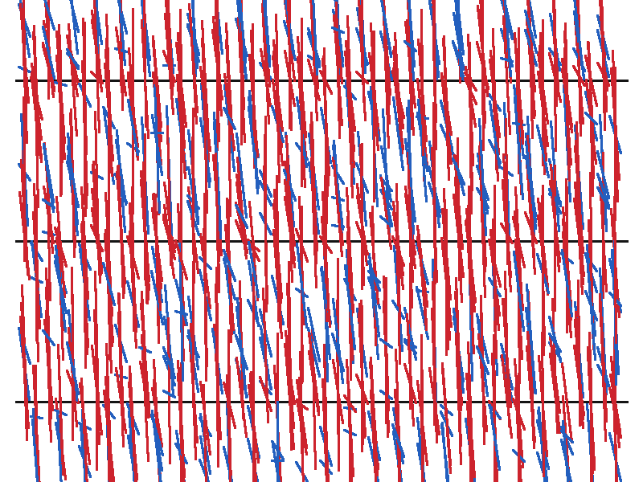

# Buffon needle crossing probability and π audit

This deterministic pseudorandom numerical audit tests Buffon's exact crossing law `p=2L/(πd)` for `L=d=1`. Four independent fixed-seed branches made 2,000,000 tosses each. The pooled recorded result was `p̂=0.63656975` versus `2/π=0.6366197723675814`, and `π̂=3.1418395234771994`. Both errors are below the predeclared five-standard-error limits; Pearson branch dispersion was 1.98255.



The [convergence animation](outputs/reference/convergence.gif) shows the pooled estimate across fixed checkpoints. The [measured daemon timeline](evidence/measured-timeline.png) records the actual activity intervals.

## Reproduce

```sh
./build.sh
./preflight.sh
./run.sh
AKOFLOW_SUBMIT=1 ./run.sh
```

The image is pinned to `python:3.11.14-slim-bookworm`, uses only the Python standard library, and executes scientific containers without network access. The daemon run is the execution evidence; local execution is a preflight and byte-recovery mechanism checked against daemon-recorded manifests.

## Measured execution

Run `community-buffon-needle-run-v1` completed eight activities in 9.54654 s. All four sampling branches overlapped for 0.722646 s on four distinct declared resources. Matched run `community-buffon-needle-one-slot-v1` completed in 13.85036 s, an observed whole-workflow ratio of 1.451× in this environment. This is an operational measurement, not an algorithmic scaling claim.

## Interpretation and limitations

The calculation preserves the first 1,000 geometries per branch, integer checkpoint numerators and final integer counts. It is not a physical needle experiment, MT19937 is reproducible rather than physical or cryptographic randomness, the inverse π estimator is nonlinear, and Monte Carlo is inefficient compared with deterministic algorithms for π.

## Citation, authorship, and license

Scientific source: Georges-Louis Leclerc, Comte de Buffon, “Essai d'arithmétique morale,” *Histoire naturelle, générale et particulière, Supplément*, tome IV, pp. 46–123 (1777), needle discussion pp. 95–105 ([historical scan](https://www.hist-math.fr/textes/Buffon1777_SupplementHistoire4.pdf)). The public-domain source is linked, not redistributed.

The workflow and generated artifacts are maintained by UFFeScience for AkôFlow Community Explorer and licensed under the MIT License.
