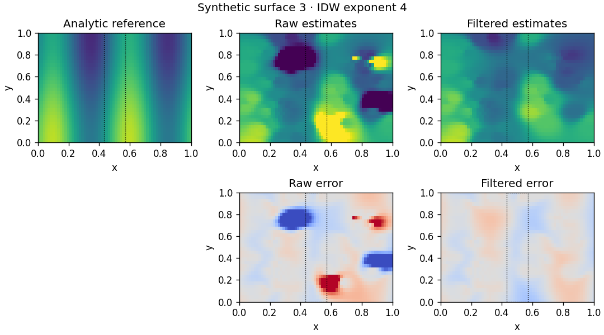
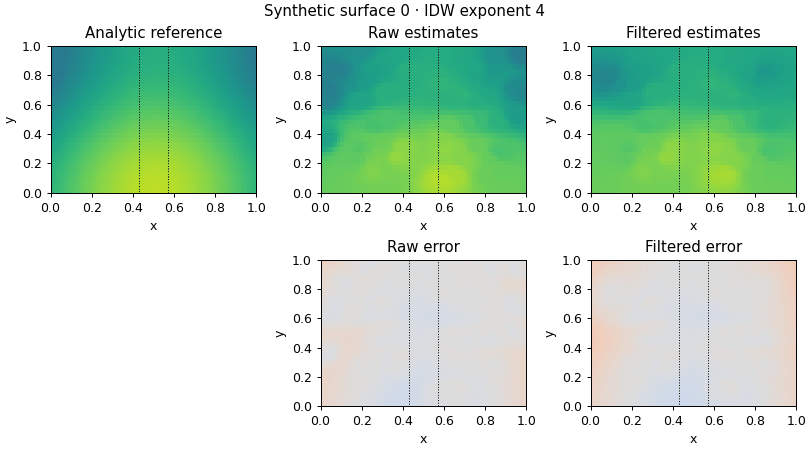
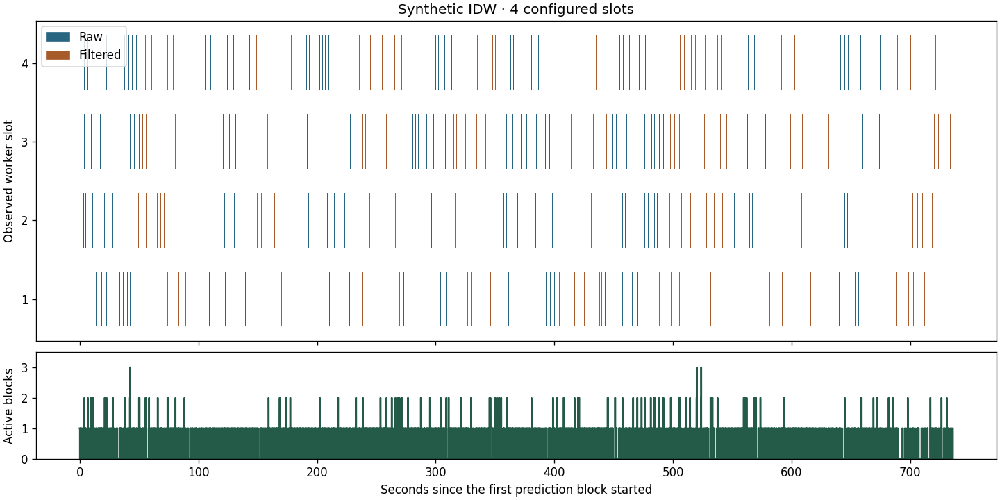

# Synthetic inverse-distance interpolation audit

This original synthetic study is motivated by Gustavo E. Kida and Raul T. Santos
(UFMT) and their [SBIAGRO 2021 study of interpolation workflows](https://doi.org/10.5753/SBIAGRO.2021.18398).
The experiment uses eight analytic surfaces, dispersed and clustered samples,
IDW exponents 2 and 4, and a common held-out strip. All training inputs are
generated here, with no paper datasets or figures copied.

The frozen inputs are [samples.json](evidence/samples.json) with
[SHA-256](evidence/samples.sha256). Training-only leave-one-site-out residuals
determine the filter prior to prediction. Exact duplicate coordinates are
averaged and their original IDs preserved. Each of the 32 prediction cases
has 32 disjoint blocks. The aggregate applies a scalar inverse-distance
formula independently and checks every cell within an absolute tolerance of
1e-12. MAE and RMSE use the spatial region excluded from training.

The local pilot verified all 1,024 blocks and 32 assembled grids. The filter
identified all 20 synthetic spikes and also removed 27 other observations.
Holdout RMSE improved in six of sixteen paired surface/exponent comparisons.
The 1,033-activity AkôFlow DAG uses eight sample-preparation tasks, 1,024
prediction tasks and one aggregation. Each prediction receives the prepared
sites for its own surface. The [portable build recipe](evidence/portable-recipe.json)
records the build context and recipe digests. The 785-byte context fetches the
manifest and scripts from the immutable `e95a6b1` revision during the image build.
Each fetch has an enforced SHA-256. Activities need no external data access.
All 1,033 executable checks
passed preflight on an isolated daemon supporting shared recipe probes.
The four-slot reference is complete. The remaining scheduling profiles and the Hub run are pending.

To register the recipe, regenerate the plans and perform a preflight:

```sh
recipe=$(./register-recipe.sh)
python3 generate.py "$recipe"
./run.sh
```

The generated plans cover 1, 4, 8, 16 and 32 logical slots. The default plan
uses four slots. Set `AKOFLOW_SUBMIT=1` to execute after preflight.





The reference run produced eight frames showing the spatial estimates and errors.
The outlined strip is excluded from sample training in every frame.

[Held-out metrics](evidence/reference/metrics.csv) ·
[Numeric grids (JSON gzip)](evidence/reference/grids.json.gz) ·
[Local pilot validation](evidence/validation.json)

Run the measured campaign on one daemon after registering the recipe and
generating the plans. The runner resumes existing runs by ID and validates the
1,024 block outputs and all four aggregate hashes before using a measurement.

```sh
python3 profile.py profile-evidence
python3 summarize-profiles.py profile-evidence profile-summary
```

The [compact recipe smoke test](evidence/portable-build-smoke.json) rebuilt the
image from its archived Dockerfile, verified the sample manifest, and ran a
prediction block with network access disabled. Its result matched the local
pilot byte for byte. The
[installed dependency list](evidence/portable-build-dependencies.txt) records
the environment used in the smoke test.

The current recipe also checks the SHA-256 of every Python wheel against
[requirements.lock](requirements.lock). A second
[offline smoke test](evidence/locked-build-smoke.json) reproduced the block
checksum with that wheel lock in place.

Once the four-slot run is complete, render its measured worker timeline:

```sh
python3 render-timeline.py profile-evidence/community-synthetic-idw-run-4-v1.json timeline.png
```

Each bar is a prediction block, colored by raw or filtered training condition.
The lower panel shows active blocks and checks its peak against the capture.


The [four-slot daemon reference](evidence/reference/reference-run.json)
completed all 1,033 activities, validated 32 assembled grids and reproduced
the local grid and metrics hashes. All 1,024 individual block results also
matched the local pilot byte for byte. The run reached three active prediction
blocks and shared the host with the rainfall infiltration campaign.



The timeline separates raw and filtered prediction tasks by color. Its lower
panel counts active blocks from the actual start and finish timestamps.

Use a daemon with empty workflow and image stores for the public
portability check. With its API configured, run
`python3 verify-hub-import.py "$uri" /path/to/reference.json /path/to/clean-evidence`.
This imports the URI through the daemon, checks that preflight requests
the build, and compares the complete clean run with the reference
prediction-block and aggregate checksums.

The [official v1.0.37 daemon test](evidence/reference/stock-release-preflight.json)
imported all 1,033 activities from the public URI into empty storage.
Its preflight reached the 30-second deadline while repeating availability
checks for the shared build recipe. The isolated cold run uses the
[shared-recipe probe fix](https://github.com/UFFeScience/akoflow/pull/519).

## Completed scheduling sweep

All five profiles at 1, 4, 8, 16 and 32 slots completed 1,033 activities
with identical checksums for the 1,024 prediction blocks and the aggregate
outputs. The measured peak was four simultaneous predictions in the
32-slot profile. The [per-run timings](evidence/reference/profile-runs.csv)
and [scheduling summary](evidence/reference/profile-summary.csv) report
end-to-end and post-preparation durations. The shared-host column covers
completed rainfall captures available at analysis time. The 32-slot
run also overlapped the IDW clean-import validation. These are shared-host
measurements.

## Verified public URI execution

The [clean public URI record](evidence/reference/clean-public-uri-run.json)
covers all 1,033 activities on the daemon with the shared-recipe fix.
The isolated Docker and workflow stores started empty, the imported
recipe rebuilt the image, and all 1,024 prediction blocks and four
aggregate outputs matched the original reference checksums.
