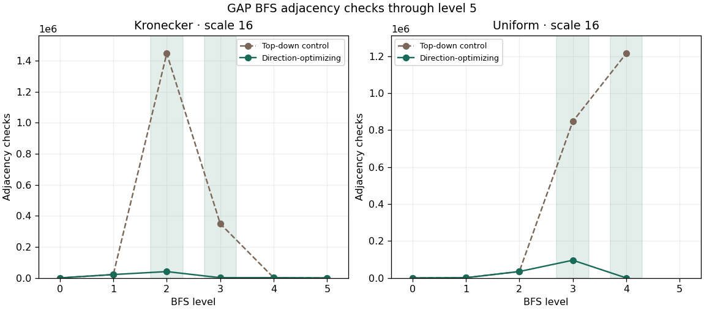
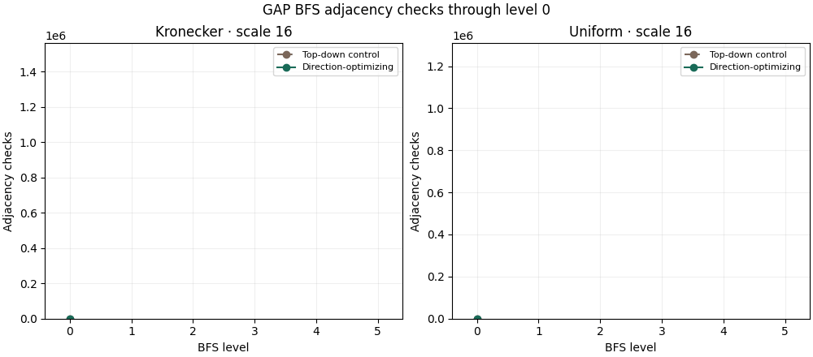
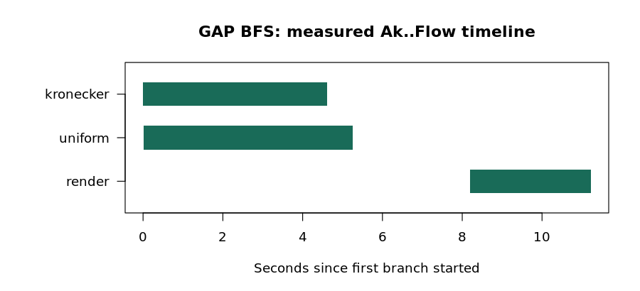

# GAP direction-optimizing BFS audit

This CPU workflow tests when direction-optimizing breadth-first search (BFS)
switches between scanning the current frontier and scanning unvisited vertices.
It compares the official GAP kernel with a top-down control on two generated
graph families at matched nominal scale and edge factor.

## Paper and authors

Scott Beamer, Krste Asanović, and David Patterson,
*Direction-Optimizing Breadth-First Search*, SC12, 2012.
[DOI](https://doi.org/10.1109/SC.2012.50)

The workflow uses the later GAP Benchmark Suite by the same authors at a
pinned revision. The included University of California redistribution notice
applies to the GAP code. AkôFlow integration, verification, and presentation
are by the Community Explorer.
[GAP specification](https://arxiv.org/abs/1508.03619)
[Pinned GAP source](https://github.com/sbeamer/gapbs/tree/941462c7c42e786e4e006a9211b0576ef78d23f7)
[GAP license](GAPBS-LICENSE)

## Scenario and workflow

The Kronecker and uniform branches run in parallel on two CPU slots with two
OpenMP threads per branch. Both generate undirected, deduplicated graphs at
scales 14 and 16 with edge factor 16. Each selects the first three nonisolated
vertices in node-ID order. The two algorithms use the same graph, source,
thread budget, and GAP top-down primitive.

An independent serial queue computes exact distances. For both algorithms the
workflow checks reachability and verifies that each parent edge enters from the
preceding layer. It also calls the GAP verifier. A tiny graph contains a diamond
with two shortest-path parents and a disconnected component. Each generated
graph is rebuilt to check stability of the edge-list and distance hashes.

The traced GAP traversal uses the default alpha and beta values of 15 and 18.
The workflow checks the frontier widths against the independent distance
layers. The logical adjacency-check counts are reconstructed from those layers
and the sorted neighbor lists. A top-down check means inspecting one edge
leaving the frontier. A bottom-up check means inspecting an incoming neighbor
of a vertex that was unvisited at the start of that level, stopping when a
frontier neighbor is found.

## Build and run

```sh
docker build -f docker/Dockerfile -t community-gap-bfs-audit:v1 .
./run.sh
AKOFLOW_SUBMIT=1 ./run.sh
```

The recipe uses a digest-pinned CPU image. It downloads the GAP source at the
fixed revision and checks the archive SHA-256 before compiling with OpenMP.

## Outputs and limitations

The two branch JSON files record graph manifests, exact certificate digests,
per-source timings, frontier widths, switch levels, and logical checks.
The final activity produces a per-level CSV, a two-panel PNG, an animation,
and a validation report with artifact checksums. The plot shows the first
deterministic source at scale 16 for each graph family. Shaded levels indicate
bottom-up steps.

The graph sizes after construction are reported individually. This is a
bounded experiment on generated graphs. The logical counts differ from
hardware performance counters and timing measurements. The workflow
keeps untraced search times separate and makes no speedup claim.

## Recorded execution and gallery

Run `community-gap-bfs-run-v1` completed all three activities. Both algorithms
passed all twelve graph/source checks. The parallel graph branches overlapped
for 4.586 seconds. The per-level table contains 67 rows, and the animation has
six frames from the selected scale-16 traces.







[Per-level CSV](outputs/bfs-levels.csv) ·
[Validation and digests](evidence/validation.json) ·
[Execution record](evidence/daemon-run.json)
