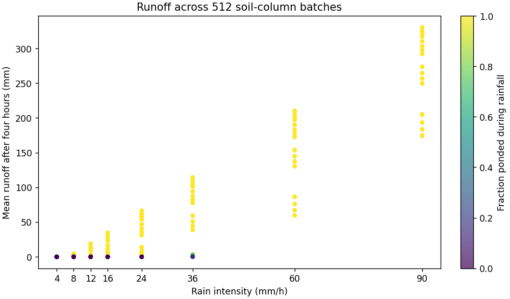
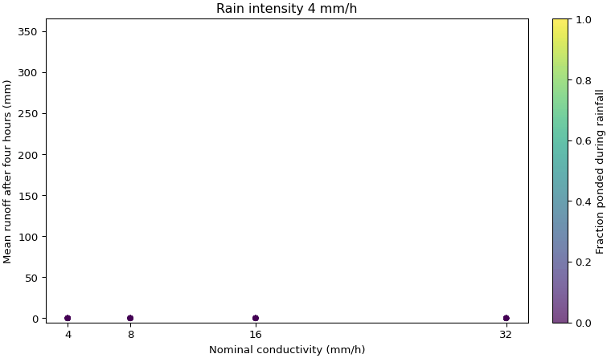
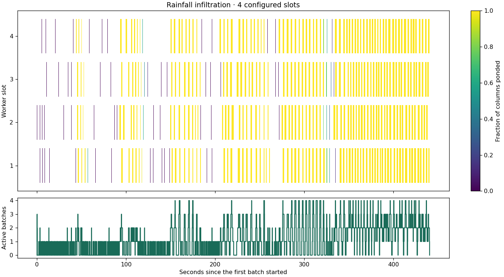

# Rainfall infiltration and ponding ensemble

This synthetic experiment implements the constant-rainfall, homogeneous-soil
setting described by Russell G. Mein and Curtis L. Larson in
[Modeling infiltration during a steady rain](https://doi.org/10.1029/WR009i002p00384)
(1973). The rainfall-limited phase ends at the analytic ponding time. After
ponding, fourth-order Runge–Kutta integration advances the Green–Ampt
equation. Independent bracketed inversion checks selected column results.

The ensemble uses 512 seeded batches, each with 256 synthetic soil columns.
Every storm runs for four hours on a two-minute sampling grid. Conductivity
varies by ±10% and suction by ±15% around each scenario's nominal value.
The [manifest audit](evidence/scenario-audit.json) records when ponding occurs.
The [pilot timings](evidence/pilot-timing.json) measure integration on selected
batches before daemon benchmarking.

The complete 514-activity DAG passed preflight on an isolated daemon with
per-report reuse of its shared recipe probe. The
[preflight comparison](evidence/preflight-comparison.json) records the
original timeout and the successful check with the image unmaterialized.

```sh
python3 scripts/scenarios.py
python3 scripts/run_batch.py 511 results
```

The AkôFlow driver resumes any completed four-slot reference execution and
runs three repetitions for each of the 1-, 4-, 8-, 16-, and 32-slot plans.
It checks the batch artifact inventory and the hashes of the aggregate CSV,
figure, and animation after each run.

```sh
python3 profile.py profile-evidence
```

## Four-slot reference

The AkôFlow run completed 514 activities, with four overlapping scientific
batches. The aggregate validated 512 batches and 131,072 columns. Of these,
77,729 columns reached ponding before the storm ended. The largest error against
bracketed inversion was 4.44 × 10⁻⁸ mm, rounded up.





Each frame shows a rainfall regime and its resulting infiltration and excess.



The timeline uses daemon activity timestamps. Bar colors reflect the fraction
of columns reaching ponding in each batch, and the lower panel counts active
scientific batches.

[Batch results CSV](evidence/reference/infiltration-batches.csv) ·
[Validation and artifact hashes](evidence/reference/reference-evidence.json)

The first [serial and four-slot phase measurements](evidence/reference/initial-phase-comparison.csv)
associate ponding with longer scientific tasks. In the four-slot run the median
batch wall time was 0.120 s for the 192 batches with zero ponded columns, 0.289 s
for the 37 partially ponded batches, and 1.555 s for the 283 fully ponded batches.
The fully ponded group spent a median of 1.398 s in post-ponding integration.
Its last batch finished 440.5 s after the first scientific task began, compared
with 273.2 s for the zero-ponding group. The fixed scenario order groups related
rainfall conditions, so both the per-batch compute cost and scheduling order
affect the observed completion tail. These measurements are from the first
repetition at each slot count.

The first [eight-slot measurement](evidence/reference/eight-slot-observation.json)
completed in 478 seconds, peaked at seven simultaneously active scientific
batches, and reproduced all three scientific artifact hashes. The run shared
the host with the IDW audit for 271 seconds of overall runtime. The windows
between first and last scientific tasks intersected for 85.8 seconds, including
any gaps between tasks. The shared load is part of this measurement.

## Measured scheduling profiles

The [first scheduling repetition](evidence/reference/first-scheduling-repetition.csv)
completed all 514 activities at each of 1, 4, 8, 16, and 32 configured slots.
Every run reproduced the same CSV, PNG and GIF checksums. The 8-, 16-, and
32-slot runs overlap the synthetic IDW campaign on the same host. Their
measurements include that concurrent load. Two further repetitions are in
progress, and these values describe the first measurement at each slot count.

The original workflow code and synthetic inputs use the [MIT license](LICENSE).
The scientific model is attributed to Mein and Larson above.

## Clean Hub import

The [public Hub version](https://hub.akoflow.com/o/akoflow/community-explorer-issue-260-rainfall-infiltration-ensemble?version=1)
was imported into an isolated installation with an empty workflow database
and Docker image store. AkôFlow reconstructed the image and completed all 514
activities. The CSV, PNG and eight-frame animation exactly matched the
recorded reference SHA-256 values. The
[clean-run record](evidence/reference/clean-hub-run.json) identifies the run,
rebuilt image and preflight patch. The unmodified
[AkôFlow v1.0.37 preflight](evidence/reference/stock-release-preflight.json)
also accepted the public URI and requested image reconstruction.
