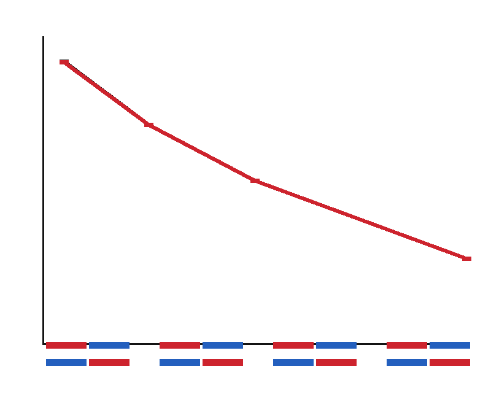
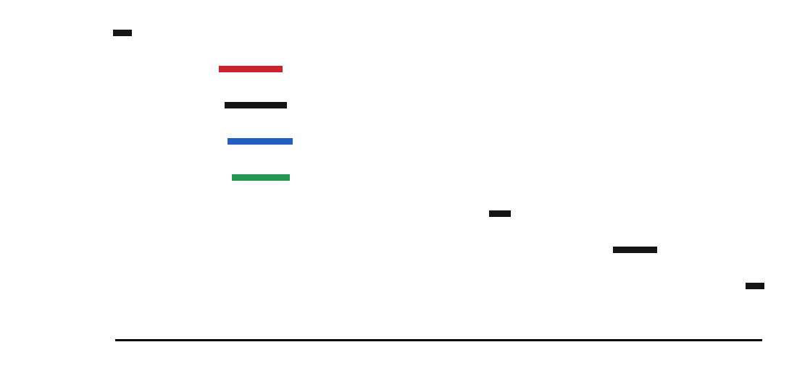

# Shannon binary-symmetric-channel capacity audit

This deterministic pseudorandom numerical audit tests a binary symmetric channel at crossover probabilities `q = 0.01, 0.05, 0.10, 0.20`. Four independent fixed-seed simulations made 2,000,000 channel uses each. The recorded empirical mutual informations were 0.918406, 0.713507, 0.532150, and 0.277536 bits, while the exact capacities `1-H2(q)` were 0.919207, 0.713603, 0.531004, and 0.278072 bits. Every predeclared uncertainty, symmetry, count, XOR, conditional-rate, monotonicity, and determinism check passed.



The [convergence animation](outputs/reference/convergence.gif) records the fixed checkpoints. The [measured daemon timeline](evidence/measured-timeline.png) records actual activity intervals.

## Reproduce

```sh
./build.sh
./preflight.sh
./run.sh
AKOFLOW_SUBMIT=1 ./run.sh
```

The image is pinned to `python:3.11.14-slim-bookworm`, uses only the Python standard library, and scientific containers run offline without Hub credentials or a Docker socket. The daemon run is execution evidence; local runs provide preflight and byte recovery checked against daemon-recorded checksums.

## Measured execution

Run `community-bsc-capacity-run-v1` completed eight activities in 9.98536 s. All four simulations overlapped for 0.685089 s on four distinct declared resources. Matched run `community-bsc-capacity-one-slot-v1` completed in 13.79563 s, an observed whole-workflow ratio of 1.382× in this environment. This is an operational measurement, not an algorithmic scaling claim.

## Interpretation and limitations

This is an audit of an ideal independent memoryless channel, not a physical communications experiment, an error-correcting-code implementation, or a proof of the coding theorem. MT19937 is reproducible rather than physical or cryptographic randomness. Empirical mutual information has finite-sample bias.

## Citation, authorship, and license

Scientific source: Claude E. Shannon, “A Mathematical Theory of Communication,” *The Bell System Technical Journal* 27(3), 379–423 (1948), [DOI 10.1002/j.1538-7305.1948.tb01338.x](https://doi.org/10.1002/j.1538-7305.1948.tb01338.x). The paper is linked and not redistributed.

The workflow and generated artifacts are maintained by UFFeScience for AkôFlow Community Explorer and licensed under the MIT License.

## Animation and measured execution



