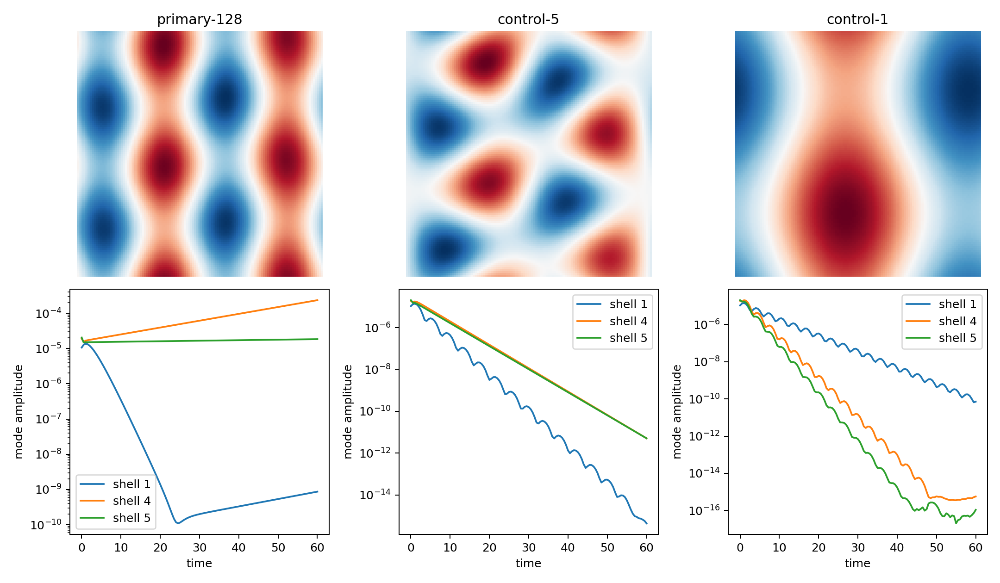
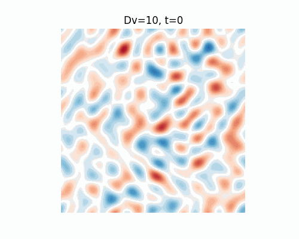
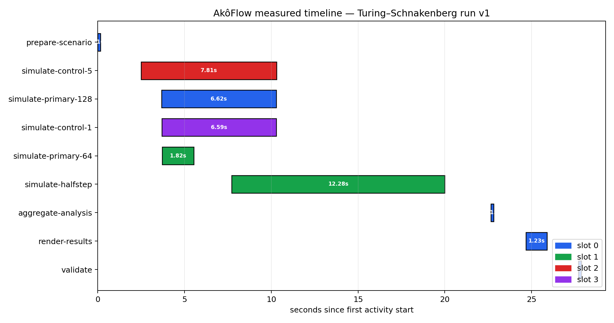

# Turing–Schnakenberg diffusion-driven pattern selection

This workflow tests a precise form of Turing's morphogenesis mechanism: unequal
diffusion destabilizes an equilibrium that is stable without space. It uses the
later Schnakenberg two-species kinetics as a small, deterministic method
adaptation. It does not reproduce a historical paper plate or model a particular
organism.

## Import from AkôFlow Hub

```text
akoflow://hub/publications/561d7297-9747-4dfe-8cf1-c5d84220490c/versions/2
```

The published workflow includes the Docker build context. Reference run
`community-turing-portable-run-v2-two-slot` completed all 9 activities and passed
scientific validation.

## Scientific references

- Alan Mathison Turing, “The Chemical Basis of Morphogenesis,” *Philosophical
  Transactions of the Royal Society B* 237(641), 37–72 (1952),
  https://doi.org/10.1098/rstb.1952.0012.
- J. Schnakenberg, “Simple chemical reaction systems with limit cycle
  behaviour,” *Journal of Theoretical Biology* 81(3), 389–400 (1979),
  https://doi.org/10.1016/0022-5193(79)90042-0.

Implementation and workflow packaging are by the AkôFlow Community Explorer
contributors and are not authorship of either scientific method.

## Registered scenario

On a periodic square of side 20, the workflow solves

```text
du/dt = Du ∇²u + 0.1 - u + u²v
dv/dt = Dv ∇²v + 0.9 - u²v
```

with `Du=1`. The equilibrium `(u,v)=(1,0.9)` has Jacobian
`[[0.8,1],[-1.8,-1]]`, trace `-0.2`, and determinant `1`, hence it is stable as
a well-mixed reaction. For `Dv=10`, the continuous unstable squared-wavenumber
band is `0.2 < q < 0.5`. On this domain the fastest available shell is
`nx²+ny²=4`, with `q=0.3947841760435743` and analytic growth
`0.044676318319031516`. Controls use `Dv=5` and `Dv=1`, where every discrete
mode decays.

The solver is float64 Fourier pseudospectral CNAB2: Crank–Nicolson diffusion,
Adams–Bashforth reaction, and a CN/Euler bootstrap. A PCG64 seed (`20261122`)
generates the same continuous low-mode perturbation on 64² and 128² grids.
The reference interval is `t=0…60`, with `dt=0.02`; a `dt=0.01` branch checks
timestep convergence.

## Scientific DAG

`prepare-scenario` derives the dispersion relation and initial conditions. Five
independent simulations then run: the 128² primary, 64² resolution control,
`Dv=5` control, `Dv=1` control, and half-timestep primary. Aggregation compares
growth and convergence; rendering creates the scientific panel and animation;
validation enforces every registered gate. The simulation fan-out is the
scientific parallel work.

## Build and validate offline

```sh
./build.sh
./preflight.sh
```

The preflight runs the complete scenario twice in network-disabled, one-CPU,
1 GiB containers and requires byte-identical scientific arrays and analysis.
Build/network access is separate from scientific execution.

With the official daemon running and its public preflight healthy:

```sh
./run.sh
AKOFLOW_SUBMIT=1 ./run.sh
```

The first command validates the exact environment, workflow, topology, scope,
and manual plan. The second submits the real Docker execution. The daemon owns
activity execution and file transfers; a helper run alone is not execution
evidence.

## Acceptance and outputs

Validation requires the analytic equilibrium/dispersion identities, measured
shell-4 growth within `0.005` of theory with `R² >= 0.99`, shell-4 selection at
both resolutions, decaying controls, finite positive concentrations, timestep
relative perturbation error at most `1e-3`, and resolution error at most `0.02`.

Key results are `analysis.json`, branch `result.npz` and `summary.json` files,
`dispersion.csv`, `turing-pattern-selection.png`, `pattern-emergence.gif`,
`validation.json`, and `manifest.json`. Daemon evidence adds the image digest,
run ID, measured timings, activity overlap, and timeline image.

## Reproducibility, licenses, and limitations

The source is BSD-3-Clause. Python, NumPy, Matplotlib, Pillow, and the Debian
base retain their upstream notices; see `THIRD_PARTY_NOTICES.md`. There is no
external dataset or checkpoint, and paper PDFs are not redistributed.

Periodic boundaries, a square nondimensional domain, a seeded low-mode
perturbation, and the numerical discretization determine this result. The
linear growth test is the scientific acceptance target. The late pattern is
descriptive and must not be interpreted as evidence for a biological tissue.
The reactions do not conserve `u+v`. Concurrency may be reported from measured
timestamps, but speedup requires a separate matched one-slot run.

## Recorded reference execution

The authoritative daemon run `community-turing-schnakenberg-run-v1` completed
9/9 activities with workflow version `community-turing-schnakenberg-v1-v1`,
plan `community-turing-schnakenberg-plan-v1`, and image digest
`sha256:812ef4e0fa23044744ae3cc9e0edafb3241956ee510506753dcbbd43938aeaeb`.
Measured makespan was 28.394708 s, accumulated compute 44.751787 s, transfer
5.059861 s, and 14,158,779 transferred bytes. Four independent scientific
branches overlapped for 1.817849 s (`1795381381.921903`–`1795381383.739752`).
This proves concurrency only; no speedup is claimed.

The daemon result passed all validation gates. Primary shell-4 growth was
`0.04467627638900089` versus analytic `0.044676318319031516`; timestep and
resolution relative errors were `3.238940955858578e-6` and
`5.878835864807414e-11`. Evidence, measured timestamps, checksums, and the
timeline are retained in `evidence/`.

## Measured result gallery






