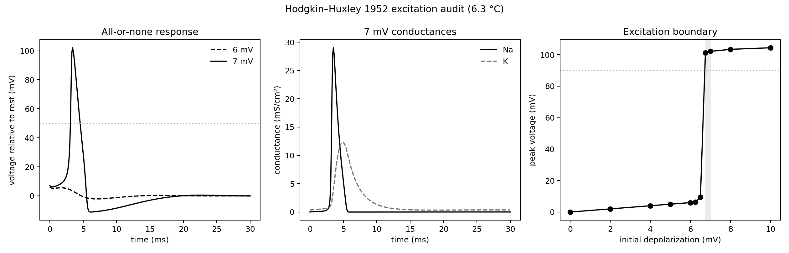
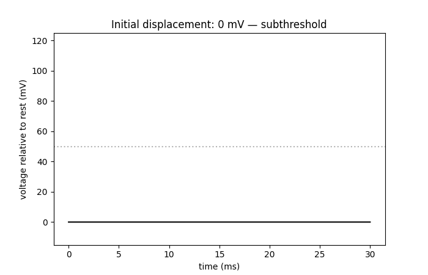
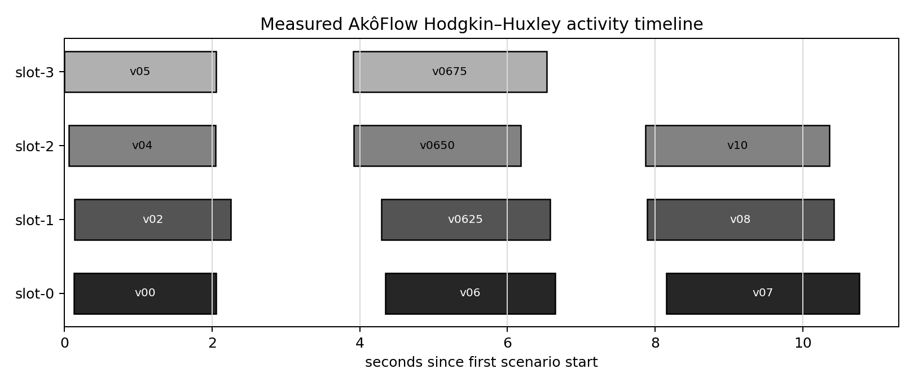

# Hodgkin–Huxley all-or-none excitation boundary

This CPU workflow reproduces the bounded excitation result in A. L. Hodgkin and A. F. Huxley, “A Quantitative Description of Membrane Current and Its Application to Conduction and Excitation in Nerve,” *Journal of Physiology* 117 (1952), 500–544, DOI `10.1113/jphysiol.1952.sp004764`.

It solves the original space-clamped membrane equations at 6.3 °C after eleven instantaneous initial displacements. Every independent branch uses SciPy DOP853 and Radau. The declared paper acceptance pair is that 6 mV remains subthreshold while 7 mV produces a regenerative action potential; denser branches only bound the numerical transition. Voltage is measured relative to the paper's resting potential, not on the common −65 mV absolute scale.

## Import from AkôFlow Hub

```text
akoflow://hub/publications/1ea20b57-5afd-4a11-8399-e629bad8ff67/versions/2
```

The published workflow includes the Docker build context. Reference run
`community-hodgkin-huxley-portable-run-v3-two-slot` completed all 15 activities and passed
scientific validation.

## Reproduce

```sh
./build.sh
./preflight.sh
./run.sh
AKOFLOW_SUBMIT=1 ./run.sh
```

The container is CPU-only and scientific execution requires no input download. Local preflight disables networking and mounts neither the Docker socket nor Hub credentials. `plan.yaml` assigns eleven scientific branches over four slots. Only timestamps from a completed daemon run establish overlap; no speedup is claimed without a matching one-slot run.

## Validation

Both solvers use `rtol=1e-10`, `atol=1e-12`, float64, and output every 0.002 ms over 30 ms. Gates must remain in `[0,1]` within numerical slack, current balance must close within `1e-8 µA/cm²`, peak voltage must agree within 0.05 mV, and 50 mV crossing time within 0.01 ms. A regenerative response crosses 50 mV upward and peaks above 90 mV. The frozen sweep must produce a transition bracket no wider than 0.25 mV wholly inside `[6,7]` mV. Two complete preflights must produce byte-identical canonical JSON and CSV.

The gallery consists of a scientific PNG/SVG, an ordered excitation-sweep GIF, and—after daemon execution—a measured activity timeline.

The validated reference run is `community-hodgkin-huxley-boundary-run-v2`, using workflow version `community-hodgkin-huxley-boundary-v2-v1` and image digest `sha256:af3d9555e83357ef9410ff6b66bfb471c7c8a8e346ef2394796241219acd29c3`. It completed 15/15 activities in 25.776878 seconds. Four independent membrane integrations overlapped for 1.908361 seconds. The fixed sweep localized the transition to `[6.5, 6.75]` mV while preserving the paper's 6/7 mV result. This is concurrency evidence only; no speedup is claimed.

## Licenses and limitations

New workflow code is BSD-3-Clause. NumPy and SciPy are BSD-3-Clause, Matplotlib has a PSF-compatible license, Pillow uses HPND, and the Python base image is pinned by digest. No empirical recording, animal-derived dataset, paper figure, or paper PDF is redistributed.

This is the original squid giant-axon, space-clamped, 6.3 °C model. It is not a human or mammalian neuron, a propagated cable, a finite-duration current clamp, an experimental reanalysis, or an in-vivo firing claim. The denser sweep is a numerical reproducibility audit and does not add experimental precision.

## Measured result gallery






