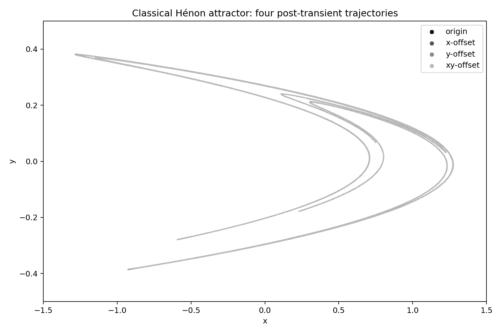
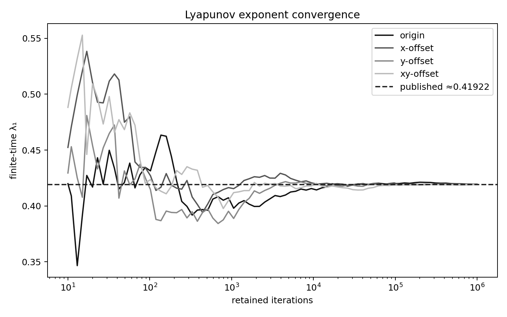
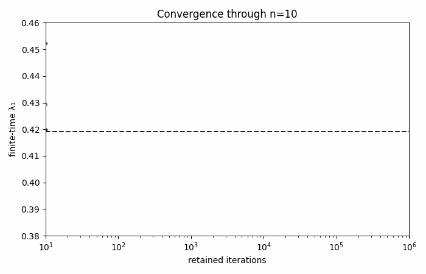
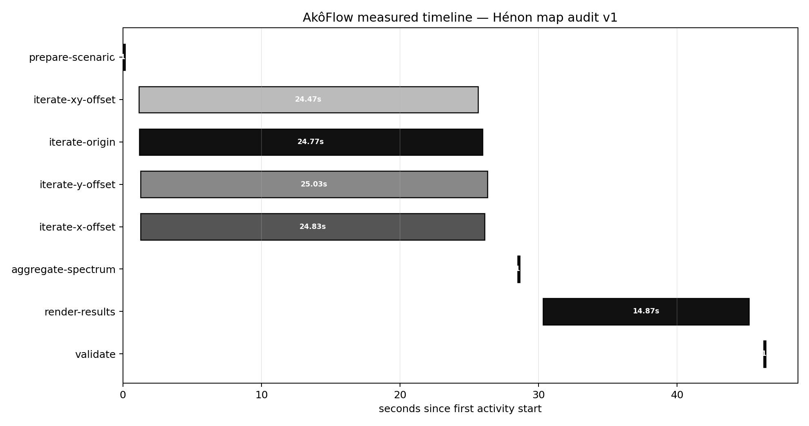

# Hénon map geometry and Lyapunov-balance audit

This CPU workflow numerically audits the classical Hénon map at `a=1.4`, `b=0.3`. Four fixed initial states independently produce post-transient geometry, a two-exponent Lyapunov estimate, and the exact constant-Jacobian balance `λ₁+λ₂=ln(0.3)`. This is finite-precision evidence at one parameter pair, not a proof that a strange attractor exists.

## Scientific reference and authorship

Michel Hénon, “A Two-dimensional Mapping with a Strange Attractor,” *Communications in Mathematical Physics* 50, 69–77 (1976), https://doi.org/10.1007/BF01608556.

The numerical spectrum is cross-checked against J. C. Sprott, “Improved Lyapunov exponent and dimension calculations for the logistic map,” *Chaos* 17, 033124 (2007), https://doi.org/10.1063/1.2785149. Implementation and packaging are by the AkôFlow Community Explorer contributors, not the cited authors.

## Fixed method and execution

The recurrence is `x[n+1]=1+y[n]-1.4*x[n]^2`, `y[n+1]=0.3*x[n]`, with Jacobian `[[-2.8*x,1],[0.3,0]]`. Each branch discards 10,000 states and retains 1,000,000 binary64 states. Modified Gram–Schmidt is applied at every retained step. Nested occupancy grids from 75×25 through 1200×400 measure multiscale geometry; every twentieth point forms a 50,000-row plotting sample.

```sh
./build.sh
./preflight.sh
./run.sh
AKOFLOW_SUBMIT=1 ./run.sh
AKOFLOW_PLAN_FILE=plan-one-slot.yaml AKOFLOW_RUN_ID=community-henon-map-one-slot-run-v1 AKOFLOW_SUBMIT=1 ./run.sh
```

The preflight performs two clean offline one-CPU executions and requires byte-identical results. Scientific containers receive neither network access, Hub credentials, nor the host Docker socket. The daemon plans are importable YAML; `plan.yaml` uses four slots and `plan-one-slot.yaml` is its matched serial control.

## Recorded results

AkôFlow run `community-henon-map-run-v1` completed 8/8 activities with workflow version `community-henon-map-v1-v1`, plan `community-henon-map-plan-v1`, and image `sha256:71504fbb1140c7d011d7e991be03cda1c1517be40dbe29f785c0ac8012b49b74`. Its measured makespan was 46.402186 s, versus 125.405589 s for completed matched run `community-henon-map-one-slot-run-v1`: a measured 2.702579× speedup. The four independent recurrence/tangent activities overlapped for 24.337284 s. Both runs used the same image, workflow, parameters, and scientific activity commands.

Across branches, `λ₁` ranged from 0.419111162 to 0.419539214, `λ₂` from -1.623512018 to -1.623083966, and Kaplan–Yorke dimension from 1.258219027 to 1.258414603. The worst absolute exponent-sum residual was `4.45e-14`. Occupancy slopes ranged from 1.224361367 to 1.226234428, and the minimum pairwise 600×200 occupancy Jaccard similarity was 0.996454. Daemon validation and the clean repeat gate passed every predeclared criterion.

## Result gallery



*The phase-space figure overlays the four fixed 50,000-point samples; close agreement is expected after burn-in and is not presented as statistical independence.*



*The convergence plot uses 80 fixed logarithmic checkpoints from each million-step tangent calculation.*



*The 80-frame animation reveals the evolving finite-time estimate; frames are calculated data, not decorative interpolation.*



*The daemon timeline records real activity timestamps and distinct slot assignments; its simultaneous branch bars establish the reported overlap.*

Machine-readable summaries, validation, branch convergence data, samples, occupancy arrays, checksums, run records, and matched comparison are in `outputs/reference-v1/` and `evidence/`.

## Public Community Explorer record

[Open the anonymously verified public workflow, gallery, completed run, and downloads](https://hub.akoflow.com/o/akoflow/community-explorer-issue-36-henon-map-v1). Import version 1 with `akoflow::o/akoflow/community-explorer-issue-36-henon-map-v1:1` or the immutable URI `akoflow://hub/publications/68796b3b-104b-4a2a-876c-9770bfe81492/versions/1`.

## Licenses and limitations

Original workflow source and generated outputs are MIT licensed. NumPy is BSD-3-Clause, Matplotlib uses a PSF-compatible license, and Pillow is HPND; exact pinned versions and notices are recorded in `requirements.txt` and `THIRD_PARTY_NOTICES.md`. No publisher text, external dataset, checkpoint, or paper figure is redistributed.

Long chaotic trajectories depend on binary64 arithmetic and the frozen iteration/QR order. Independent initial states can eventually share a finite-precision orbit, so branch agreement is a reproducibility check rather than evidence of independent sampling. Occupancy slope is a bounded multiscale raster diagnostic, not a rigorous fractal dimension.
