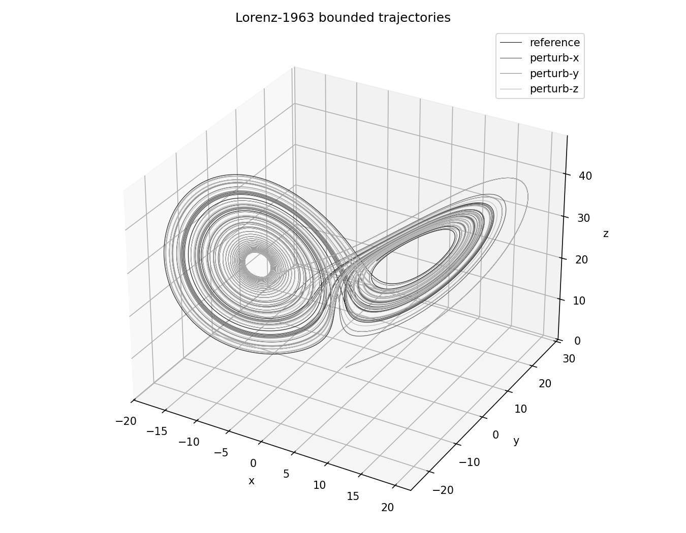
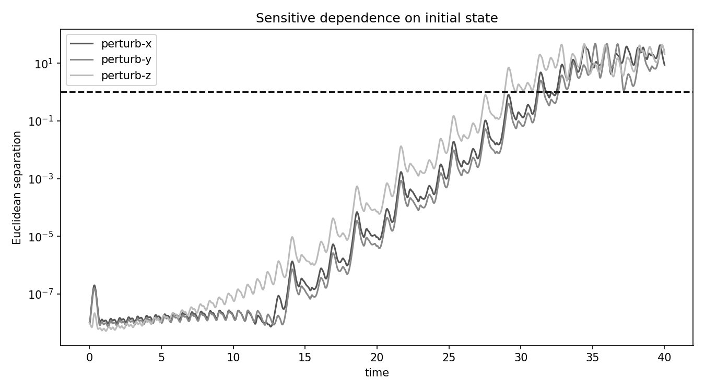
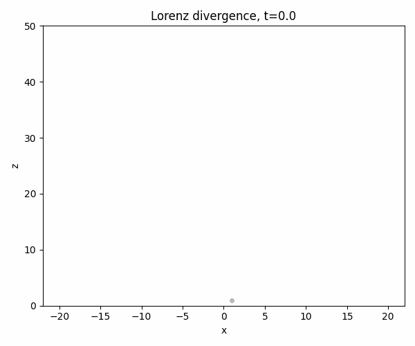
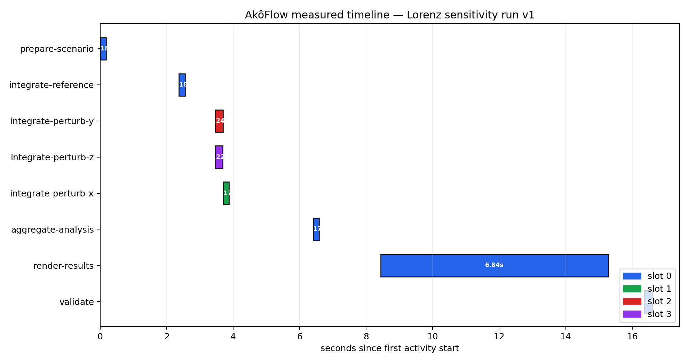

# Lorenz-1963 bounded sensitivity ensemble

This workflow reproduces a bounded slice of Edward N. Lorenz's result that nearby states of a deterministic nonperiodic flow can evolve into considerably different states. Four independent branches integrate the classic three-mode convection equations: a reference trajectory and `1e-8` perturbations in each coordinate.

## Scientific reference

Edward N. Lorenz, “Deterministic Nonperiodic Flow,” *Journal of the Atmospheric Sciences* 20(2), 130–141 (1963), https://doi.org/10.1175/1520-0469(1963)020%3C0130:DNF%3E2.0.CO;2.

Implementation and packaging are by the AkôFlow Community Explorer contributors, not the paper author.

## Scenario and scientific DAG

The equations are `x'=10(y-x)`, `y'=x(28-z)-y`, and `z'=xy-(8/3)z`. Classical binary64 RK4 uses `dt=0.001` for 40,000 steps from `(1,1,1)` and three coordinate perturbations. `prepare-scenario` fans out into four independent integrations, aggregation measures Euclidean separation, rendering produces the attractor, separation figure, and animation, and validation enforces the registered gates.

```sh
./build.sh
./preflight.sh
./run.sh
AKOFLOW_SUBMIT=1 ./run.sh
```

The preflight runs the scenario twice in offline one-CPU containers and requires byte-identical trajectories. The submitted run must use the official AkôFlow daemon and at least two slots; helper output is not execution evidence.

Every branch must emit 40,001 finite states and remain below absolute magnitude 50. Each perturbation must cross unit separation during `t=28…32`, cross separation 10 by `t=34`, and reach maximum separation 40. Outputs include trajectory CSV/NPY files, `separation.csv`, `metrics.json`, two PNG figures, an animated GIF, `validation.json`, and `manifest.json`.

This is a modern RK4 reproduction of bounded sensitivity, not Lorenz's original machine trace, a fitted Lyapunov exponent, or a weather-forecast horizon. Chaotic coordinates are discretization-dependent at long times. Source is MIT licensed; third-party runtime notices are retained separately.

## Recorded reference execution

AkôFlow run `community-lorenz-sensitivity-run-v1` completed all 8 activities with workflow version `community-lorenz-sensitivity-v1-v1`, plan `community-lorenz-sensitivity-plan-v1`, and image digest `sha256:f8e693478378338d69a9c8955130735c0947bb8fe33129b5d56a0f5433933e58`. Measured makespan was 16.462526 s, compute 12.801033 s, transfer 3.877208 s, and 49,985,235 transferred bytes. The independent y- and z-perturbation integrations overlapped for 0.224196 s (`1795382153.742367`–`1795382153.966563`). This proves concurrency only; no speedup is claimed.

Daemon validation passed every gate. Unit-separation crossings were 31.143, 31.225, and 28.878 time units for x, y, and z perturbations. Maximum separations were 42.544960, 47.689195, and 46.581624. The retained evidence includes daemon artifacts, validation SHA-256 `22bd9dfba6c16a05508b2af7ef62d59404b8408e324737fd177570dbad0f8d7e`, measured timestamps, overlap calculation, and timeline image.

## Measured result gallery








