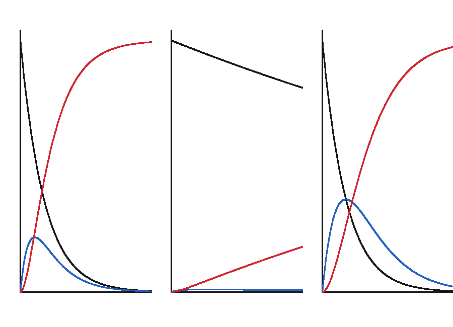

# Bateman radioactive-decay chain equilibrium audit

This deterministic workflow reproduces Harry Bateman's analytic solution for a synthetic three-member serial transformation. It checks transient equilibrium, secular equilibrium, and the continuous repeated-root limit against an independently coded fixed-step RK4 integration.



The [activity-equilibrium animation](outputs/reference/activity-equilibrium.gif) shows transient parent and daughter activity evolution. The measured daemon timeline records actual activity intervals.

## Measured execution

Daemon run `community-bateman-decay-run-v1` completed seven activities in 12.815 seconds. All three solver activities overlapped for 0.4007 seconds on three distinct declared resources. The matched one-slot run completed in 12.493 seconds, so no whole-workflow speedup was observed in this short workload; the concurrency claim is limited to timestamp-proven activity overlap.

## Reproduce

```sh
./build.sh
./preflight.sh
./run.sh
AKOFLOW_SUBMIT=1 ./run.sh
```

The image is pinned to Python 3.11.14 and uses only its standard library. Scientific execution is offline, with no Hub credentials or host Docker socket. Local execution is a preflight; the recorded AkôFlow daemon run is the execution evidence.

## Interpretation and limitations

All reported populations are mathematical fractions, not real atom counts. Half-lives are synthetic and do not identify physical nuclides. This workflow excludes branching, irradiation, stochastic counting, uncertainty, emissions, detector response, energy release, and dose. The repeated-root expression is the continuous limit of Bateman's distinct-root solution.

## Citation, authorship, and license

Scientific source: Harry Bateman, “The solution of a system of differential equations occurring in the theory of radio-active transformations,” *Proceedings of the Cambridge Philosophical Society* 15 (1910), 423–427. The [primary scan hosted by MIT OpenCourseWare](https://ocw.mit.edu/courses/12-744-marine-isotope-chemistry-fall-2012/resources/mit12_744f12_rd1910btmn/) is linked and not redistributed.

The original workflow code and generated artifacts are maintained by UFFeScience for AkôFlow Community Explorer and licensed under the MIT License. Python is distributed under the PSF License.
