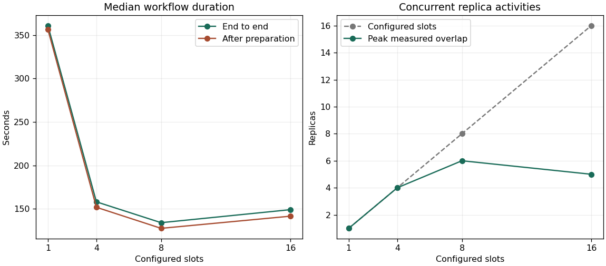
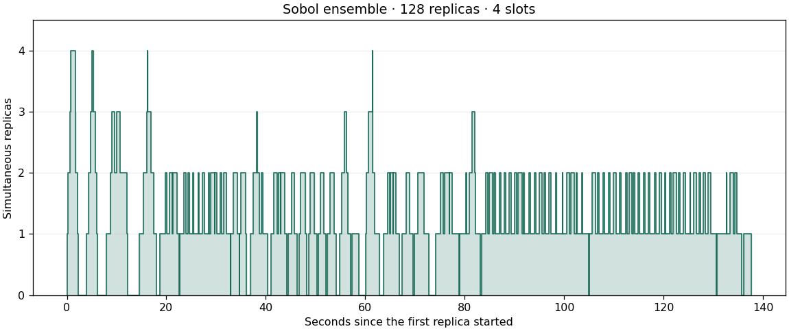

# Scrambled Sobol and pseudorandom integration

This workflow compares convergence of two randomized integration methods on
two 16-dimensional functions whose integrals are known exactly. It also
measures how the same 128 independent replicates execute across AkôFlow slots.

## Paper and authors

Zexin Pan and Art B. Owen, *The nonzero gain coefficients of Sobol's
sequences are always powers of two*. The synthetic experiment explores
empirical convergence using SciPy's documented linear matrix scramble and
digital shift. The AkôFlow implementation is by the Community Explorer.
[Paper](https://artowen.su.domains/reports/gainpow2.pdf)
[SciPy Sobol documentation](https://docs.scipy.org/doc/scipy/reference/generated/scipy.stats.qmc.Sobol.html)

## Scenario and workflow

The smooth integrand is the product of `1+xⱼ` across 16 coordinates. Its
integral is `(3/2)^16`. The discontinuous integrand indicates whether the
coordinate sum exceeds eight. Its integral is one half by symmetry.
Each method and integrand pair has 32 independent replicates. A fixed
NumPy SeedSequence with entropy 107 creates all 128 distinct seeds.

The preparation activity verifies independent streams, nested prefix
generation, a constant-function fixture, and the indicator boundary. A
replicate generates up to 2²⁰ points, reporting estimates at 11 power-of-two
prefixes. Scrambled Sobol replicates are initialized independently and each
uses one balanced stream. The pseudorandom control uses the same sample
counts. The image pins NumPy 2.4.2 and SciPy 1.17.1.

The aggregation activity verifies the manifest and collects all 1,408
estimates. The CSV reports signed error by replicate and the summary
reports empirical RMSE, bias, sample variance, and the standard error of
the ensemble mean. Prefixes are nested, so their errors are correlated.

## Run

The portable build carries the scripts and a digest-pinned Python base image.
For a local image and the four-slot reference execution:

```sh
docker build -f docker/Dockerfile -t community-sobol-ensemble:v1 .
./run.sh
AKOFLOW_SUBMIT=1 ./run.sh
```

When validating a Hub import on an isolated daemon, use
`AKOFLOW_USE_IMPORTED_WORKFLOW=1` with `run.sh`. The script fetches the
imported definition before registering the test environment and schedule.

To run three repetitions of each 1-, 4-, 8-, and 16-slot profile sequentially
and verify identical output digests:

```sh
python3 profile.py profile-evidence
```

The profiling driver resumes existing execution IDs and waits for each run
before starting the next. Save each completed run’s `replicate-timing.csv`
from the aggregate activity as `profile-evidence/<run-id>-process.csv`.
After all 12 runs complete, summarize the captures and render the comparison
with Matplotlib from the workflow's pinned environment.

```sh
python3 summarize-profiles.py profile-evidence profile-results
python3 render-profiles.py profile-results/profile-summary.csv profile-results/profile.png
```

The summary reports the largest observed RSS of a single replicate process
and two elapsed times. End-to-end time starts when the run starts. The
post-preparation window starts when the prepare activity finishes, excluding
its initial image build. With eight host CPUs, 16 logical slots can compete
for the same cores. The process CSV records the timing and peak RSS of each
replicate. The daemon activity trace supplies queue latency and concurrent
activity counts.

## Outputs and limitations

The workflow emits per-replicate estimates, convergence summaries, replicate
timings, a convergence figure, an animation, and validation checksums.
The empirical comparison concerns these functions and seeds. The experiment
measures convergence and scheduling on these fixed test cases.

## Measured scheduling profile

Three matched runs at each capacity produced byte-identical scientific
outputs. The median post-preparation durations were 356.58 seconds with one
slot, 151.72 seconds with four slots, 127.49 seconds with eight slots, and
141.51 seconds with sixteen slots. Relative to the matching one-slot control,
the measured speedups were 2.35×, 2.80×, and 2.52×. Peak replica overlap was
one, four, six, and five respectively. The sixteen-slot profile therefore
shows host saturation rather than continued scaling: this machine has eight
host CPUs, and logical slots do not create additional compute capacity. The
largest per-replica peak RSS observed across the profiles was 238,492 KiB.



[Per-run profile measurements](outputs/profile-runs.csv) ·
[Profile summary](outputs/profile-summary.csv)

## Four-slot reference run

Run `community-sobol-run-4-v1` completed all 130 activities and validated
1,408 estimates. The daemon recorded a peak of four simultaneous replicas.
At 2²⁰ points per replica, the observed RMSEs were 0.005285 for Sobol and
0.429079 for pseudorandom sampling on the smooth function. On the indicator,
the observed RMSEs were 0.000177 and 0.000600 respectively.




[Replicate estimates](outputs/replicates.csv) ·
[Convergence summary](outputs/convergence.csv) ·
[Process timing and peak RSS](outputs/replicate-timing.csv) ·
[Validator](evidence/validation.json) ·
[Recorded activities](evidence/reference-run.json)

## Scheduling comparison

All 12 runs completed 130 activities each. The estimates, convergence CSV,
figure, and animation were byte-identical across runs. On this eight-CPU
host, eight configured slots gave the lowest median post-preparation time,
127.5 seconds versus 356.6 seconds with one slot (2.80× speedup). Sixteen
configured slots took 141.5 seconds and had a higher median ready-to-start
delay. The daemon observed at most six simultaneous replicas in the
eight-slot runs. These are shared-host measurements.


[Individual measurements](outputs/profile-runs.csv) ·
[Summary by slot count](outputs/profile-summary.csv)
