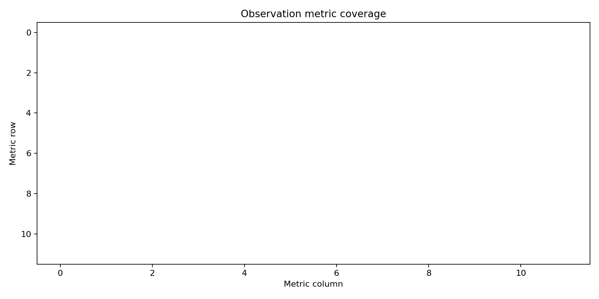
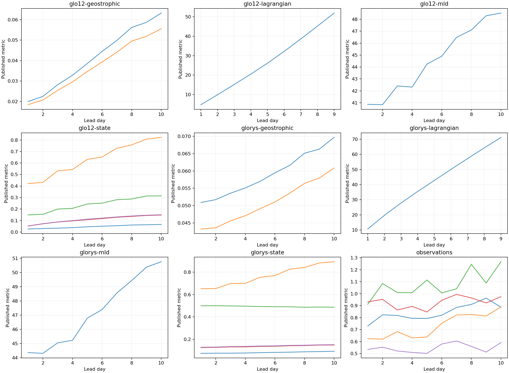
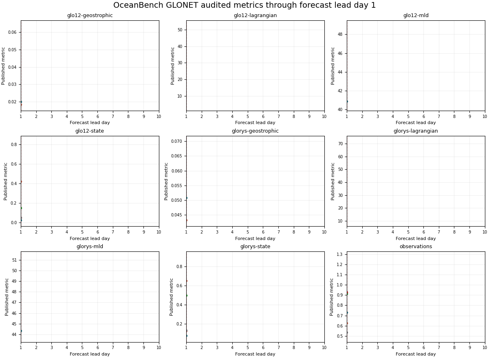
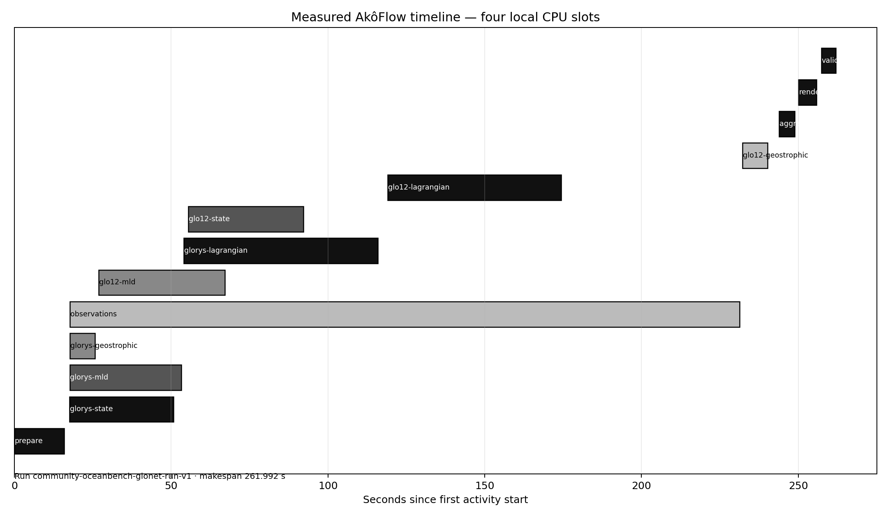

# OceanBench GLONET two-initialization metric reproduction

This workflow reproduces the nine metric tables in OceanBench's official GLONET 1° tutorial for the forecast initializations of 3 and 10 January 2024. It is a bounded tutorial audit, not an official OceanBench submission, global leaderboard reproduction, model-training result, or estimate of operational forecast skill.

The scientific implementation is OceanBench 0.6.0 at commit `61aea40e13689b3dbb0592a74dbf716f15882f5b`. It evaluates state variables, mixed-layer depth, geostrophic currents, observations, and Lagrangian trajectory deviation against GLORYS and GLO12. Every table cell and coverage field is checked against the displayed precision of the pinned report notebook (`sha256:dfa92abfe9ddc515dd37e2a58bc7cbede71471c6e9b913bcf54de38fa0b6913a`).

## Reproduce

The preparation step is the only networked scientific-input step. It anonymously mirrors the exact public Zarr stores, records S3 size, ETag, Last-Modified, and downloaded SHA-256 for every object, and downloads the pinned reference notebook.

```sh
python3 prepare-inputs.py
./build.sh
./preflight.sh
./run.sh
AKOFLOW_SUBMIT=1 ./run.sh
```

Metric containers run from the checksum-verified local snapshot with Docker networking disabled. The workflow fans out nine independent official metric calls, then aggregates, plots, and validates them. `plan.yaml` assigns those branches across four CPU slots; measured daemon events, rather than the plan, are the authority for overlap.

## Acceptance

- The challenger dimensions are exactly 2 initializations × 10 leads × 21 depths × 168 latitudes × 360 longitudes, with source `MOI GLONET` and CF-1.8 metadata.
- All frozen objects match the preparation manifest before metrics execute.
- All nine official tables match the notebook cell-by-cell at its six-decimal displayed precision, including missingness or observation coverage columns.
- The documented GLORYS/GLO12 state and mixed-layer-depth sentinels pass as early diagnostics.
- A completed daemon run must show overlap between at least two metric activities. A one-slot run is required before making any speedup claim.

## Attribution and licenses

OceanBench is EUPL-1.2 software by Anass El Aouni, Quentin Gaudel, Juan Emmanuel Johnson, Charly Regnier, Julien Le Sommer, van Gennip, Ronan Fablet, Marie Drevillon, Yann Drillet, and Pierre-Yves Le Traon, with Mercator Ocean International. Cite *OceanBench: A Benchmark for Data-Driven Global Ocean Forecasting Systems*, NeurIPS 2025 Datasets and Benchmarks Track.

The forecast is attributed to MOI GLONET. GLORYS, GLO12, and observation products are attributed to Mercator Ocean International and the E.U. Copernicus Marine Service. Raw inputs are not committed or published; only manifests, derived tables, validation reports, and figures are publication artifacts. Consult the source providers' current terms before redistributing data.

## Limitations

This audit contains two initializations and ten lead days from a tutorial sample. It does not quantify seasonal performance, uncertainty, statistical significance, model-training quality, or leaderboard rank. The notebook exposes rounded table values, so the frozen oracle is displayed precision rather than hidden full-precision arrays.

## Measured result gallery







The animation reveals the audited metric rows through lead days 1–10. Each
panel keeps one fixed vertical scale across all frames; the red dashed line is
the current lead day. This is a visualization of the committed result tables,
not a new execution or a physical-field forecast.



Animation provenance, fixed axis bounds, source checksum, artifact checksum,
dimensions, and frame count are recorded in
`evidence/animation-provenance.json`.
