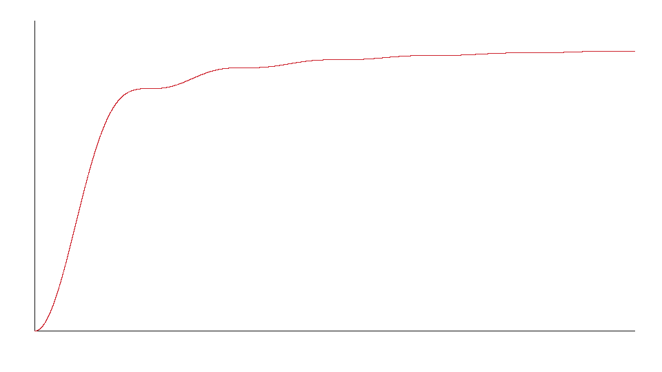
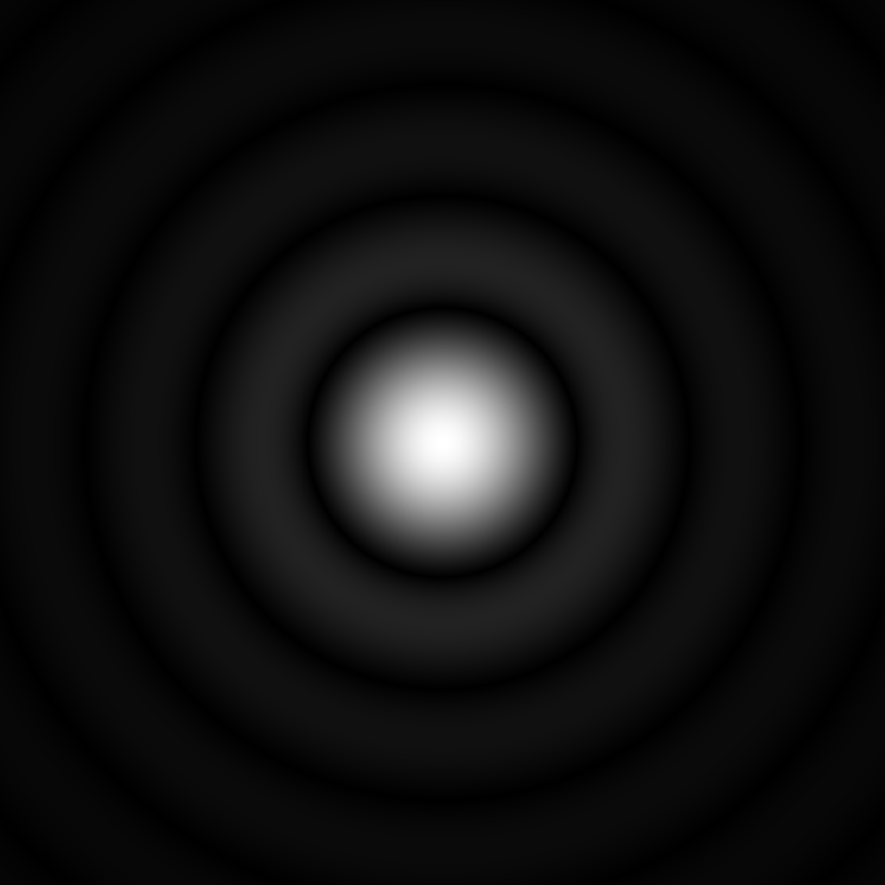
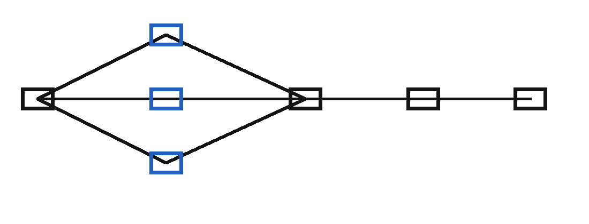
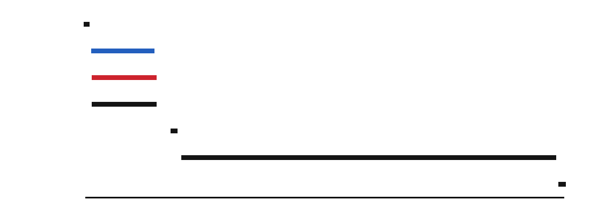

# Airy circular-aperture diffraction and encircled-energy audit

This deterministic CPU workflow reproduces George Biddell Airy's ideal circular-aperture radial intensity law, `I(u)=[2 J1(u)/u]^2`, and checks the first dark ring, wavelength scaling, and encircled energy at 450, 550, and 650 nm. It uses an 80-significant-digit standard-library Decimal series to avoid the large-argument cancellation found during qualification.



*The scientific profile figure shows the shared dimensionless diffraction law evaluated independently by all three wavelength branches; physical dark-ring radii scale with wavelength.*



*The 1024×1024 450 nm focal-plane image spans ±4 λf/D. The corresponding 550 and 650 nm PSFs are retained beside it as independently generated results.*


*The fixed-axis animation visualizes analytic wavelength scaling from 450 to 650 nm; its interpolated frames are presentation artifacts, not additional executed scientific branches.*

## Validated result

All three daemon branches recovered `j(1,1)=3.831705970207512`, with `|J1(root)|=1.17e-16`. The central-disk encircled energy is `0.8377848691733144`; independent 131,072-subinterval Simpson quadrature differs by about `7.8e-15`. Each branch emitted 20,001 ordered radial samples, used at most 76 series terms, passed the fixed integral checkpoints, and produced byte-identical dimensionless intensity and energy columns. The first-dark-ring radii are 5.4885, 6.7082, and 7.9279 micrometres for 450, 550, and 650 nm respectively.

## Measured AkôFlow execution

Daemon run `community-airy-diffraction-run-v1` completed all seven activities in `90.6462 s`. The three independent wavelength evaluations overlapped for `11.0066 s` on three distinct declared resources. The matched one-slot run `community-airy-diffraction-one-slot-v1` completed in `111.1543 s`; the observed whole-workflow ratio was `1.2262×`. This is a measured result for this host and scenario, not a general scaling claim.



*The measured workflow DAG fans out into three scientific wavelength evaluations and joins for scaling, rendering, and validation.*



*The timeline is rendered from persisted daemon timestamps and records actual overlap among the 450, 550, and 650 nm evaluations.*

## Reproduce

```sh
./build.sh
./preflight.sh
./run.sh
AKOFLOW_SUBMIT=1 ./run.sh
```

The image is pinned to Python 3.11.14 and uses only its standard library. Scientific execution is offline and receives neither Hub credentials nor the host Docker socket. A helper run is only preflight; the recorded daemon runs above are execution evidence.

## Interpretation and limitations

This is an ideal scalar, monochromatic, paraxial, unobscured circular aperture. It does not model aberrations, central obscuration, spiders, atmospheric seeing, vector diffraction, finite bandwidth, detector sampling, or a measured telescope. The animation interpolates wavelength only after the independently evaluated reference branches.

## Citation, authorship, and license

Scientific source: George Biddell Airy, “On the Diffraction of an Object-glass with Circular Aperture,” *Transactions of the Cambridge Philosophical Society* 5 (1835), 283–291. Bessel zeros and radial integral identities are cross-checked against [NIST DLMF §10.21](https://dlmf.nist.gov/10.21) and [§10.22](https://dlmf.nist.gov/10.22). Sources are linked, not redistributed.

The original workflow code and generated artifacts are maintained by UFFeScience for AkôFlow Community Explorer under the MIT License. Python is distributed under the PSF License.
