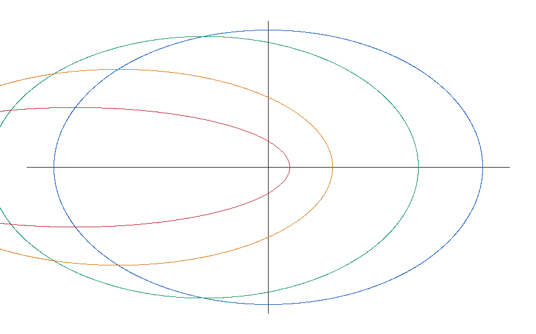
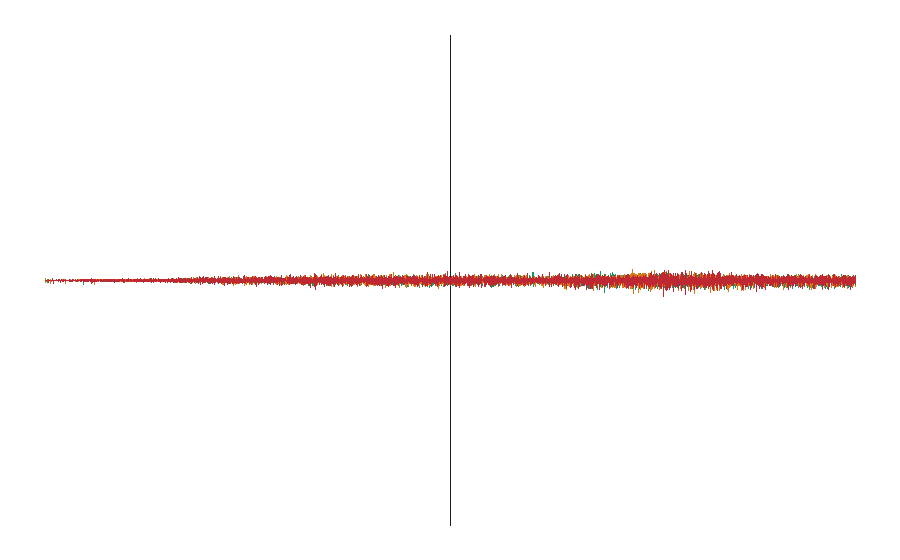
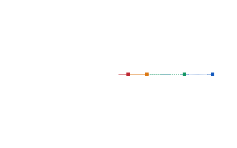
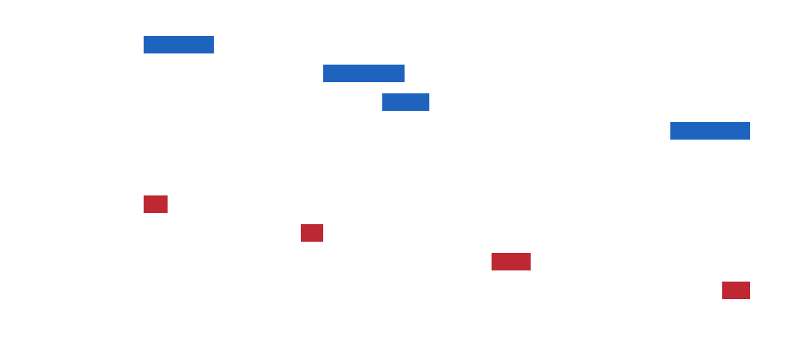

# Kepler elliptic-orbit equal-area audit

This CPU-only AkôFlow workflow solves Kepler's equation on 4096 equal-time intervals for eccentricities `0.0`, `0.3`, `0.7`, and `0.9`. Four independent scientific branches use safeguarded Newton/bisection inversion, reconstruct each ellipse, and evaluate swept area independently from the parametric line integral. The aggregate checks frozen quarter-period roots, ellipse geometry, apsides, equal interval areas, total area, and finite-difference areal velocity.

*The committed Cartesian branch results for the circular, moderate-, and high-eccentricity cases. Each curve is sampled uniformly in time (mean anomaly), so spatial point spacing concentrates near apoapsis.*

*Equal-time swept-area increments normalized around their branch mean. The plotted deviations come from the independent parametric line integral, not from substituting area proportional to mean anomaly.*

*Result-bearing evolution through 24 uniformly spaced times. Each colored radius vector terminates at the position obtained by independently solving Kepler's equation for its eccentricity.*

*Measured scientific-branch runtime bars. The upper group is the four-slot daemon run and the lower group is the one-slot control; within each group rows correspond to `e=0.0`, `0.3`, `0.7`, and `0.9`. The four-slot run measured 0.091643 s of overlap between the `e=0.7` and `e=0.9` branches. The one-slot branches were strictly sequential.*

## Result

All frozen criteria passed. The maximum interval-area relative error was `1.64e-12`, the maximum quarter-root absolute error was below `3e-14`, and the worst finite-difference areal-velocity relative span was `1.93e-6` at `e=0.9`. Total areas agreed with `pi sqrt(1-e^2)` within `2.45e-15` relative. These results support equal areas in equal times for the fixed ideal two-body scenarios.

The completed four-slot daemon run is `community-kepler-run-v1`; the matching control is `community-kepler-one-slot-run-v1`. Scientific outputs and validation checksums are byte-identical. Their compute makespans were 26.130 s and 16.999 s respectively on a contended shared host, so no speedup is claimed. Parallel evidence is limited to the measured overlap of independent scientific activities.

## Reproduce

`workflow.yaml` resolves all activities from portable build `recipe-build-5b2ee5f0f83fd7a7b711aa302afa76551a71ff05305893e02aaa5680500ce2f2`. The embedded context digest is `sha256:eb6d2b3f5e839f9ceadfe86d82d455d5d344955b7d78f2840940dc104f190dda`, the Dockerfile digest is `sha256:7219c30ff8bbac2ae3ead8687e6967ffc819311ca964687515e8bf65eac4be67`, and the reconstructed image digest is `sha256:c8390844f004795528fdabd440a788c81b68165ecd7dafdbd30dddaf457c256e`. The base image is pinned by digest. Every `COPY` source is versioned inside the context and the Dockerfile performs no network download.

Run `./run.sh` for daemon preflight, then set `AKOFLOW_SUBMIT=1` to execute `plan.yaml`. Select the control with `AKOFLOW_PLAN_FILE=plan-one-slot.yaml`, `AKOFLOW_PLAN_ID=community-kepler-one-slot-plan-v1`, and a unique `AKOFLOW_RUN_ID`. The clean-state preflight reported `Build required` for every activity, reconstructed the image from the registered context, and completed all eight activities without Hub credentials or host socket access inside the scientific container.

## Result data and evidence

- [Validation report](outputs/reference/validation.json) and [aggregate metrics](outputs/reference/metrics.json)
- Orbit tables for [`e=0.0`](outputs/reference/orbit-e00.csv), [`e=0.3`](outputs/reference/orbit-e03.csv), [`e=0.7`](outputs/reference/orbit-e07.csv), and [`e=0.9`](outputs/reference/orbit-e09.csv)
- [Daemon runs, activity timestamps, overlap, checksums, and build provenance](evidence/daemon-runs.json)

## Provenance and limitations

Primary citation: Johannes Kepler, *Astronomia nova ... de motibus stellae Martis* (Heidelberg: Gotthard Vögelin, 1609), persistent record [doi:10.3931/e-rara-558](https://doi.org/10.3931/e-rara-558). The historical source and digitization are public domain; this original implementation is Apache-2.0 and the authored dimensionless input is CC0-1.0.

This is an ideal dimensionless two-body calculation, not an observed Solar-System ephemeris. It uses modern eccentric-anomaly notation to audit Kepler's historical geometric law and excludes perturbations, relativity, finite masses, non-elliptic trajectories, and observational uncertainty.
