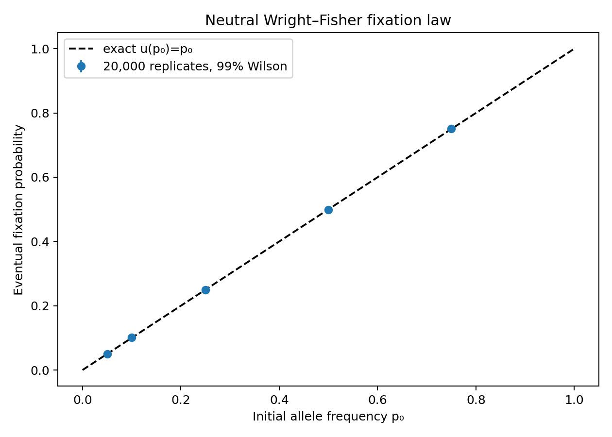
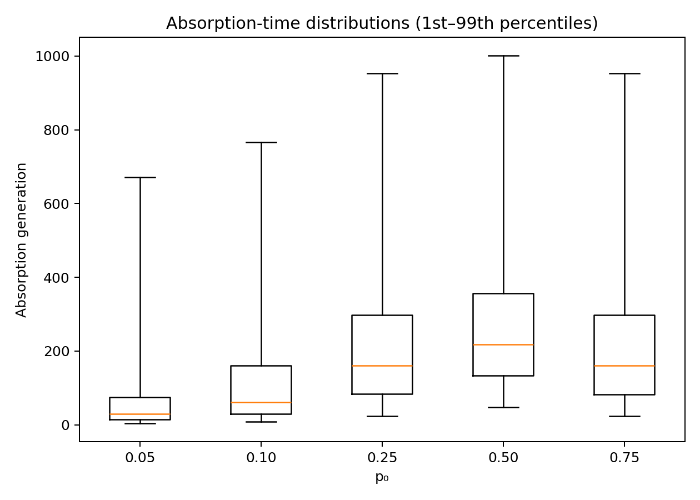
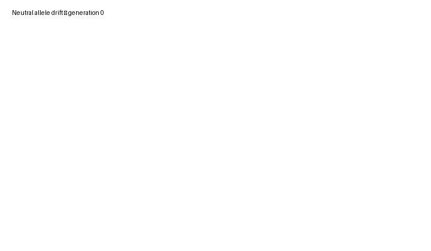
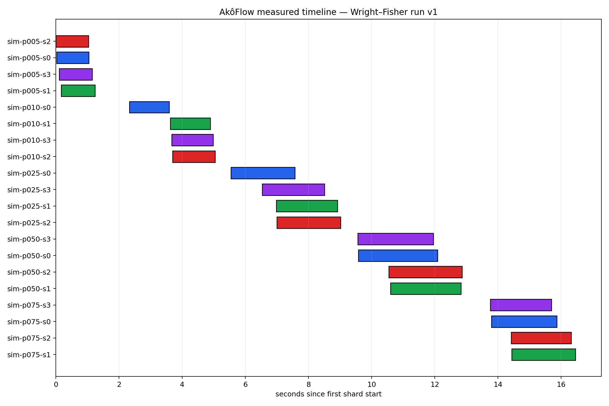

# Kimura neutral Wright–Fisher fixation law

This CPU workflow reproduces the neutral boundary of Motoo Kimura, “On the Probability of Fixation of Mutant Genes in a Population,” *Genetics* 47 (1962), 713–719, DOI 10.1093/genetics/47.6.713. For the exact finite neutral Wright–Fisher chain, the eventual fixation probability equals the initial allele frequency, `u(p₀)=p₀`.

Twenty independent shards simulate 100,000 trajectories for `K=200` haploid gene copies and `p₀=0.05, 0.10, 0.25, 0.50, 0.75`. Each replicate has an execution-order-independent SHA-256/PCG64DXSM seed. Five aggregation branches compare fixation proportions with the exact law and prospectively fixed 99% Wilson, error, absorption, and symmetry gates.

Run `./build.sh` and `./preflight.sh`. The preflight is offline and receives neither Hub credentials nor the Docker socket. Authoritative execution must use the AkôFlow daemon plan with at least two slots; only measured activity timestamps prove overlap, and no speedup is claimed without a matching one-slot run.

The gallery contains the fixation-law figure, absorption summary, real simulated allele-drift animation, and measured daemon timeline. New code is BSD-3-Clause; NumPy is BSD-3-Clause, Matplotlib uses its PSF-compatible license, and Pillow uses HPND. No external dataset or paper figure is redistributed.

The validated reference execution is `community-wright-fisher-run-v1`, workflow version `community-wright-fisher-fixation-v1`, schedule plan `community-wright-fisher-plan-v1`, and image `sha256:e9f448de9228a5ef5ee5bbd28590ac22beda9e468809969c86876653504d6664`. The daemon completed 28/28 activities in 33.381965 seconds, with 41.200169 compute seconds and 2,064,585 transferred bytes. The first four independent shards overlapped for 0.866451 seconds. This proves concurrency only; no speedup is claimed.

This is a neutral haploid finite-population slice. It does not model selection, mutation, migration, recombination, diploid genotype sampling, or a named biological population. Model generations are not laboratory time.

## Import from AkôFlow Hub

```text
akoflow://hub/publications/790e5aef-207d-409b-8a11-79db6f16063a/versions/2
```

The published workflow includes the Docker build context. Reference run
`community-wright-fisher-portable-run-v2-two-slot` completed all 28 activities and passed
scientific validation.

## Measured result gallery








