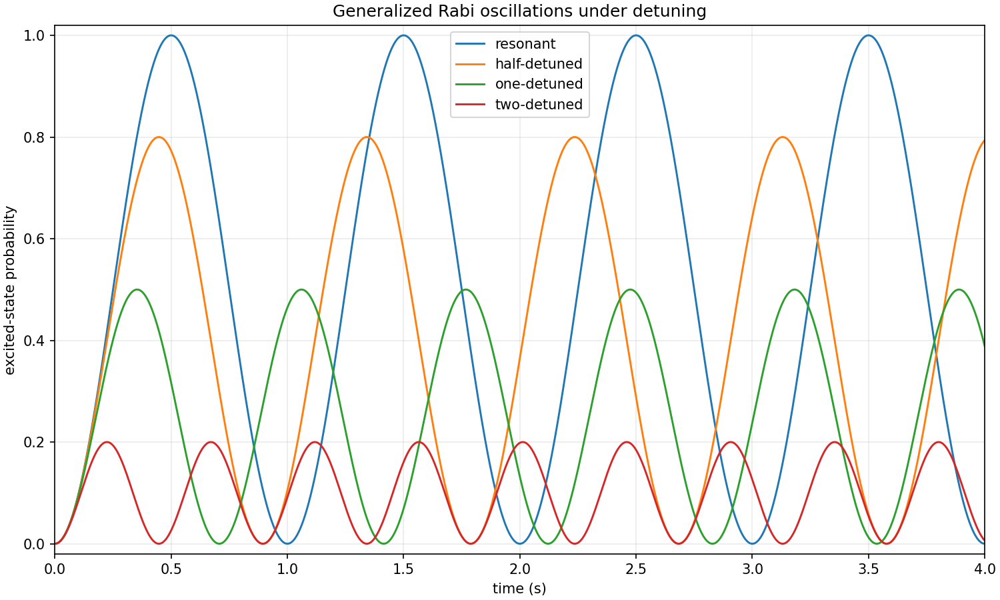
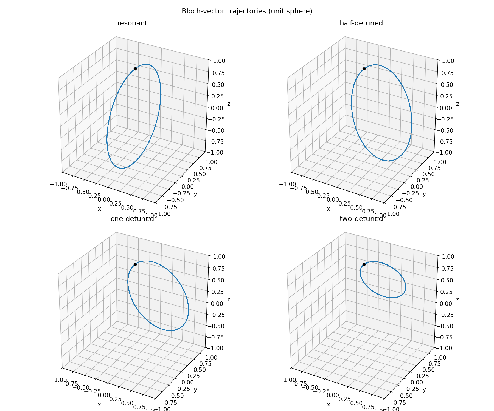
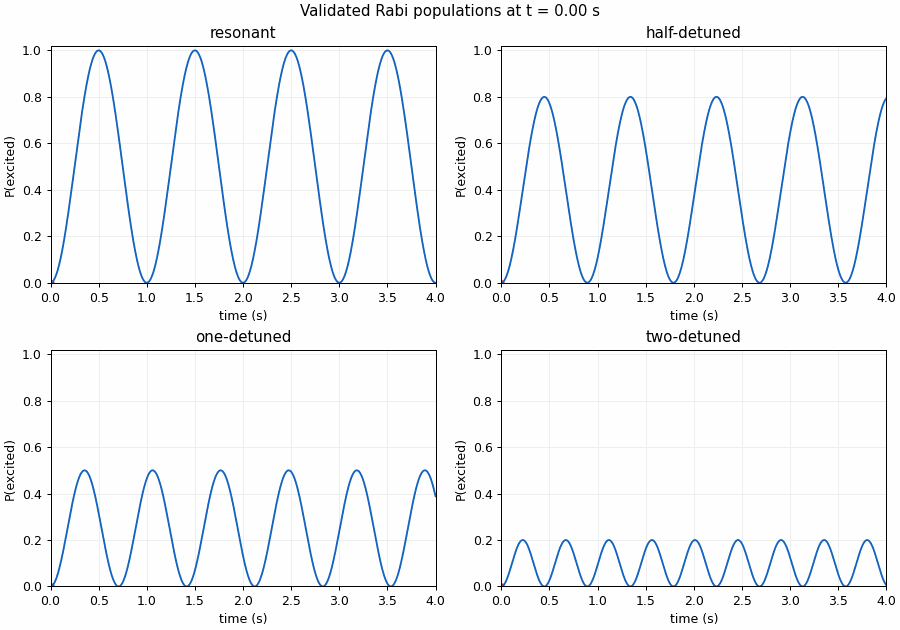
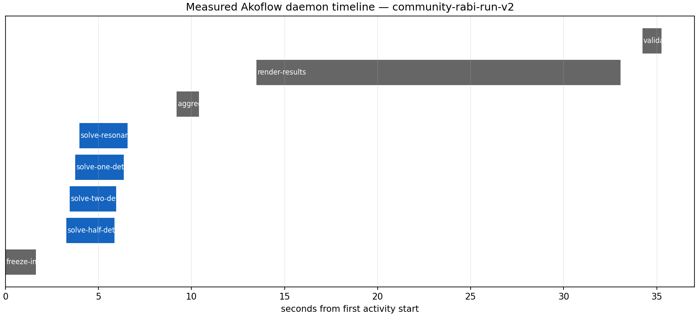

# Rabi two-level detuning and population-transfer audit

This deterministic CPU workflow integrates an ideal coherently driven two-level quantum system and checks every retained sample against the exact generalized Rabi transition law. Four independent detuning branches demonstrate that detuning raises the oscillation frequency while limiting the maximum population transfer.



*Excited-state probabilities on identical axes for `Delta/Omega = 0, 0.5, 1, 2`. Resonance reaches complete transfer; the exact detuned maxima are `0.8`, `0.5`, and `0.2`.*



*The complex numerical states remain on the unit Bloch sphere. Detuning tilts the effective rotation axis and changes the accessible population range.*



*The 41-frame result animation advances one shared clock across all validated branches; the red marker is an actual retained sample, not decorative interpolation.*

## Validated result

With `Omega = 2*pi rad/s`, initial state `(1,0)`, and four seconds of evolution, all fixed acceptance gates passed:

| `Delta/Omega` | exact frequency (cycles/s) | measured frequency | exact maximum | sampled maximum |
|---:|---:|---:|---:|---:|
| 0 | 1.0000000000 | 1.0000000000 | 1.0 | 1.0000000000 |
| 0.5 | 1.1180339887 | 1.1180339885 | 0.8 | 0.7999999544 |
| 1 | 1.4142135624 | 1.4142135628 | 0.5 | 0.4999999963 |
| 2 | 2.2360679775 | 2.2360679810 | 0.2 | 0.1999999886 |

The worst pointwise probability disagreement with the analytic solution was `3.11e-15`; maximum state-norm error was `3.11e-15`; maximum Bloch-norm error was `2.89e-15`; and the largest coarse/fine probability change was `5.33e-15`. Two offline preflights produced byte-identical CSV, JSON, PNG, and GIF artifacts. The authoritative daemon manifests agree with all 14 common reference files.

## Reproduce

```sh
./build.sh
./preflight.sh
./run.sh
AKOFLOW_SUBMIT=1 ./run.sh
```

The image pins Python 3.11.14 and every Python dependency listed in `requirements.txt`. Scientific activities run with networking disabled, no Hub credential, and no host Docker socket. A local run is only deterministic qualification; the recorded daemon run below is execution evidence.

The imported workflow resolves all eight activities from one immutable AkôFlow
build recipe. Its archived context contains the Dockerfile, pinned requirements,
license, and workflow source; every `COPY` source is contained. This backfill
also pins the Python base image by digest. From an unmaterialized state,
preflight reported `Build required`, and AkôFlow reconstructed and verified the
OCI image before running the DAG.

## Measured Akoflow execution

Portable daemon run `community-rabi-run-v2` rebuilt the missing image and
completed all eight activities in `35.262494 s`. The four independent detuning
solves overlapped simultaneously for `1.872366 s`. The matching one-slot run
`community-rabi-one-slot-run-v2` completed in `41.342805 s`, a measured ratio
of `1.172430` on this host. No generalized speedup claim is made.



*Daemon start/finish timestamps show genuine overlap among the four ODE integrations before aggregation, rendering, and validation.*

- Image: `sha256:36650b350a379d9b61eca19fd6570ad462aeea84e317554b05aecb9a08a4ff0a`
- Context: `sha256:1bd74e7eb68a452f8790e2ec698fef0242d0a650f287d668c499d943b6eef4aa`
- Recipe: `sha256:de047035725831283c04765288b43073a9acb90674acddc48847f1479d1000bc`
- Workflow version: `community-rabi-oscillations-v2-v1`
- Reference run: `community-rabi-run-v2`
- One-slot control: `community-rabi-one-slot-run-v2`
- Machine-readable metrics, full daemon captures, checksums, validation, and agreement evidence are committed under `outputs/reference/` and `evidence/`.

## Scientific model and limitations

In units with `hbar=1`, the rotating-frame Hamiltonian is

```text
H = 0.5 * [[Delta, Omega], [Omega, -Delta]].
```

For initial state `(1,0)`, the exact excited-state probability is

```text
P1(t) = Omega^2/(Omega^2 + Delta^2)
        * sin^2(0.5*sqrt(Omega^2 + Delta^2)*t).
```

This is an ideal rotating-wave, coherent, constant-drive two-level model. It excludes relaxation, dephasing, pulse envelopes, counter-rotating/Bloch–Siegert effects, leakage levels, spatial variation, measurement noise, and hardware calibration. Agreement validates this frozen numerical scenario; it is not an experimental reproduction or a general proof of quantum mechanics.

## Citation, authorship, and license

Scientific source: Isidor Isaac Rabi, “Space Quantization in a Gyrating Magnetic Field,” *Physical Review* 51, 652–654 (1937), [DOI 10.1103/PhysRev.51.652](https://doi.org/10.1103/PhysRev.51.652).

The workflow implementation and generated artifacts are maintained by UFFeScience for Akoflow Community Explorer and licensed under the MIT License. The article is cited and not redistributed. Python, NumPy, SciPy, Matplotlib, Pillow, and transitive dependencies retain their upstream licenses; see `THIRD_PARTY_NOTICES.md`.

## Public Community Explorer record

[Open the public workflow and measured results](https://hub.akoflow.com/o/akoflow/community-explorer-issue-49-rabi-oscillations-v1).
Import portable version 2 with
`akoflow://hub/publications/b69279b7-1735-470d-9630-b1ea64734e2d/versions/2`.
