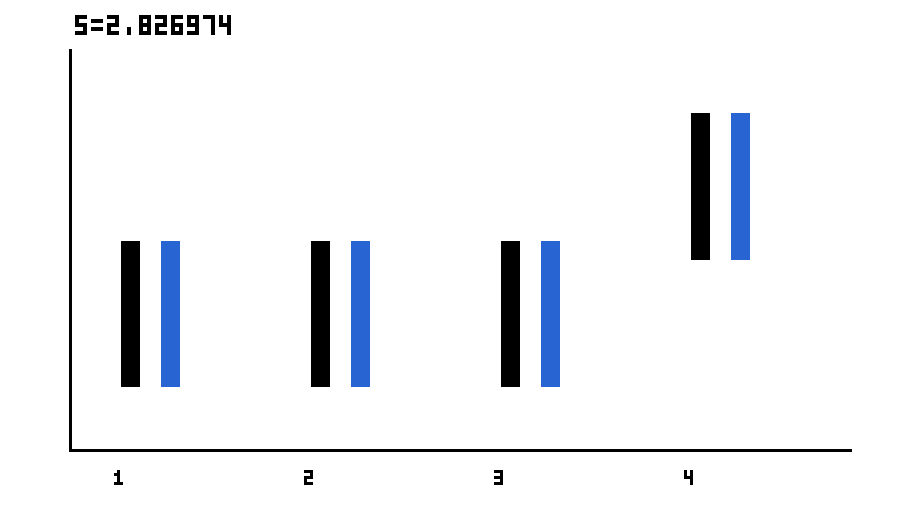
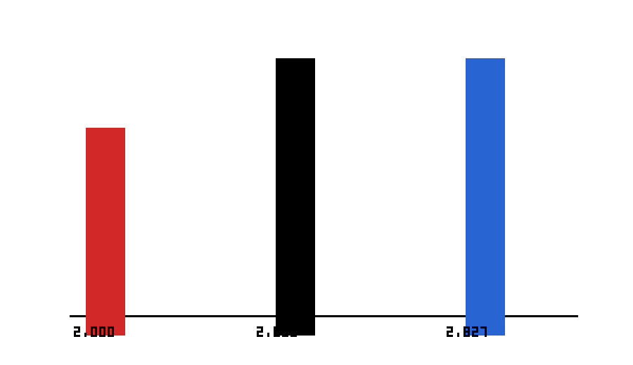
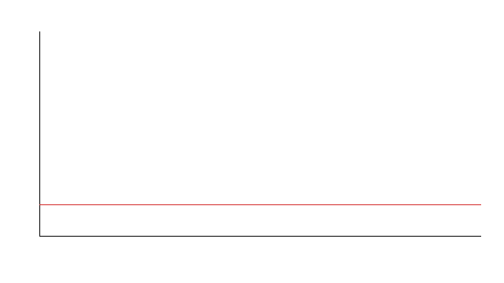
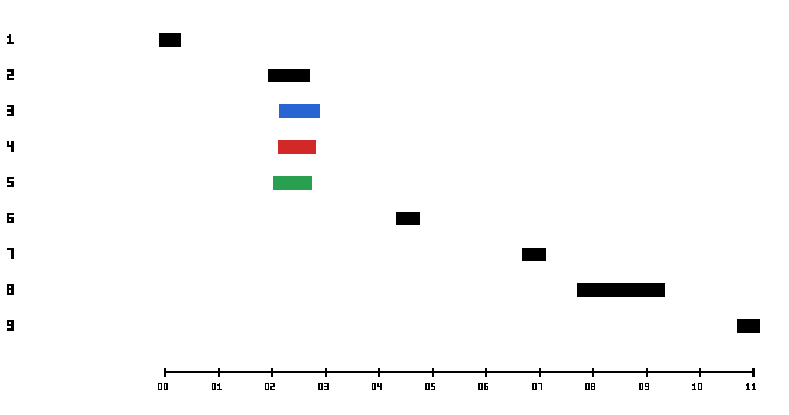

# CHSH singlet-correlation violation and local bound

This bounded workflow samples four ideal spin-singlet correlations and combines
their raw product sums into the CHSH statistic

`S = |E(a,b) + E(a,b') + E(a',b) - E(a',b')|`.

For `a=0`, `a'=π/2`, `b=π/4`, and `b'=-π/4`, quantum mechanics predicts
`S=2√2=2.8284271247461903`. The recorded AkôFlow run sampled one million pairs
per setting and obtained `S=2.826974`. An independent exhaustive branch checked
all 16 deterministic local assignments and recovered the local maximum `2`.





The [convergence animation](outputs/reference/convergence.gif) shows the sampled
statistic across fixed logarithmic checkpoints. The
[measured timeline](evidence/measured-timeline.png) shows overlap among the four
independent correlation activities.

## Reproduce

Build and run two deterministic offline preflights:

```sh
./build.sh
./preflight.sh
```

Import the portable Hub revision with this URI.

```text
akoflow://hub/publications/a6bbce30-c8ea-4169-bd51-3f82e1e959b5/versions/2
```

The imported workflow includes its Docker build context. The portable
reference run `community-chsh-singlet-portable-run-v2` completed all nine
activities and passed scientific validation.

Check the daemon payload, then submit the idempotent recorded run:

```sh
./run.sh
AKOFLOW_SUBMIT=1 ./run.sh
```

The workflow uses the immutable `python:3.11.14-slim-bookworm` base image and the
Python 3.11 standard library only. Scientific containers run with no network.
Seeds, trial counts, angles, equations, and expected tolerances are frozen in
`scenario.json` and enforced by `validation.json`.

## Measured execution

The four-slot daemon run `community-chsh-singlet-run-v1` completed all nine
activities in 10.576217 seconds. The four sampling runtimes shared a common
0.313193-second interval and used four distinct declared resources. A matched
one-slot daemon run, `community-chsh-singlet-run-one-slot-v1`, completed in
15.898394 seconds. The observed whole-workflow ratio was 1.503×; it is an
environment-specific operational measurement, not an algorithmic scaling claim.

## Scientific interpretation

This is a computational audit of the ideal correlation law. It distinguishes
the exact mathematical value, a finite deterministic Monte Carlo estimate, and
the deterministic local-strategy bound. It is not a laboratory Bell test and
does not model detector efficiency, locality, setting independence, accidental
coincidences, or any other experimental loophole. MT19937 is reproducible, not
cryptographically random.

## Citation, authorship, and license

Scientific reference: John F. Clauser, Michael A. Horne, Abner Shimony, and
Richard A. Holt, “Proposed Experiment to Test Local Hidden-Variable Theories,”
*Physical Review Letters* 23, 880–884 (1969),
[doi:10.1103/PhysRevLett.23.880](https://doi.org/10.1103/PhysRevLett.23.880).

The workflow implementation and generated artifacts are maintained by
UFFeScience for the AkôFlow Community Explorer and are licensed under the MIT
License. The cited paper is linked, not redistributed.

## Animation and measured execution




