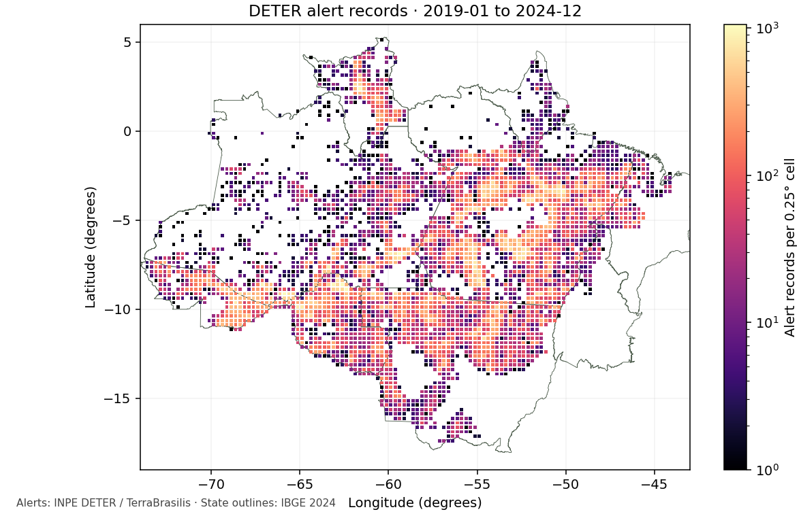
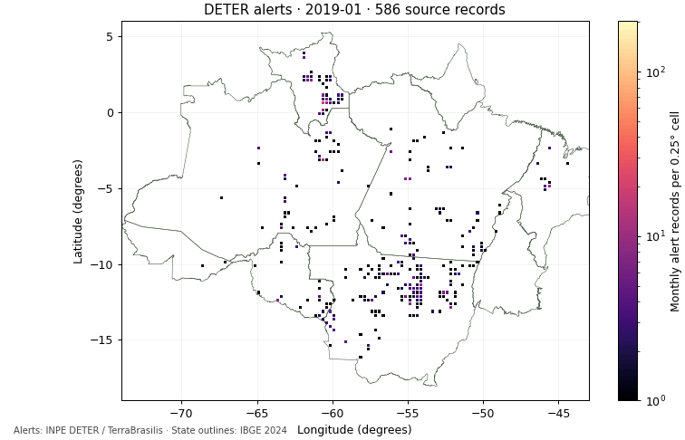
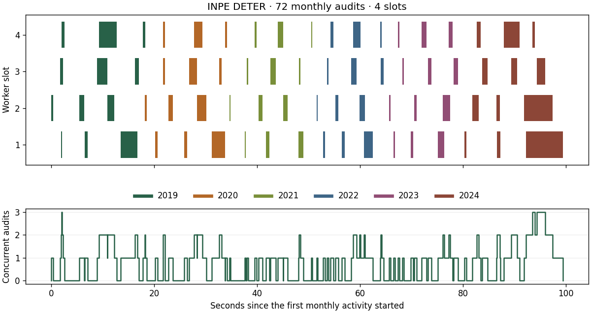

# INPE DETER monthly Amazon alert audit

[Issue #326](https://github.com/UFFeScience/akoflow-community-explorer/issues/326)

The input is INPE's anonymous TerraBrasilis layer `deter-amz:deter_amz`.
The [layer metadata and access details](evidence/qualification-sources.json)
record the applied CC BY-SA 4.0 license. Credit INPE and TerraBrasilis,
described by [Assis et al. (2019)](https://doi.org/10.3390/ijgi8110513).

Each partition covers one observation month using a closed start date and an
open end date. The provider reuses some identifiers for distinct observations.
The content SHA-256 of the entire record distinguishes those observations.
Validate municipal codes by matching their first two digits to the reported UF.

Report the source's municipal area as recorded. A separate geometric diagnostic
uses polygon coordinates and flags degenerate rings. Keep flagged features in
the source counts. The summed areas represent alert records, so the same area
can contribute more than once when alerts overlap or recur. Annual PRODES rates
use a separate product and method.

The frozen snapshot covers January 2019 through December 2024. The
[manifest](snapshot/manifest.json) records the date bounds, capture time,
feature count, and SHA-256 for every monthly archive. The
[independent qualification](evidence/qualification.json) found 334,054 records
and no missing reported area. The
[reference table](evidence/reference-by-month-state-class.csv) contains the
expected counts and reported area by observation month, state, and class.

```sh
python3 tools/freeze.py snapshot
python3 tools/qualify.py snapshot qualification
```

Capture resumes from each archive whose bytes match its recorded SHA-256.
Qualification checks the partitions and independently aggregates the records
by observation month, state, and class with SQLite.

## Run in AkôFlow

The portable image recipe fetches the 72 monthly archives and the IBGE state
outlines from the pinned snapshot commit during image preparation. It verifies
each archive before allowing any audit activity to start. The benchmark uses
the same 72 month activities in each 1-, 4-, and 8-slot plan.

```sh
./run.sh
AKOFLOW_SUBMIT=1 ./run.sh
```

The aggregate activity checks the output inventory, compares counts and source
areas against the SQLite reference, and emits a CSV, a diagnostics CSV, a
reference map, and a monthly animation.

## Local pilot

The local pilot processed all 334,054 records, matched the SQLite reference
across 2,491 groups, and generated 72 animation frames. The map counts alert
records in 0.25° cells using the center of each valid geometry's bounding box.
Geometry anomalies remain in the tabular alert counts.





[Monthly table](outputs/deter-month-state-class.csv) ·
[Diagnostics](outputs/deter-monthly-diagnostics.csv) ·
[Local pilot validation](evidence/local-pilot-validation.json)

## Daemon reference

The four-slot reference run completed all 74 activities and reproduced the
four scientific output hashes from the pilot. The timeline shows the actual
worker assignments and simultaneous monthly audits.



[Daemon activity trace](evidence/reference-run.json) ·
[Daemon validation](evidence/reference-validation.json)

## Scheduling comparison

The 1-, 4-, and 8-slot runs each completed all 74 activities and produced
identical scientific outputs. Eight slots reached five simultaneous monthly
audits and ran in 126.6 seconds after preparation, compared with 297.0 seconds
with one slot. Both the measurements and the observed overlap describe this
shared host.

[Measured durations and transfers](outputs/profile-summary.csv)

The comparison used the original recipe with the manifest and verification
table included in the build context. The compact recipe fetches those same
files by immutable URL and checks their SHA-256 before execution.

The compact portable reference `community-inpe-deter-portable-run-4-v1`
subsequently completed all 74 activities in 153.84 seconds. Its four result
artifacts are byte-identical to the pilot and scheduling runs. This is the
reference to use for publication; the earlier timing runs remain the evidence
for the matched one-, four-, and eight-slot comparison.

[Compact portable reference](evidence/portable-reference.json)
