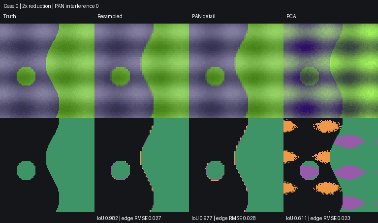
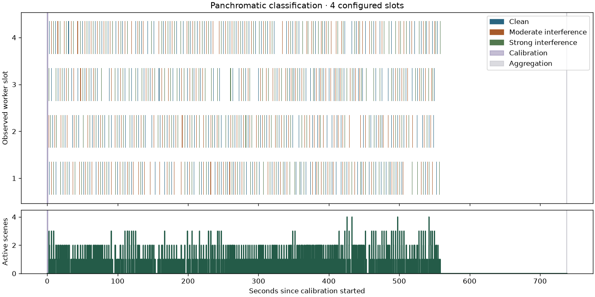

# Pansharpening and crop classification

This synthetic experiment is inspired by Bendini et al. at INPE,
[Effects of Image Fusion Methods on Sugarcane Classification with
Landsat-8 Imagery](https://www.esensing.org/papers/paper_104.pdf), SBSR 2015.
It studies how edge reconstruction and downstream classification can
change in different directions. The code and generated scenes use MIT.

The manifest crosses 64 disjoint test seeds, four resolution factors, and
three PAN interference levels. Eight separate seeds calibrate the
three-band class centroids for each treatment and condition. Each case
compares resampling, additive detail injection, and replacement of the
first principal component. It reports finite-difference edge error,
per-band spectral RMSE, and target IoU for a fixed rule and the calibrated
classifier.

```sh
python3 fusion.py calibrate centroids.json
python3 fusion.py case 0 centroids.json case-000.csv
```

The local numerical check reproduced the expected reversal in all 256
zero-interference cases. The AkôFlow scheduling
measurements, and Hub publication remain pending.

## Local pilot artifacts

The panels compare the high-resolution truth and three treatments for
seed 0 at 2× reduction. The upper row uses a fixed reflectance scale.
The lower row shows centroid classification, with green for a correct
target pixel, orange for a false positive, and purple for a false
negative. Labels report target IoU and edge RMSE. The animation holds the
scene and resolution fixed and varies PAN interference across the three
registered levels.


[Download pilot metrics for all three treatments and 768 scenes](evidence/pilot-metrics.csv).

## Measured AkôFlow reference

The four-slot reference completed 770 activities, including a separate
calibration, 768 scene comparisons and the aggregate. The results contain
2,304 method measurements and 36 condition summaries.






[Per-scene metrics](evidence/reference/scene-metrics.csv) ·
[Condition summaries](evidence/reference/condition-summary.csv) ·
[Calibration centroids](evidence/reference/centroids.json) ·
[Reference evidence](evidence/reference/reference-run.json).

## AkôFlow workflow

Register the portable build and generate the full 770-activity DAG,
which runs calibration once, fans out to 768 scenes, then aggregates.

```sh
recipe=$(./register-recipe.sh)
python3 generate.py "$recipe"
./run.sh
```

Set `AKOFLOW_SUBMIT=1` after preflight to execute. The short workflow
uses the first four test seeds and all 12 conditions at each of 1, 4
and 8 slots. Generate it with `python3 generate.py "$recipe" --cases 48`.
On submission set `AKOFLOW_WORKFLOW_ID=community-panchromatic-classification-profile-v1`,
`AKOFLOW_PLAN_FILE=plan-N.yaml` and
`AKOFLOW_PLAN_ID=community-panchromatic-classification-profile-v1-plan-N`,
where N is the number of slots. Use distinct run IDs for the profiles.
Regenerate the full workflow before using its plans again.

The [compact build evidence](evidence/compact-build-preflight.json) records
the 682-byte build context, offline validation against the local pilot,
and daemon preflights for both the full workflow and all short schedules.

Run `python3 profile.py "$recipe" /path/to/evidence` to execute or resume
the full four-slot reference and the short profiles. The collector checks
calibration dependencies, exact artifact inventory, and matching
calibration, scene, and aggregate checksums across the short runs. Its
timing summary separates calibration, scene processing, aggregation
preparation, and aggregation execution.

Use `python3 render-timeline.py <completed-profile.json> <timeline.png>`
with Matplotlib to visualize the measured scene concurrency by
interference level. The figure marks calibration and aggregation and
validates dependency ordering and captured peak concurrency.

Run `python3 verify-hub-import.py "$uri" /path/to/reference.json /path/to/clean-evidence`
against a daemon with empty workflow and image stores. It imports the workflow
from the URI, requires preflight to request the build, and checks that the
calibration, all 768 per-scene CSVs, and four aggregate artifacts match the
reference checksums.
