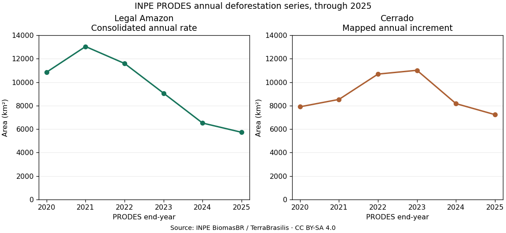
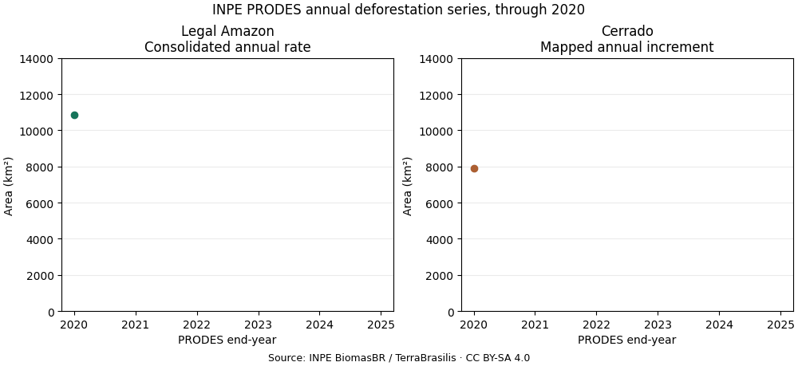
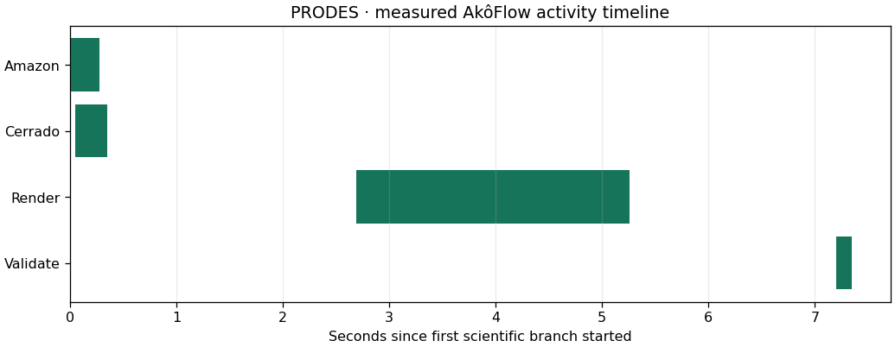

# INPE PRODES annual deforestation series audit

This workflow reconstructs six annual observations from each of two official
TerraBrasilis dashboard snapshots. The Legal Amazon series reports consolidated
annual rates. The Cerrado series reports mapped annual increments. The reporting
areas and measures differ, so each series is plotted and validated independently.

## Sources and authors

Luiz Felipe F. G. Assis, Karine R. Ferreira, Lubia Vinhas, Luis Maurano, Alexandre
Almeida, André Carvalho, Jim Jones Rodrigues, Adeline Maciel, and Cláudio Camargo,
*TerraBrasilis: A Spatial Data Analytics Infrastructure for Large-Scale Thematic
Mapping*, ISPRS International Journal of Geo-Information 8(11), 513, 2019.
[DOI](https://doi.org/10.3390/ijgi8110513)

The input data come from INPE BiomasBR / PRODES via TerraBrasilis. The inputs and
derived data are attributed to INPE and shared under CC BY-SA 4.0. The workflow
implementation is by the AkôFlow Community Explorer.
[Official attribution and license](https://terrabrasilis.dpi.inpe.br/citacoes-e-licenca-de-uso/)

## Scenario and workflow

The pinned snapshots cover PRODES end-years 2020–2025. Each reporting period
starts on 1 August of the preceding year and ends on 31 July. Each branch checks
the snapshot digest, reporting dates, the expected number of locations, and
published reference values. The Amazon branch expects nine locations per year.
The Cerrado branch expects 13. Each branch sums type-1 areas at reporting level
1, using decimal arithmetic.

The two reductions are independent and assigned to separate CPU slots. A
downstream step builds the two-panel visualization and combined CSV. The final
activity verifies all 12 rows, checks the published numerical targets, decodes the
PNG and all six GIF frames, and records output SHA-256 digests.

## Run

To build and reproduce the image locally from the workflow directory:

```sh
docker build -f docker/Dockerfile -t community-prodes:v1 .
```

To preflight the two-slot plan on a local AkôFlow daemon:

```sh
./run.sh
AKOFLOW_SUBMIT=1 ./run.sh
```

The portable workflow embeds a pinned Python base image recipe, the two
compressed snapshots, and the analysis scripts. Snapshot acquisition and hashes
are documented in [data/README.md](data/README.md).

## Results and validation

The acceptance targets are 6,518 km² and 5,731 km² exactly for the Legal Amazon in
2024 and 2025, and 8,174 km² within 0.5 km² for the Cerrado in 2024. The tolerance
accounts for rounding in the official table.
[INPE consolidated Amazon release](https://www.gov.br/inpe/pt-br/assuntos/ultimas-noticias/sistema-do-inpe-aponta-5-731-km2-de-desmatamento-na-amazonia-em-2025)
[Government Cerrado table](https://www.gov.br/fazenda/pt-br/assuntos/noticias/2026/julho/arquivo/coletiva_de_imprensa_transformacao_ecologica_em_numeros.pdf)

The workflow produces `prodes-annual.csv`, `prodes-annual.png`,
`prodes-annual.gif`, and `validation.json`. The GIF adds one observed reporting
year per frame. This audit starts from published dashboard aggregates and is
limited to reproducing those values from the pinned release.

## Recorded execution and gallery

Run `community-prodes-run-v1` completed all four activities and passed scientific
validation. The Amazon and Cerrado reductions overlapped for 0.228 seconds on
separate CPU slots. The run lasted about 54 seconds including image preparation.
The recorded 2024 Cerrado increment was 8,174.1679 km².







The [CSV](outputs/prodes-annual.csv), [validation report](evidence/validation.json),
and [execution timing](evidence/daemon-run.json) are available as downloads.
The gallery reproduces the same figure and animation digests recorded by the
daemon validator.
