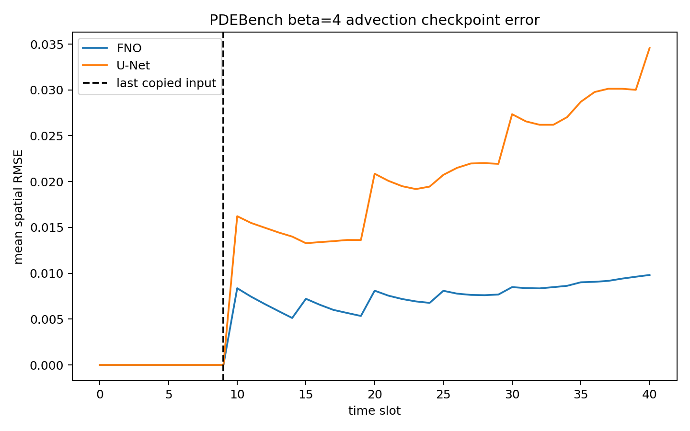
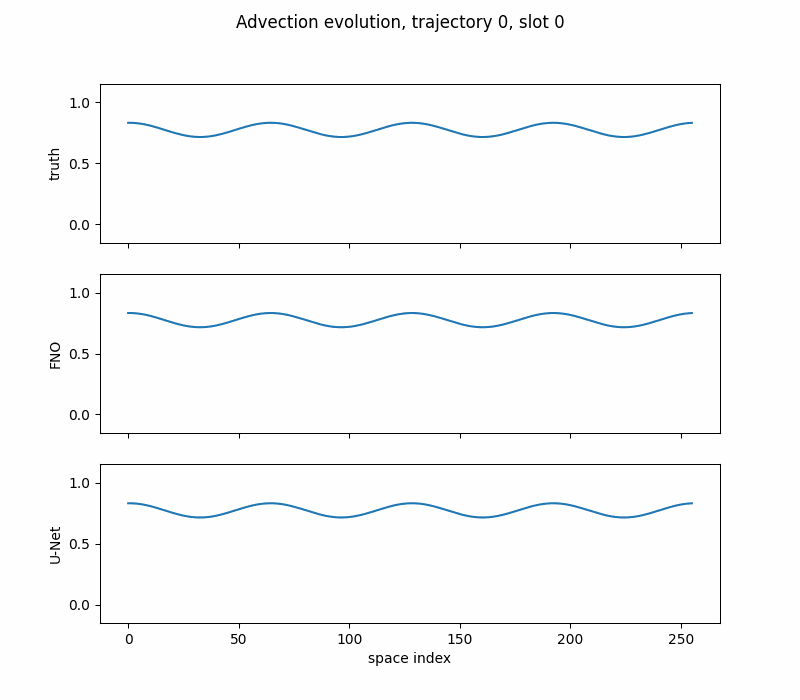
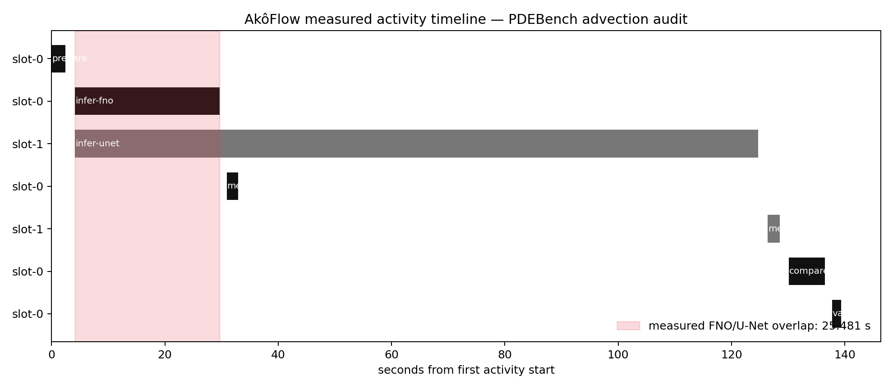

# PDEBench 1D advection checkpoint audit

This workflow asks whether the released PDEBench 2022 FNO and U-Net
checkpoints reproduce the NeurIPS 2022 `beta=4.0` one-dimensional advection
result. It independently reads the frozen tensor, performs autoregressive
rollout, and computes the historical all-slot and predicted-slot metrics. It
does not use the NEC-restricted PDEBench loader or metric utilities.

## Validated result

The AkôFlow daemon run `community-pdebench-advection-run-v2` completed all
seven activities with workflow version `community-pdebench-advection-v1-v1`.
It used image
`sha256:0efafedf6d9379f9587ad4afa66dfec116ad914cb34796e05cf5dc71b7ef5c6e`
on two one-thread CPU slots.

| Model | all-slot nRMSE | predicted-slot nRMSE | RMSE | acceptance |
| --- | ---: | ---: | ---: | --- |
| FNO | 0.010003876872360706 | 0.013230935670435429 | 0.005804696120321751 | pass |
| U-Net | 0.029358740895986557 | 0.03882930800318718 | 0.016253985464572906 | pass |

FNO rounds to the paper's `1.0e-2`. The released U-Net checkpoint rounds to
`2.9e-2`, not the printed `2.6e-2`; this is the audited artifact result, not a
failed attempt to tune the checkpoint toward the table.

The daemon measured a 139.392307 s makespan, 160.610609 activity-seconds, and
252,142,168 transferred bytes. FNO and U-Net inference overlapped for
25.480750 s (`1795375406.8761938` through `1795375432.356944`). This proves
concurrent scientific work only. No parallel speedup is claimed because no
matching one-slot run was performed.

## Inputs and reproducibility

The bounded input contains the HDF5 header and first 1,000 contiguous
trajectories from DaRUS dataset `10.18419/darus-2986` version 1.0, file ID
`133113`. `input-manifest.json` records its source size, bounded range, and
SHA-256 together with the two released checkpoint identities. Inputs are
staged during image preparation and are excluded from Git. Runtime containers
have no network, credentials, or host Docker socket.

```sh
./build.sh
./preflight.sh
./run.sh
AKOFLOW_RUN_ID=community-pdebench-advection-run-v2 AKOFLOW_SUBMIT=1 ./run.sh
```

The local preflight runs the complete workflow twice offline and requires
scalar metrics to agree within `1e-7`. It is a portability check, not execution
evidence. The importable AkôFlow definitions are `environment.yaml`,
`scope.yaml`, `topology.yaml`, `workflow.yaml`, and `plan.yaml`.

## DAG and outputs

After `prepare` verifies every input checksum, `infer-fno` and `infer-unet` run
independently. Each feeds its own metrics stage; `compare` then produces the
model-error figure and field-evolution animation, and `validate` enforces the
pre-registered tolerances and hashes. `evidence/measured-timeline.png` is
rendered only from daemon timestamps.

Key recorded checksums are:

| Artifact | SHA-256 |
| --- | --- |
| FNO prediction | `c4ae7fe1d1588407751539ff54cfcd82e60739bb7854ba19c910bc1838a6b46e` |
| U-Net prediction | `0ed0a0bd6946cb6c7172d831848ac4a255573fe0371b71a516a9a3b6ebccfcf2` |
| comparison figure | `b5be1adf43c645631a12f47dc5d14cdf25578a54fdccee17f3ad44731f7106aa` |
| evolution animation | `7a9b59e2729f762c5670ef4b3a36804ae6e374891ca22b7026dfeb88e516c5e9` |
| daemon validation | `29df137e9214380e7c5e2f7a2664d7a3b79782273520e29180c34e2a6fab9e33` |

## Citation and licenses

Makoto Takamoto, Timothy Praditia, Raphael Leiteritz, Daniel MacKinlay,
Francesco Alesiani, Dirk Pflüger, and Mathias Niepert, “PDEBench: An Extensive
Benchmark for Scientific Machine Learning,” NeurIPS 2022 Datasets and
Benchmarks Track, <https://doi.org/10.52202/068431-0117>.

The DaRUS data and released weights are CC BY 4.0. The independently adapted
FNO/U-Net architecture files retain the upstream MIT notice in `LICENSE`; this
workflow is MIT licensed. The implementation does not redistribute or derive
from PDEBench files carrying the NEC restricted license.

## Limitations

This is a released-checkpoint audit, not training reproduction. It evaluates
only the frozen 2022 `beta=4.0` first-1,000 population. The historical all-slot
metric includes the ten copied input slots, so the predicted-slot metric is
reported separately. Results do not apply to later regenerated PDEBench data,
other advection coefficients, accelerators, or training configurations.

## Measured result gallery






