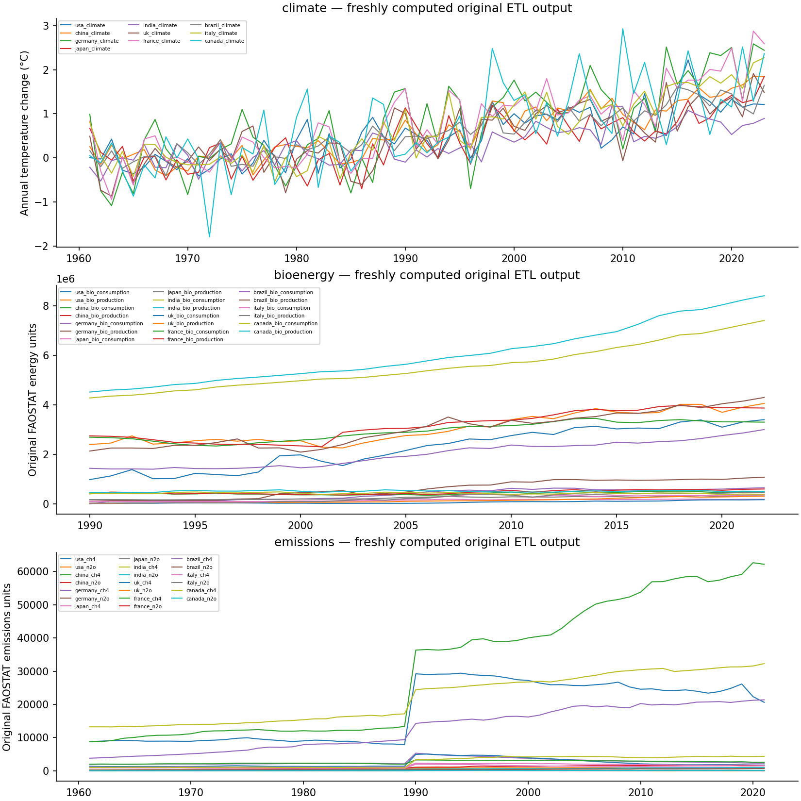
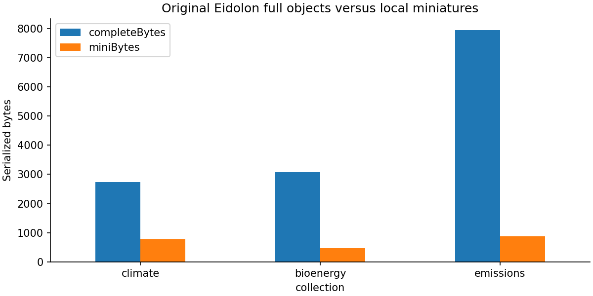
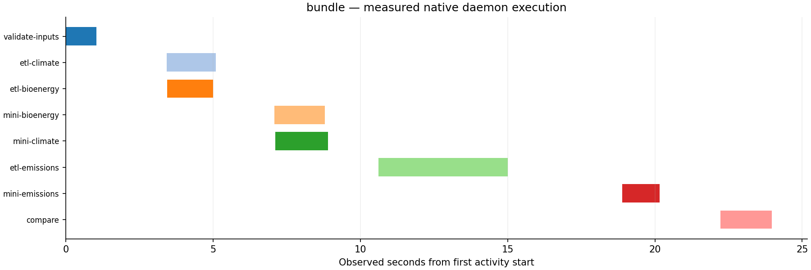

# Eidolon — reproducible scientific data collections

Conference tags: `bresci`, `bresci-2026`. [Browse BreSci on the Hub](https://hub.akoflow.com/categories/bresci).

Adapted from **XX Brazilian e-Science Workshop (BreSci 2026), co-located with SBBD**. Original authors: **Lucas Calmon, Marcus Junior, Lucas Santos, Fernando Alexandrino, Rafaelli Coutinho, Gustavo Guedes, Diego Carvalho, Eduardo Ogasawara**.

[Original paper](https://sol.sbc.org.br/index.php/bresci/article/view/44071) · [Original code and data](https://github.com/cefet-rj-dal/tspredbench)

## Scientific scope

Run the original R ETLs for the complete climate, bioenergy and emissions source tables, followed by the original miniature-generation script. Each newly generated complete R object is compared semantically with the authors’ published full object at the same commit; published objects are references only, never substituted for ETL output. This is a three-collection instantiation of Eidolon, not every collection or remote publication. Origin: FAOSTAT https://www.fao.org/faostat/en/#data/ET , https://www.fao.org/faostat/en/#data/BE and https://www.fao.org/faostat/en/#data/GT . Code is MIT; source data retain FAO terms. Three independent ETL branches and three dependent miniaturization activities expose real parallelism.

This is an adaptation of the cited scientific application to native AkôFlow activities. It is not a claim of exact agreement with the paper. Source URLs, immutable revisions and input SHA-256 hashes are recorded in `data/sources.json` and `data/acquisition.json`. Original authors retain authorship of the scientific methods and artifacts; the AkôFlow contribution is orchestration, packaging and validation.

Bioenergy values are in **TJ**; emissions are in **kt of the gas named in each series**. Temperature change is in °C, as recorded by FAOSTAT.

## Execute

[Original input URL manifest](data/sources.json) · [Verified input SHA-256 receipts](data/acquisition.json) · [Scientific provenance](data/provenance.json)

```sh
./prepare.sh
./run.sh
```

Preparation acquires original inputs and builds the image. All computation then executes with networking disabled. No synthetic fallback replaces unavailable original data. `AKOFLOW_PARALLEL` controls standalone concurrency.

To register and execute in Desktop through the local daemon, from the repository root:

```sh
go run ./tools/daemon-local -example scientific-workflows/eidolon -env-file /path/to/installation.env -api-url http://YOUR_DAEMON:8080/akoflow-api -lanes 3
```

Tracking item: [AKO-46](https://github.com/UFFeScience/akoflow-examples/issues/46).

The daemon records the exact image and execution identity in `evidence/daemon-run.json`. `workflow.yaml` declares dependencies and explicit artifact transfers. `outputs/scientific-validation.json` contains semantic checks and findings. A successful exit alone is not a scientific validation.

## Results

Native daemon run `eidolon-local-ba2593ae8f-run-20261117t150749.138605490` completed **8/8 activities**. Scientific figures below were generated by the completed daemon run, verified against its artifact SHA-256 hashes, and copied without editing. The execution timeline is derived from observed native activity start/finish times. All figures show measured results.

Findings:

```json
{
  "collections": [
    {
      "collection": "climate",
      "fullSeries": 10,
      "observations": 630,
      "referenceAgreement": true,
      "miniSeries": 1,
      "completeBytes": 2729,
      "miniBytes": 770
    },
    {
      "collection": "bioenergy",
      "fullSeries": 20,
      "observations": 660,
      "referenceAgreement": true,
      "miniSeries": 1,
      "completeBytes": 3070,
      "miniBytes": 468
    },
    {
      "collection": "emissions",
      "fullSeries": 20,
      "observations": 1220,
      "referenceAgreement": true,
      "miniSeries": 1,
      "completeBytes": 7941,
      "miniBytes": 870
    }
  ],
  "originalRCodeExecuted": true,
  "allFullObjectsMatchPinnedPublishedReferences": true
}
```





## Observed parallel execution

The native run completed 8 activities in **23.97 seconds**, with **2 overlapping activities** at peak. These are execution observations, not a measured speedup against a sequential baseline.



Python dependency versions from the measured image are retained in [`evidence/python-packages.txt`](evidence/python-packages.txt). Independent post-run validation is recorded in [`evidence/independent-validation.json`](evidence/independent-validation.json).

To regenerate the execution timeline from an observed run, mount this bundle at `/bundle` in its measured image and run `python /bundle/expected/render_execution.py`. The renderer uses `evidence/daemon-run.json`; predicted schedule times are excluded.
