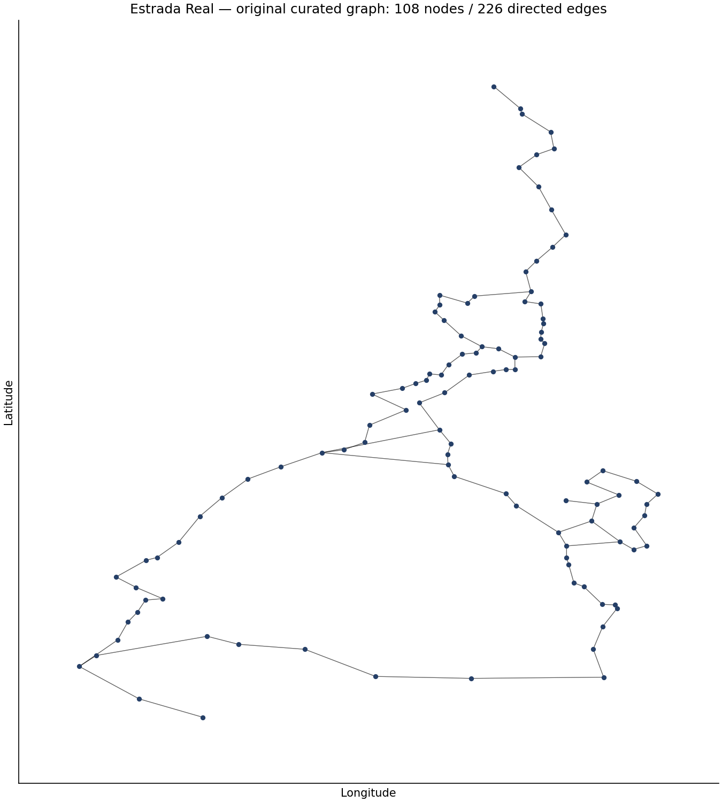
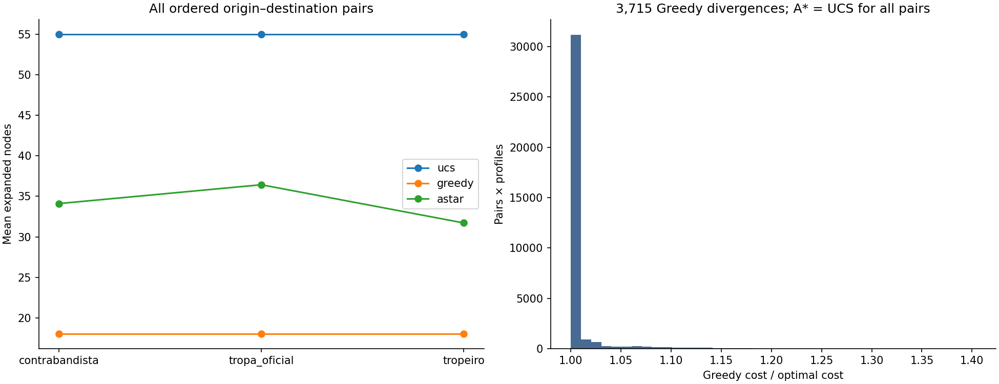
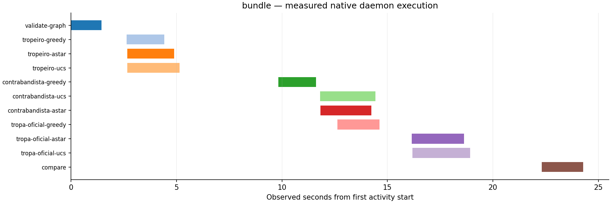

# Estrada Real — informed search on a curated historical graph

Adapted from **XX Brazilian e-Science Workshop (BreSci 2026), co-located with SBBD**. Original authors: **Davi Machado da Rocha**.

[Original paper](https://sol.sbc.org.br/index.php/bresci/article/view/44084) · [Original code and data](https://zenodo.org/records/20867698)

## Scientific scope

Re-execute the original UCS, Greedy and A* notebook functions over the complete frozen curated graph: 108 nodes, 226 directed edges, all 11,556 distinct ordered origin–destination pairs for each of three original cost profiles. Nine independent search activities produce 104,004 searches. This reproduces the search stage, not the upstream geographic source reconstruction. The paper reports 3,715 Greedy divergences; the workflow measures and reports actual agreement. Original data deposit: https://doi.org/10.5281/zenodo.20867698. Deposit metadata states CC BY 4.0; its README contains provisional code-license wording, so no broader code redistribution license is inferred.

This is an adaptation of the cited scientific application to native AkôFlow activities. It is not a claim of exact agreement with the paper. Source URLs, immutable revisions and input SHA-256 hashes are recorded in `data/sources.json` and `data/acquisition.json`. Original authors retain authorship of the scientific methods and artifacts; the AkôFlow contribution is orchestration, packaging and validation.

## Execute

[Original input URL manifest](data/sources.json) · [Verified input SHA-256 receipts](data/acquisition.json) · [Scientific provenance](data/provenance.json)

```sh
./prepare.sh
./run.sh
```

Preparation acquires original inputs and builds the image. All computation then executes with networking disabled. No synthetic fallback replaces unavailable original data. `AKOFLOW_PARALLEL` controls standalone concurrency.

To register and execute in Desktop through the local daemon, from the repository root:

```sh
go run ./tools/daemon-local -example scientific-workflows/estrada-real -env-file /path/to/installation.env -api-url http://YOUR_DAEMON:8080/akoflow-api -lanes 3
```

Tracking item: [AKO-46](https://github.com/UFFeScience/akoflow-examples/issues/46).

The daemon records the exact image and execution identity in `evidence/daemon-run.json`. `workflow.yaml` declares dependencies and explicit artifact transfers. `outputs/scientific-validation.json` contains semantic checks and findings. A successful exit alone is not a scientific validation.

## Results

Native daemon run `estrada-real-local-0c3426a638-run-20261117t145937.986646313` completed **11/11 activities**. Scientific figures below were generated by the completed daemon run, verified against its artifact SHA-256 hashes, and copied without editing. The execution timeline is derived from observed native activity start/finish times. All figures show measured results.

Findings:

```json
{
  "nodes": 108,
  "directedEdges": 226,
  "searches": 104004,
  "greedyDivergences": 3715,
  "paperGreedyDivergences": 3715,
  "paperCountMatches": true,
  "astarUcsAgreementPairs": 34668,
  "originalNotebookCells": [
    19,
    34,
    36
  ]
}
```





## Observed parallel execution

The native run completed 11 activities in **24.29 seconds**, with **3 overlapping activities** at peak. These are execution observations, not a measured speedup against a sequential baseline.



Python dependency versions from the measured image are retained in [`evidence/python-packages.txt`](evidence/python-packages.txt). Independent post-run validation is recorded in [`evidence/independent-validation.json`](evidence/independent-validation.json).

To regenerate the execution timeline from an observed run, mount this bundle at `/bundle` in its measured image and run `python /bundle/expected/render_execution.py`. The renderer uses `evidence/daemon-run.json`; predicted schedule times are excluded.
