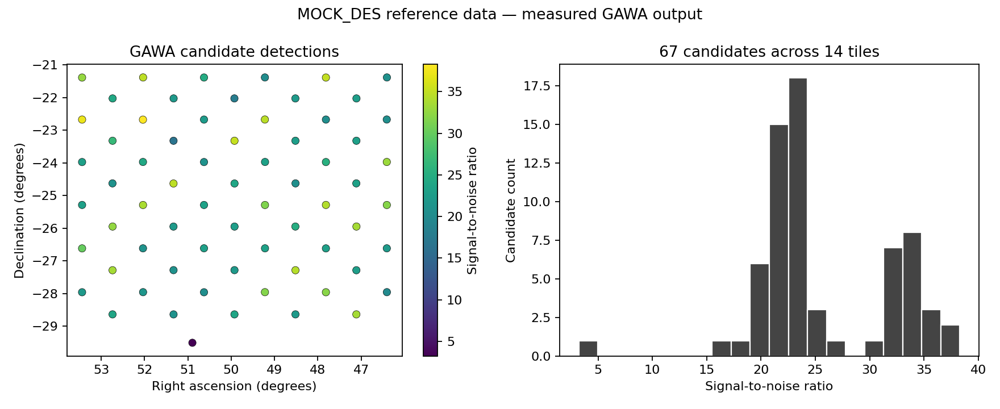

# GAWA — Stellar Cluster Detection

Detect stellar-system candidates in the bundled MOCK_DES star catalog with
isochrone masks and wavelet filtering. GAWA is developed by the original
[GAWA project](https://github.com/linea-it/gawa); the
[UFFeScience fork](https://github.com/UFFeScience/gawa) adds tile-level execution.

## Workflow

Preparation creates the survey tiling and common masks. Four execution slots
process the **14 tiles**, one activity per tile, followed by global consolidation
and validation. The workflow contains **16 activities**. Distance slices remain
inside their tile activity. This single-host profile shares a run-scoped directory
through the Akoflow daemon workspace volume; it is not a multi-host storage profile.

## Measured reference execution

The homeserver Docker-backed run completed **16/16 activities in 428 seconds
(7 minutes 8 seconds)** with **four simultaneous tile activities**, confirmed
from their observed start/end intervals. Hardware: Intel Core i7-1165G7,
4 physical cores / 8 logical CPUs, about 31 GiB RAM. The manual plan predictions
are placeholders; the reported duration is measured wall time.

Outputs: **67 candidate detections**, FITS and CSV catalogs, validation records,
and **91 PNG diagnostic images** including the catalog preview below. Coordinates
and signal-to-noise values are finite and in valid ranges. All numeric catalog
columns match the bundled 67-candidate reference within numerical tolerance
(rtol 1e-8, atol 1e-10); SNR and right ascension match exactly, maximum declination
difference is 3.56e-15 degrees. This is a regression comparison against the bundled
reference, not a new measurement of scientific completeness or purity. The input
is a mock dataset, and candidate detections are not confirmed sky discoveries.



## Reproduce

Build the image from this public source bundle; this path needs no GHCR login:

```bash
./prepare.sh
```

Import `workflow.yaml` together with `environment.yaml`, `scope.yaml`, and
`topology.yaml` in Akoflow. Create a plan using four separate resource slots on
the local Docker host, then execute. The daemon must mount its shared workspace
volume at `/akoflow/workspace`. Four fixed tile dependency chains cap concurrency;
a single plan lane will serialize activities. Start every experiment as a new run.
Each tile declares one CPU and 4 GiB as an initial resource limit, not a measured
minimum. The final task copies the result tree into its observed artifact workspace.

The official image is also available as `ghcr.io/uffescience/gawa:tiles-v1`, but
UFFeScience currently blocks public packages, so GHCR pulls require authentication.
The recorded run used a locally built image; its exact image identifier and source
hashes are recorded in `outputs/execution-summary.json` and `evidence/provenance.json`.

## Results

- [FITS catalog](outputs/clusters.fits) and [CSV catalog](outputs/clusters.csv).
- [Numeric validation](outputs/validation.json).
- [Measured execution and concurrency](outputs/execution-summary.json).
- [Bundled reference comparison](outputs/reference-comparison.json).
- [Download all diagnostic images and validated result files](https://github.com/UFFeScience/gawa/releases/download/showcase-v1/gawa-results.tar.gz).

[Open the Hub publication and native execution capture](https://hub.akoflow.com/o/akoflow/scientific-workflows-gawa).

## Provenance and runtime correction

Scientific source revision: `UFFeScience/gawa@1055838`. The base scientific
container is pinned by digest in `docker/Dockerfile`; star catalogs and masks are
bundled with that image. Original data/source terms still apply; publishing this
bundle does not grant additional rights to redistribute upstream data.

A preflight attempt exposed a segmentation fault in legacy `mr_filter` with long
workspace filenames. The published source passes short filenames using an explicit
working directory and the same filter parameters. The successful run and reference
comparison above use this correction. The failed attempt is not presented as a result.
