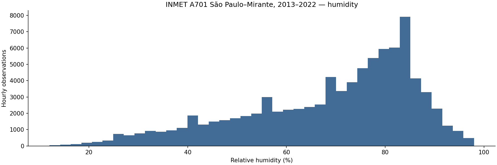
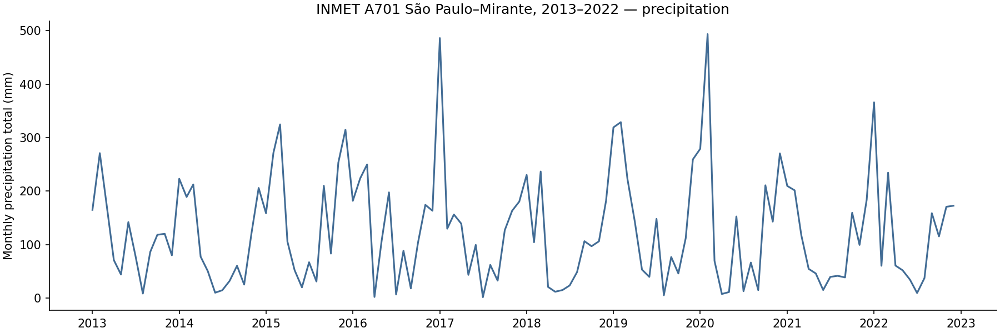
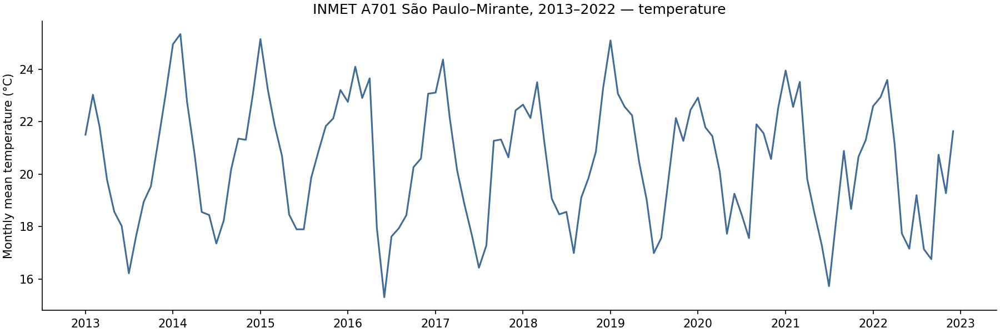
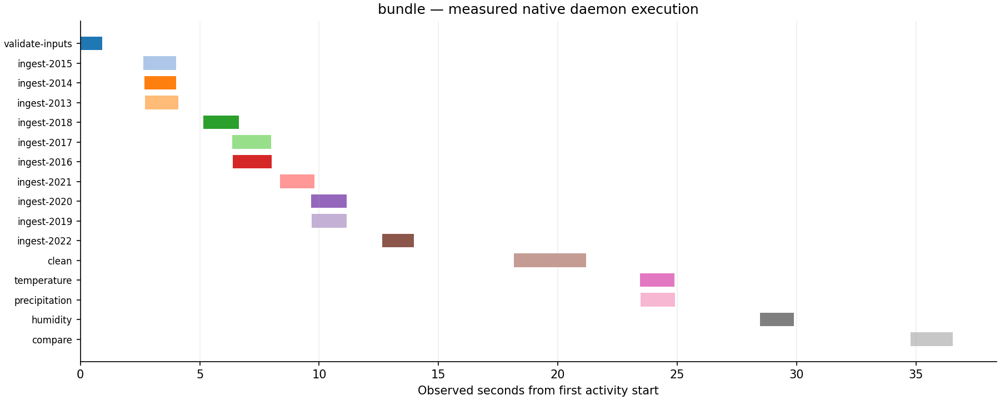

# INMET — São Paulo meteorological observations, 2013–2022

Adapted from **XIX Brazilian e-Science Workshop (BreSci 2025), co-located with SBBD**. Original authors: **Rosa Virginia Encinas Quille, Felipe Valencia de Almeida, Danielle Monteiro, Pedro Luiz Pizzigatti Corrêa**.

[Original paper](https://sol.sbc.org.br/index.php/bresci/article/view/36912) · [Original code and data](https://zenodo.org/records/16864784)

## Scientific scope

Process all original hourly CSVs for São Paulo–Mirante station A701 from 2013 through 2022, the station and period illustrated by the paper. Execute the original notebook ingestion/normalization and cleaning definitions (cells 16 and 20), then generate noninteractive temperature, precipitation and humidity analyses. Yearly ingestion activities are independent; the original cleaning runs once after concatenation, preserving cross-year filling. Raw inputs come from the nested dataset.zip in the original Zenodo deposit, acquired by verified ZIP members through HTTP byte ranges. The entire 1.92 GB parent archive is not downloaded or claimed to have a newly verified global hash; extracted member CRC and SHA-256 are checked. Original notebook and data: CC BY 4.0. INMET source portal: https://portal.inmet.gov.br/dadoshistoricos . No processed author outputs are used as computation inputs.

This is an adaptation of the cited scientific application to native AkôFlow activities. It is not a claim of exact agreement with the paper. Source URLs, immutable revisions and input SHA-256 hashes are recorded in `data/sources.json` and `data/acquisition.json`. Original authors retain authorship of the scientific methods and artifacts; the AkôFlow contribution is orchestration, packaging and validation.

## Execute

[Original input URL manifest](data/sources.json) · [Verified input SHA-256 receipts](data/acquisition.json) · [Scientific provenance](data/provenance.json)

```sh
./prepare.sh
./run.sh
```

Preparation acquires original inputs and builds the image. All computation then executes with networking disabled. No synthetic fallback replaces unavailable original data. `AKOFLOW_PARALLEL` controls standalone concurrency.

To register and execute in Desktop through the local daemon, from the repository root:

```sh
go run ./tools/daemon-local -example scientific-workflows/inmet -env-file /path/to/installation.env -api-url http://YOUR_DAEMON:8080/akoflow-api -lanes 3
```

Tracking item: [AKO-46](https://github.com/UFFeScience/akoflow-examples/issues/46).

The daemon records the exact image and execution identity in `evidence/daemon-run.json`. `workflow.yaml` declares dependencies and explicit artifact transfers. `outputs/scientific-validation.json` contains semantic checks and findings. A successful exit alone is not a scientific validation.

## Results

Native daemon run `inmet-local-1514940793-run-20261117t151423.285983342` completed **16/16 activities**. Scientific figures below were generated by the completed daemon run, verified against its artifact SHA-256 hashes, and copied without editing. The execution timeline is derived from observed native activity start/finish times. All figures show measured results.

Findings:

```json
{
  "rawRows": 87648,
  "cleanedRows": 87252,
  "removedRows": 396,
  "station": "A701",
  "start": "2013-01-01 00:00:00",
  "end": "2022-12-31 23:00:00",
  "originalNotebookCells": [
    16,
    20
  ],
  "variables": {
    "temperature": {
      "observations": 87252,
      "minimum": 4.1,
      "maximum": 37.3,
      "mean": 20.490728006234818
    },
    "precipitation": {
      "observations": 87252,
      "minimum": 0.0,
      "maximum": 77.8,
      "mean": 0.1712808875441251
    },
    "humidity": {
      "observations": 87252,
      "minimum": 12.0,
      "maximum": 98.0,
      "mean": 68.80686975656718
    }
  }
}
```







## Observed parallel execution

The native run completed 16 activities in **36.55 seconds**, with **3 overlapping activities** at peak. These are execution observations, not a measured speedup against a sequential baseline.



Python dependency versions from the measured image are retained in [`evidence/python-packages.txt`](evidence/python-packages.txt). Independent post-run validation is recorded in [`evidence/independent-validation.json`](evidence/independent-validation.json).

To regenerate the execution timeline from an observed run, mount this bundle at `/bundle` in its measured image and run `python /bundle/expected/render_execution.py`. The renderer uses `evidence/daemon-run.json`; predicted schedule times are excluded.
