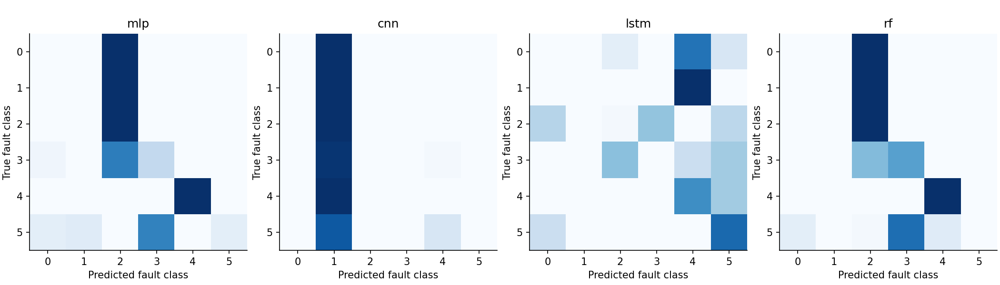
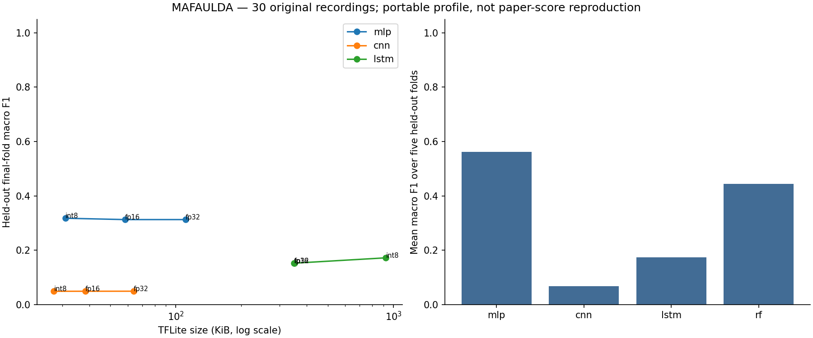
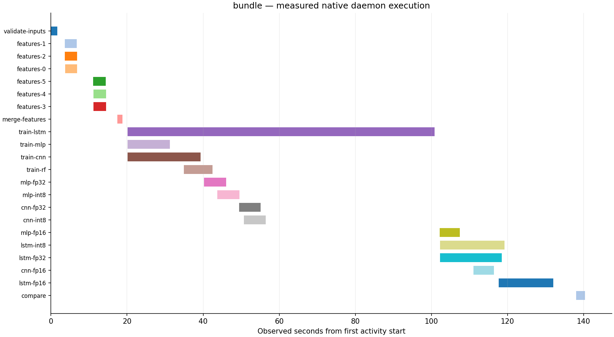

# MAFAULDA — rotating-machinery faults and TinyML quantization

Adapted from **XX Brazilian e-Science Workshop (BreSci 2026), co-located with SBBD**. Original authors: **Cândido Alfredo Carvalho de Lucena Filho, Felipe Valencia de Almeida**.

[Original paper](https://sol.sbc.org.br/index.php/bresci/article/view/44074) · [Original code and data](https://github.com/candidoalfilho/MAFAULDA_TINY_ML_ANALYSIS)

## Scientific scope

Portable reproduction profile: five complete original UFRJ recordings from each of six fault classes (30 recordings, selected deterministically across each archive). Execute the original notebook’s 132-feature extraction and neural architecture definitions; retain its 2,048-sample window, 1,024 hop and maximum 50 windows per recording. Run five-fold group-aware evaluation with complete relative recording paths as group IDs. Default training is shortened to 10 epochs (LSTM 5); AKOFLOW_PROFILE=standard uses 50 (LSTM 15). Quantization uses the final fold model, calibrates only on its training recordings and evaluates only on held-out recordings. These explicit protocol adaptations avoid mixing training observations into quantization evaluation; results do not claim to reproduce the paper’s F1=0.98 or on-device memory/latency. No physical microcontroller is tested. Original data creators: Signals, Multimedia and Telecommunications Laboratory, COPPE/Poli/UFRJ; source https://www02.smt.ufrj.br/~offshore/mfs/page_01.html . The original notebook and data remain attributed to their authors; no license is inferred from public availability.

This is an adaptation of the cited scientific application to native AkôFlow activities. It is not a claim of exact agreement with the paper. Source URLs, immutable revisions and input SHA-256 hashes are recorded in `data/sources.json` and `data/acquisition.json`. Original authors retain authorship of the scientific methods and artifacts; the AkôFlow contribution is orchestration, packaging and validation.

## Execute

[Original input URL manifest](data/sources.json) · [Verified input SHA-256 receipts](data/acquisition.json) · [Scientific provenance](data/provenance.json)

```sh
./prepare.sh
./run.sh
```

Preparation acquires original inputs and builds the image. All computation then executes with networking disabled. No synthetic fallback replaces unavailable original data. `AKOFLOW_PARALLEL` controls standalone concurrency.

To register and execute in Desktop through the local daemon, from the repository root:

```sh
go run ./tools/daemon-local -example scientific-workflows/mafaulda-tinyml -env-file /path/to/installation.env -api-url http://YOUR_DAEMON:8080/akoflow-api -lanes 3
```

Tracking item: [AKO-46](https://github.com/UFFeScience/akoflow-examples/issues/46).

The daemon records the exact image and execution identity in `evidence/daemon-run.json`. `workflow.yaml` declares dependencies and explicit artifact transfers. `outputs/scientific-validation.json` contains semantic checks and findings. A successful exit alone is not a scientific validation.

## Results

Native daemon run `mafaulda-tinyml-local-351678315d-run-20261117t152055.178793114` completed **22/22 activities**. Scientific figures below were generated by the completed daemon run, verified against its artifact SHA-256 hashes, and copied without editing. The execution timeline is derived from observed native activity start/finish times. All figures show measured results.

Findings:

```json
{
  "recordings": 30,
  "classes": 6,
  "windows": 1500,
  "features": 132,
  "quantizedModels": 9,
  "evaluation": "recording-disjoint 5-fold; quantization calibration=train, evaluation=test",
  "paperScoreAgreementClaimed": false,
  "baselineMeanF1": {
    "mlp": 0.5613240483296876,
    "cnn": 0.0678380800335783,
    "lstm": 0.17380730640378292,
    "rf": 0.44450077855608167
  }
}
```





## Observed parallel execution

The native run completed 22 activities in **140.40 seconds**, with **3 overlapping activities** at peak. These are execution observations, not a measured speedup against a sequential baseline.



Python dependency versions from the measured image are retained in [`evidence/python-packages.txt`](evidence/python-packages.txt). Independent post-run validation is recorded in [`evidence/independent-validation.json`](evidence/independent-validation.json).

The standalone command `AKOFLOW_PROFILE=standard ./run.sh` increases training epochs on the same 30-recording selection. The recorded native execution uses the default portable profile.

To regenerate the execution timeline from an observed run, mount this bundle at `/bundle` in its measured image and run `python /bundle/expected/render_execution.py`. The renderer uses `evidence/daemon-run.json`; predicted schedule times are excluded.
