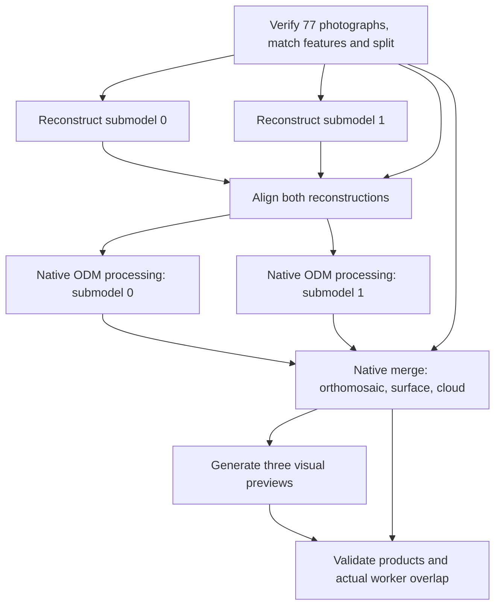

# OpenDroneMap: Caliterra split/merge

## Public results and animations

The published execution completed all nine activities using 77 real CC0 photographs. Both dense-processing submodels ran in parallel; the native merge contains **4,510,286 points**, the exact sum of both submodel clouds. The recorded execution includes recovery after an external daemon restart; it is not an uninterrupted performance benchmark.


This presentation uses the original input-photo thumbnails and a progressive reveal of the actual final raster. It is an illustrative presentation, not footage of intermediate reconstruction states or execution timing.


The rotating view renders decimated measured LAZ points and their actual RGB values. It creates no new geometry. The downloadable LAZ retains all 4,510,286 points.

### Downloads

- [Real results: GeoTIFF orthomosaic, DSM, LAZ, previews and native validation](https://github.com/UFFeScience/akoflow-examples/releases/download/opendronemap-caliterra-v1/opendronemap-results.tar.gz).
- [Complete reproducible source bundle](https://github.com/UFFeScience/akoflow-examples/releases/download/opendronemap-caliterra-v1/opendronemap-source.tar.gz).
- [Exact executed Docker image archive, linux/amd64, approximately 824 MiB](https://github.com/UFFeScience/akoflow-examples/releases/download/opendronemap-caliterra-v1/opendronemap-executed-image.tar.gz).
- [SHA-256 checksums](https://github.com/UFFeScience/akoflow-examples/releases/download/opendronemap-caliterra-v1/SHA256SUMS).
- [Animation provenance and source-product hashes](https://github.com/UFFeScience/akoflow-examples/releases/download/opendronemap-caliterra-v1/animation-provenance.json).

To use the exact runtime captured by the Hub workflow, download the image archive and load it:

```sh
docker load -i opendronemap-executed-image.tar.gz
```

The archive restores `akoflow-local/opendronemap:local-ce38c348fa95a1f0`, including all original photograph inputs and the scientific programs used in the native run. No public OCI registry tag is implied. The source bundle also supports building and running the local workflow below. The GIF renderer is additional publication postprocessing, separate from the nine-activity captured workflow.

Process 77 original GPS-tagged aerial photographs of Caliterra, Dripping Springs, Texas into a georeferenced orthomosaic, a surface-elevation raster and a colored point cloud. AkôFlow schedules two reconstruction activities in parallel, aligns their results, schedules two native ODM processing activities in parallel, and merges their products using the original ODM merge implementation.

## Data and implementation

The photographs are provided by Dennis Baldwin / Unmanned Airlines under CC0-1.0. `data/source.json` pins dataset commit `bec3dc7296e90aacb3930eb9df8061849fbfe0d0`, the URL, byte count and SHA-256 of every image. `data/license.html` preserves the original attribution and license statement. Preparation obtains the original JPEGs from the pinned source; execution verifies every hash. Source photographs occupy approximately 273 MiB and are included in the prepared OCI image, not in this Git checkout.

The scientific runtime is OpenDroneMap 3.5.6, pinned to the amd64 image `opendronemap/odm@sha256:ca5634e99e711b67e082c7493d2ad5573b0edff3f7e521661f94b99a992f5df1`. The adapter invokes its existing dataset loader, OpenSfM feature matching, native `create_submodels`, reconstruction and alignment methods, the native submodel argument builder and `ODMMergeStage`. It does not replace these algorithms or generate artificial observations.

The adapter exposes the internal split/merge boundaries as separate AkôFlow activities. Unlike launching ODM's complete `--split` command in one activity, the two reconstruction jobs and two product-processing jobs are individually scheduled by AkôFlow and exchange explicit artifacts.

## DAG



The split defines two initial groups by longitude, then lets OpenSfM add overlapping photographs within 40 metres. Validation requires at least five shared photos and rejects two copies of the entire dataset. Each branch uses its own private project directory at the same canonical in-container path; tar artifacts preserve native OpenSfM links and metadata across isolated containers. The alignment stage rejects missing reconstructions rather than dropping a failed submodel.

## Run locally

Install Python 3, Go 1.23+ and Docker with linux/amd64 support. Start with 4 available CPU cores, 16 GiB RAM and 20 GiB free disk; these are a suggested capacity, not measured minimum requirements. Two workers can each use two CPU threads. Apple Silicon requires amd64 emulation.

```sh
cd scientific-workflows/opendronemap
./prepare.sh
./run.sh
```

Preparation requires network for the pinned image and original photos. CI uses `./validate.sh -definition` to check the pinned runtime, all original-photo hashes and the parallel DAG contract; that gate does not claim a new scientific execution. The standalone runner disables container networking. Scientific activities use the photographs already bundled in the image and do not download inputs during processing. Native daemon runs follow the Docker driver network configuration; the measured daemon profile used its bridge network. The local scheduler uses two concurrent activity slots. `./run.sh` writes its outputs and per-activity observations to `outputs/`; `./validate.sh` independently reopens the geospatial products and checks overlapping worker timestamps.

The profile uses low feature quality, lowest dense-cloud quality, a 50,000-vertex mesh, 20 cm/pixel orthophoto resolution and 40 cm/pixel surface resolution. Requested pixel spacing does not establish positional accuracy. GPS metadata provides georeferencing; this dataset has no ground-control measurements for independent accuracy assessment.

## Execute through the AkôFlow daemon

After preparation, with a Docker-enabled local daemon and `AKOFLOW_API_TOKEN` in your shell:

```sh
go run ../../tools/daemon-local -root ../.. -example scientific-workflows/opendronemap -lanes 2 -wait=false
```

If the daemon is bound to another address, pass `-api-url http://HOST:PORT/akoflow-api`. An optional `-env-file /path/to/.env` reads the API token without writing it to evidence. The helper registers the environment, scope, topology, nine-activity workflow and a plan with two execution lanes. Its placeholder predicted times are not performance measurements. The daemon performs real container execution and artifact transfers.

To follow the existing run without submitting another one, use the same flags with `-observe -wait-timeout 40m`. `evidence/daemon-run.json` records the actual run identity, image ID, attempts, logs and observed timings. The terminal `validate` activity produces the final scientific validation report and explicitly copies final products and per-stage records into its own `results/` directory. This preserves them when the daemon releases intermediate workspaces. Validation also requires all 77 source photos to be reconstructed and the merged point count to equal the sum of both native submodel clouds.

To copy the completed daemon results from its Docker workspace into this bundle (without running the computation again):

```sh
./collect-results.py --container YOUR_AKOFLOW_SERVER_CONTAINER
./validate.sh
```

The destination must be empty; use `--output /another/path` to preserve existing local results.

## Visual outputs

- `orthophoto.png`: overview of the real merged orthomosaic; `orthophoto.tif` preserves georeferencing.
- `surface.png`: height colors with shading from the merged DSM; `surface.tif` preserves elevation values. A DSM includes vegetation and structures, rather than bare-earth terrain.
- `pointcloud.png`: oblique view of decimated reconstructed, colored points; `pointcloud.laz` contains the merged full cloud.
- `validation.json`: input count, native alignment, raster dimensions/CRS, point count, actual worker overlap in seconds and SHA-256 of final products.

ODM split/merge does not merge textured 3D meshes. The final 3D product here is the colored point cloud. The PNG projection and display color ramps are previews of computed products; neither is an additional measurement.

## Sources

- Dataset and original license: <https://github.com/OpenDroneMap/odm_data_caliterra>.
- Official example dataset catalog: <https://github.com/OpenDroneMap/ODMdata>.
- Split/merge implementation: <https://github.com/OpenDroneMap/ODM/blob/v3.5.6/stages/splitmerge.py>.
- OpenSfM integration: <https://github.com/OpenDroneMap/ODM/blob/v3.5.6/opendm/osfm.py>.
- ODM source, AGPL-3.0: <https://github.com/OpenDroneMap/ODM>.

## Measured native execution

Run `opendronemap-caliterra-split-merge-local-1e96697664-run-20261116t134725.875498305` completed **9/9 activities** using the exact executed image `akoflow-local/opendronemap:local-ce38c348fa95a1f0`. An external daemon restart interrupted control-plane observation while the first processing attempts finished; native recovery reused split/reconstruction/alignment and repeated both dense-processing activities. The capture preserves the interrupted attempts and successful recovery, so this is not an uninterrupted performance benchmark.

All 77 photographs were reconstructed. Native overlapping submodels contain 59 and 65 photos, with 47 shared. The final two complete clouds contain 2,142,686 and 2,367,600 points; the native merged cloud contains their exact sum, **4,510,286 points**. Scientific worker timings show 32.142 seconds of overlapping reconstruction and 689.825 seconds of overlapping dense processing, on one local Docker host with two execution lanes.

The final workspace is sealed and retains the copied products. All 15 collected files were compared with the terminal activity's native artifact checksums. Independent verification passed for the six product hashes, raster coordinates/dimensions, complete cloud count, PNG decoding and worker overlap, with the collected output directory mounted read-only. See `evidence/daemon-run.json`, `evidence/scientific-validation.json` and `evidence/acceptance.json`.


