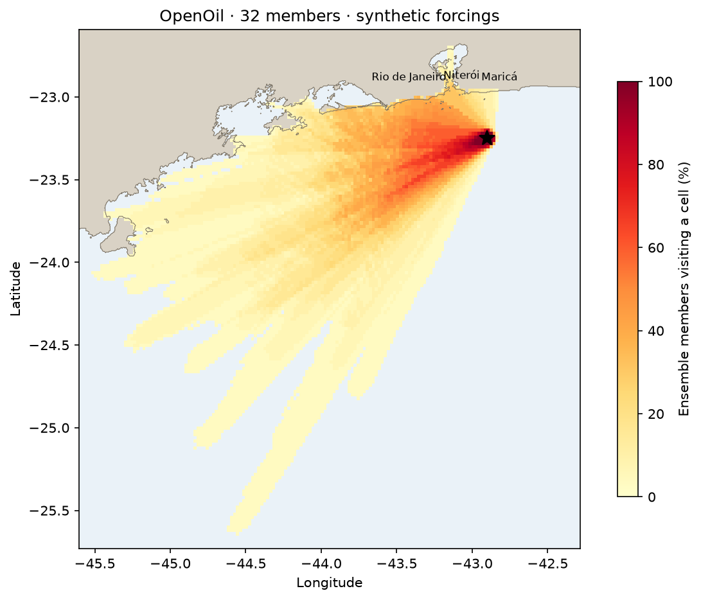
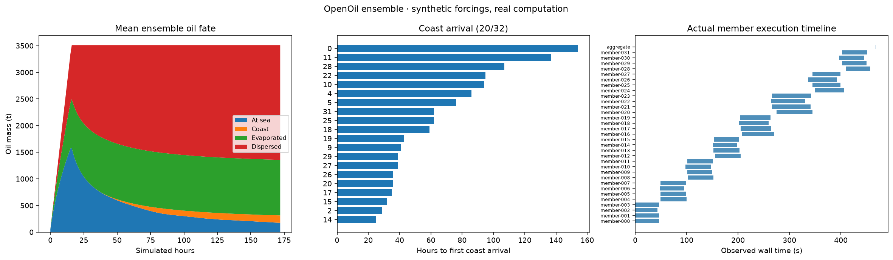
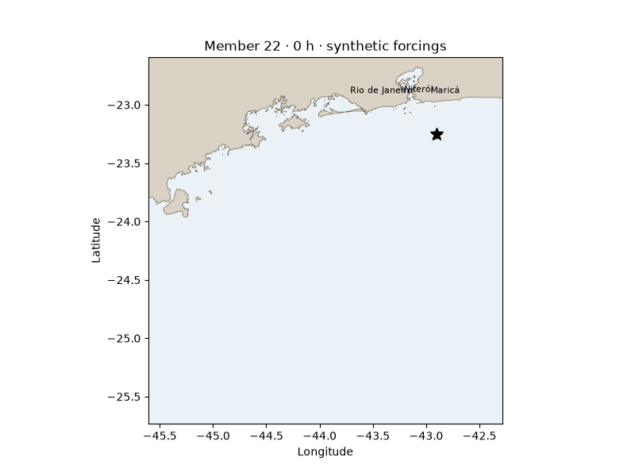

# OpenOil ensemble — 32 members

A real OpenDrift OpenOil oil-spill ensemble offshore of Maricá/Niterói, Brazil. This example has **32 independent simulation activities** and **38 native AkôFlow activities** in total. Each member produces NetCDF trajectories and a measured CPU/memory/runtime profile. Aggregation computes ensemble cell visitation, coast arrival, and oil fate; map, summary and animation activities produce the figures below. A terminal activity validates all scientific outputs and file checksums.

**Scientific limit:** the wind/current forcings are synthetic, constant in space/time, sampled between northeast wind and a cold-front regime. The coastline and OpenOil weathering calculations are real. This is a reproducible teaching experiment, **not an operational forecast**.

## Scenario

| Setting | Value |
| --- | --- |
| Members | 32 |
| Particles per member | 1,000 |
| Simulated duration | 172 h |
| Release | 16 h × 250 m³/h = 4,000 m³ |
| Start | 2026-11-20 06:00:00 (model clock; no timezone supplied in the notebook) |
| Location | longitude -42.90, latitude -23.25 |
| Oil | GENERIC MEDIUM CRUDE |
| Integration / output | 900 s / 1 h |
| Water temperature | 30 °C |
| Parameter seed / member seed | 42 / 42 + member index |
| Native execution lanes | 4 local Docker lanes |

The notebook introduction mentions 300 m³ and 72 h, but its executable configuration contains the values above. All three variants use nested parameter sampling: their shared member indices receive the same forcings and seeds. Complete production experiments run **serially on the homeserver: 8 → 16 → 32**, with validation before advancing. The 8- and 16-member runs use two explicit execution lanes; the 32-member run uses four lanes (four CPUs and 16 GiB of declared capacity). These different resource profiles must be considered when comparing observed durations.

## Run with Docker

The shared [Dockerfile](../../images/openoil/docker/Dockerfile), [locked dependencies](../../images/openoil/requirements.lock), [scientific runner](../../images/openoil/app/workflow.py), and [source notebook](../../images/openoil/source/openoil_derramamento_ensemble.ipynb) are versioned in this repository.

Published image: `ghcr.io/uffescience/openoil-ensemble:v1` for **linux/amd64 and linux/arm64**. The workflow and runner pin the tested multi-platform index digest rather than relying on a mutable tag. Both architectures pass the real offline small-ensemble check; full 32-member evidence records the homeserver amd64 execution.

```sh
./prepare.sh
./run.sh
./validate.sh
```

Preparation pulls the image. `run.sh` is a simple sequential standalone reproduction using the same stages with networking disabled; use the native AkôFlow workflow for the measured four-lane ensemble schedule. Keep enough memory for the OpenDrift coastline mask (roughly 2–3 GiB per member process) and disk for the complete NetCDF outputs. No cloud account, external API, live weather service, GPU or network connection is required during execution.

## Run through AkôFlow

From the repository root, configure `AKOFLOW_API_TOKEN` in your shell and set the daemon URL:

```sh
go run ./tools/daemon-local -root . -example scientific-workflows/openoil-ensemble-32 -api-url http://127.0.0.1:8080/akoflow-api -registry-image -lanes 4
```

Companion definitions: [workflow.yaml](workflow.yaml), [environment.yaml](environment.yaml), [scope.yaml](scope.yaml), and [topology.yaml](topology.yaml). Transfer edges explicitly name all required files. Imported execution plan predictions are placeholders and are not timing measurements. The profile CSV and native execution capture contain observed durations.

## Measured result gallery







The GIF selects the member with the highest final stranded-particle fraction; ties select the first member. The map is the fraction of ensemble members with any recorded oil position in each grid cell. It is not a calibrated posterior probability.

## Result files and validation

The result archive contains every member's `.nc` trajectory, `probability.nc`, `arrival.csv`, `mass_balance.csv`, `summary.json`, `perfil_tarefas.csv`, per-stage profiles, PNGs, multi-frame GIF, selected-member trajectory and SHA-256 manifest. The profile CSV records member and aggregation measurements; the native capture also records rendering and validation activities.

The terminal validator checks particle/time dimensions, finite nonnegative mass, post-release mass conservation within 1%, probability bounds and exact hit-count normalization, decoded PNG dimensions and a GIF with multiple frames. Missing data or failed members abort the workflow; no precomputed or synthetic timing result substitutes for a failed simulation.

## Provenance

Adapted from the user-supplied `openoil_derramamento_ensemble.ipynb`; [provenance metadata](../../images/openoil/source/provenance.json) records its checksum. See [OpenDrift](https://github.com/OpenDrift/opendrift) for upstream code and licensing, [installation documentation](https://opendrift.github.io/install.html), and the dependency lock for scientific package versions. No real forcing-file integration is claimed as validated by these synthetic-forcing runs.

## Natural model termination

OpenDrift stops a member early when every particle has stranded. Raw NetCDF trajectories retain that actual end time. The shared ensemble accounting grid extends to 172 hours by carrying the terminal oil mass pools forward, without claiming further model integration. Shortened trajectories are accepted only after release has finished and every particle is verified stranded; active, missing or unreleased particles fail validation. The selected-member GIF retains the original model time range.
