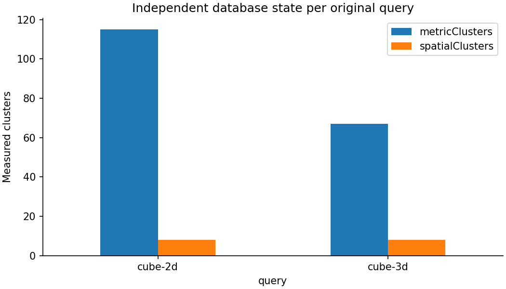
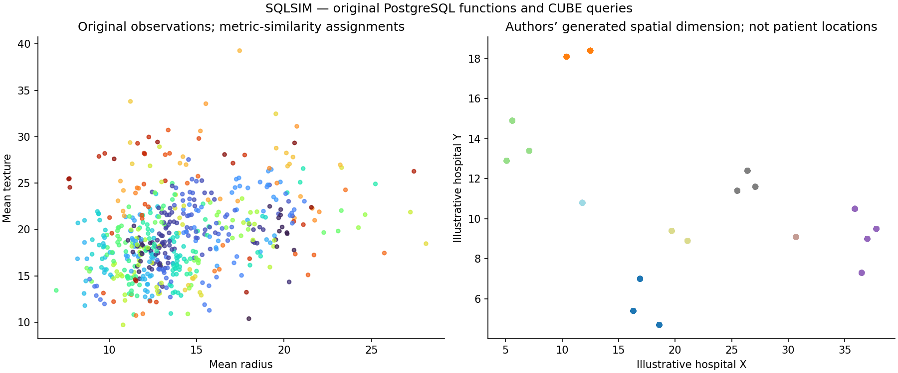
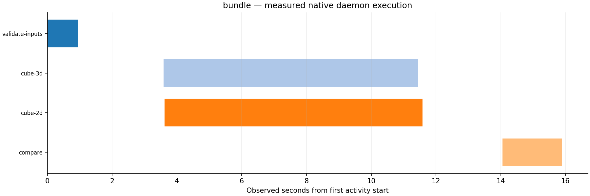

# SQLSIM — analytical similarity queries in PostgreSQL

Adapted from **XVIII Brazilian e-Science Workshop (BreSci 2024), co-located with SBBD**. Original authors: **Antônio Lívio C. de Mendonça, Maria Camila N. Barioni, Humberto Razente**.

[Original paper](https://sol.sbc.org.br/index.php/bresci/article/view/30580) · [Original code and data](https://github.com/liviomendonca/sqlsim)

## Scientific scope

Execute the original PL/pgSQL functions and both original 2D/3D CUBE queries on all 569 original Wisconsin Diagnostic Breast Cancer observations supplied by the authors. Each query gets an isolated PostgreSQL/PostGIS instance, so parallel activities do not mutate one another’s clustering state. Transport path is adapted and PostgreSQL random seed is fixed to 0.42 for the authors’ generated hospital/date dimensions. Hospital locations and dates are illustrative generated dimensions, not clinical provenance. Runtime uses PostgreSQL 15/PostGIS 3 on Debian Bookworm rather than the paper’s PostgreSQL 16.3; result semantics, not timing equivalence, are checked. Original dataset: https://archive.ics.uci.edu/dataset/17/breast+cancer+wisconsin+diagnostic . Upstream repository has no explicit code license; no redistribution grant is inferred.

This is an adaptation of the cited scientific application to native AkôFlow activities. It is not a claim of exact agreement with the paper. Source URLs, immutable revisions and input SHA-256 hashes are recorded in `data/sources.json` and `data/acquisition.json`. Original authors retain authorship of the scientific methods and artifacts; the AkôFlow contribution is orchestration, packaging and validation.

## Execute

[Original input URL manifest](data/sources.json) · [Verified input SHA-256 receipts](data/acquisition.json) · [Scientific provenance](data/provenance.json)

```sh
./prepare.sh
./run.sh
```

Preparation acquires original inputs and builds the image. All computation then executes with networking disabled. No synthetic fallback replaces unavailable original data. `AKOFLOW_PARALLEL` controls standalone concurrency.

To register and execute in Desktop through the local daemon, from the repository root:

```sh
go run ./tools/daemon-local -example scientific-workflows/sqlsim -env-file /path/to/installation.env -api-url http://YOUR_DAEMON:8080/akoflow-api -lanes 3
```

Tracking item: [AKO-46](https://github.com/UFFeScience/akoflow-examples/issues/46).

The daemon records the exact image and execution identity in `evidence/daemon-run.json`. `workflow.yaml` declares dependencies and explicit artifact transfers. `outputs/scientific-validation.json` contains semantic checks and findings. A successful exit alone is not a scientific validation.

## Results

Native daemon run `sqlsim-local-164a71f419-run-20261117t150646.625598270` completed **4/4 activities**. Scientific figures below were generated by the completed daemon run, verified against its artifact SHA-256 hashes, and copied without editing. The execution timeline is derived from observed native activity start/finish times. All figures show measured results.

Findings:

```json
{
  "observations": 569,
  "queries": {
    "cube-2d": {
      "cubeRows": 486,
      "assignedObservations": 569,
      "metricClusters": 115,
      "spatialClusters": 8
    },
    "cube-3d": {
      "cubeRows": 1121,
      "assignedObservations": 569,
      "metricClusters": 67,
      "spatialClusters": 8
    }
  },
  "databaseIsolation": "one PostgreSQL cluster per activity",
  "seed": 0.42
}
```





## Observed parallel execution

The native run completed 4 activities in **15.90 seconds**, with **2 overlapping activities** at peak. These are execution observations, not a measured speedup against a sequential baseline.



Python dependency versions from the measured image are retained in [`evidence/python-packages.txt`](evidence/python-packages.txt). Independent post-run validation is recorded in [`evidence/independent-validation.json`](evidence/independent-validation.json).

To regenerate the execution timeline from an observed run, mount this bundle at `/bundle` in its measured image and run `python /bundle/expected/render_execution.py`. The renderer uses `evidence/daemon-run.json`; predicted schedule times are excluded.
