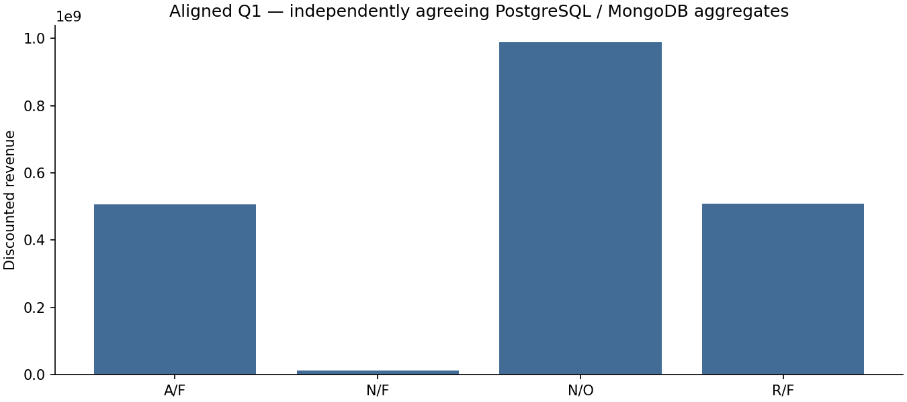
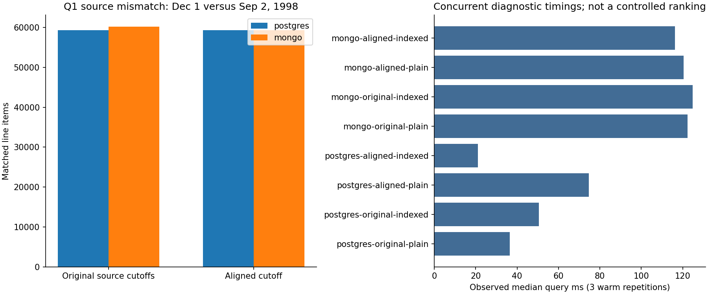
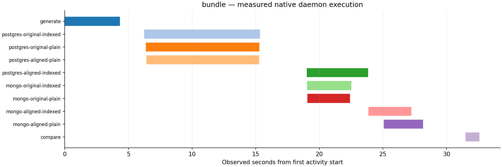

# TPC-H Q1 — MongoDB embedding versus PostgreSQL reproducibility audit

Adapted from **XVIII Brazilian e-Science Workshop (BreSci 2024), co-located with SBBD**. Original authors: **André Merlo, Jorge N. S. Pavão, Luiz C. de Freitas, Jorge Soares, Diego Brandão, Kele Belloze**.

[Original paper](https://sol.sbc.org.br/index.php/bresci/article/view/30582) · [Original code and data](https://github.com/jnpavao/tpch_mongodb)

## Scientific scope

Portable audit of Q1 from the published repository, using genuine TPC-H dbgen 2.13.0 at scale factor 0.01 (complete generated lineitem table). The original MongoDB pipeline filters through 1998-12-01 while the original PostgreSQL query filters through 1998-09-02. Run both unchanged, then an explicitly named aligned variant that changes only MongoDB’s cutoff to 1998-09-02. Execute each engine/mode with and without an index in isolated database instances. Validate numerical equivalence only for aligned semantics and record original-source disagreement. This is a Q1 audit, not reproduction of all 22 queries, the paper’s hardware, scale or performance ranking. Timings under concurrent execution are observations, not a controlled database benchmark. Original data generator and specification: https://www.tpc.org/tpch/ and https://github.com/electrum/tpch-dbgen/tree/32f1c1b92d1664dba542e927d23d86ffa57aa253. TPC-H data are generated by definition; no hand-built fixture replaces them. Original code authors retain attribution; upstream has no explicit license declaration. MongoDB binary is obtained from its official distribution; respective upstream terms apply.

This is an adaptation of the cited scientific application to native AkôFlow activities. It is not a claim of exact agreement with the paper. Source URLs, immutable revisions and input SHA-256 hashes are recorded in `data/sources.json` and `data/acquisition.json`. Original authors retain authorship of the scientific methods and artifacts; the AkôFlow contribution is orchestration, packaging and validation.

## Execute

[Original input URL manifest](data/sources.json) · [Verified input SHA-256 receipts](data/acquisition.json) · [Scientific provenance](data/provenance.json)

```sh
./prepare.sh
./run.sh
```

Preparation acquires original inputs and builds the image. All computation then executes with networking disabled. No synthetic fallback replaces unavailable original data. `AKOFLOW_PARALLEL` controls standalone concurrency.

To register and execute in Desktop through the local daemon, from the repository root:

```sh
go run ./tools/daemon-local -example scientific-workflows/tpch-databases -env-file /path/to/installation.env -api-url http://YOUR_DAEMON:8080/akoflow-api -lanes 3
```

Tracking item: [AKO-46](https://github.com/UFFeScience/akoflow-examples/issues/46).

The daemon records the exact image and execution identity in `evidence/daemon-run.json`. `workflow.yaml` declares dependencies and explicit artifact transfers. `outputs/scientific-validation.json` contains semantic checks and findings. A successful exit alone is not a scientific validation.

## Results

Native daemon run `tpch-databases-local-5dff16106f-run-20261117t152506.699433105` completed **10/10 activities**. Scientific figures below were generated by the completed daemon run, verified against its artifact SHA-256 hashes, and copied without editing. The execution timeline is derived from observed native activity start/finish times. All figures show measured results.

Findings:

```json
{
  "query": "TPC-H Q1",
  "scaleFactor": 0.01,
  "originalMatchedRows": {
    "postgres": 59307,
    "mongo": 60175
  },
  "originalSourceMismatchObserved": true,
  "alignedAllNumericAggregatesAgree": true,
  "isolatedDatabaseRuns": 8,
  "originalSqlCutoff": "1998-09-02",
  "originalMongoCutoff": "1998-12-01"
}
```





Python dependency versions from the measured image are retained in [`evidence/python-packages.txt`](evidence/python-packages.txt). Independent post-run validation is recorded in [`evidence/independent-validation.json`](evidence/independent-validation.json).

## Observed parallel execution

The native run completed 10 activities in **32.59 seconds**, with **3 overlapping activities** at peak. These are execution observations, not a measured speedup against a sequential baseline.



Timing interpretation: PostgreSQL measurements include a new `psql` client process per repetition, while MongoDB reuses a Python client. These end-to-end diagnostic observations cannot establish an engine performance ranking. The principal checked result is query-semantic equivalence after explicitly aligning the date cutoff.

To regenerate the execution timeline from an observed run, mount this bundle at `/bundle` in its measured image and run `python /bundle/expected/render_execution.py`. The renderer uses `evidence/daemon-run.json`; predicted schedule times are excluded.
