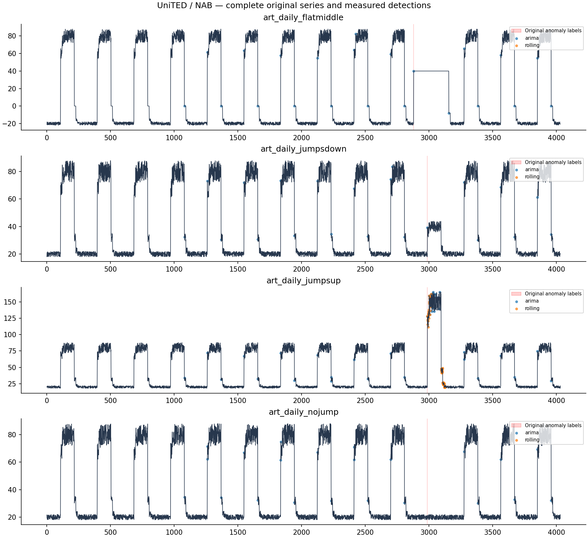
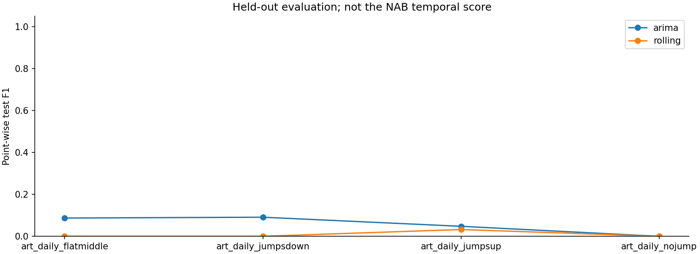
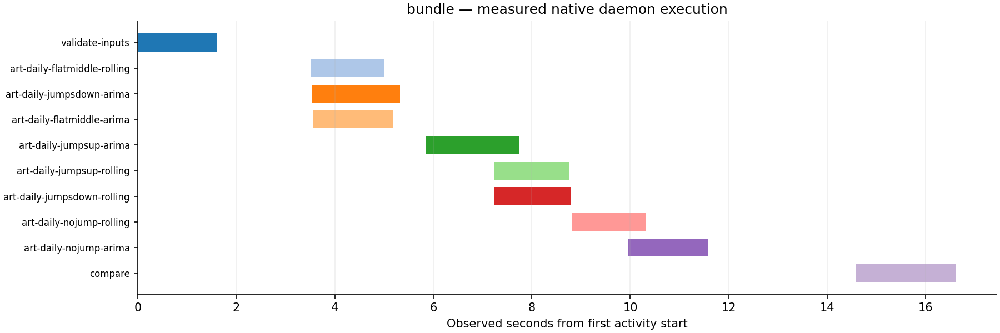

# UniTED — labeled time-series event detection

Adapted from **XIX Brazilian e-Science Workshop (BreSci 2025), co-located with SBBD**. Original authors: **Janio Lima, Hélio Castro, Luiz Oliveira, Ellen Paixão, Lais Baroni, Rebecca Salles, Ricardo Vargas, Eduardo Ogasawara**.

[Original paper](https://sol.sbc.org.br/index.php/bresci/article/view/36901) · [Original code and data](https://github.com/cefet-rj-dal/united)

## Scientific scope

Four complete labeled NAB artificialWithAnomaly source series curated by UniTED, with no point subsampling. ARIMA(2,0,2) and a causal rolling-residual baseline are Python adapters; they are not the original R/Harbinger implementation and do not claim paper-metric equivalence. Detectors fit thresholds on the first 25% and are scored on the remaining observations with point-wise labels; no temporal-tolerance NAB score is claimed. These artificial signals are original benchmark inputs, not locally generated substitutes. Original upstream benchmark: https://github.com/numenta/NAB. UniTED code: MIT; upstream dataset conditions remain applicable.

This is an adaptation of the cited scientific application to native AkôFlow activities. It is not a claim of exact agreement with the paper. Source URLs, immutable revisions and input SHA-256 hashes are recorded in `data/sources.json` and `data/acquisition.json`. Original authors retain authorship of the scientific methods and artifacts; the AkôFlow contribution is orchestration, packaging and validation.

## Execute

[Original input URL manifest](data/sources.json) · [Verified input SHA-256 receipts](data/acquisition.json) · [Scientific provenance](data/provenance.json)

```sh
./prepare.sh
./run.sh
```

Preparation acquires original inputs and builds the image. All computation then executes with networking disabled. No synthetic fallback replaces unavailable original data. `AKOFLOW_PARALLEL` controls standalone concurrency.

To register and execute in Desktop through the local daemon, from the repository root:

```sh
go run ./tools/daemon-local -example scientific-workflows/united -env-file /path/to/installation.env -api-url http://YOUR_DAEMON:8080/akoflow-api -lanes 3
```

Tracking item: [AKO-46](https://github.com/UFFeScience/akoflow-examples/issues/46).

The daemon records the exact image and execution identity in `evidence/daemon-run.json`. `workflow.yaml` declares dependencies and explicit artifact transfers. `outputs/scientific-validation.json` contains semantic checks and findings. A successful exit alone is not a scientific validation.

## Results

Native daemon run `united-local-e796844aa5-run-20261117t145730.223156114` completed **10/10 activities**. Scientific figures below were generated by the completed daemon run, verified against its artifact SHA-256 hashes, and copied without editing. The execution timeline is derived from observed native activity start/finish times. All figures show measured results.

Findings:

```json
{
  "series": 4,
  "detectorRuns": 8,
  "totalInputPoints": 16128,
  "evaluation": "held-out point-wise; Python adaptation"
}
```





## Observed parallel execution

The native run completed 10 activities in **16.61 seconds**, with **3 overlapping activities** at peak. These are execution observations, not a measured speedup against a sequential baseline.



Python dependency versions from the measured image are retained in [`evidence/python-packages.txt`](evidence/python-packages.txt). Independent post-run validation is recorded in [`evidence/independent-validation.json`](evidence/independent-validation.json).

To regenerate the execution timeline from an observed run, mount this bundle at `/bundle` in its measured image and run `python /bundle/expected/render_execution.py`. The renderer uses `evidence/daemon-run.json`; predicted schedule times are excluded.
