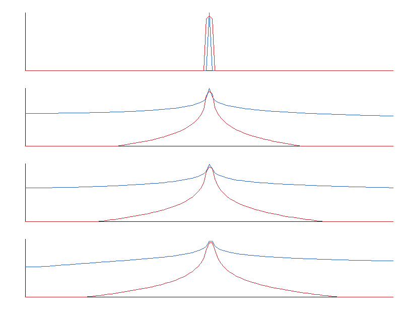
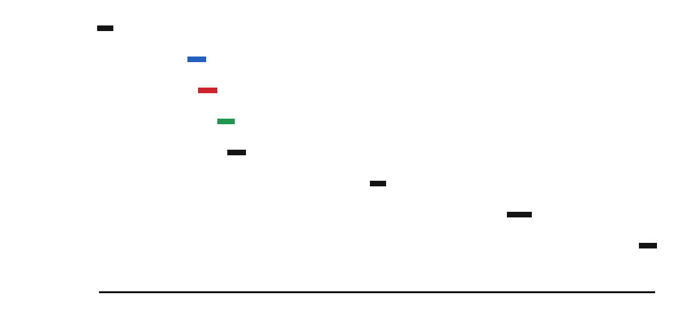

# Cooley–Tukey FFT and spectral-leakage audit

This deterministic CPU workflow implements an iterative radix-2 decimation-in-time FFT and audits four real tones at offsets `δ = 0, 0.125, 0.25, 0.5` bins. Every branch passed direct-DFT agreement, inverse round trip, Parseval energy, conjugate symmetry, peak-bin, periodic-Hann, serialization, and deterministic rerun checks.



The figure uses fixed frequency and decibel axes. Blue is the rectangular record and red is the periodic Hann taper. The centered tone is sparse at bins 64 and 960; fractional offsets spread energy across bins. The four-nearest-bin and exact-bin leakage fractions are retained in [aggregate.csv](outputs/reference/aggregate.csv); the workflow does not claim that one window universally minimizes every leakage definition.

## Half-bin result

For the real tone at `64.5` bins and phase `0.37`, bin 65 is 0.7463428668% larger than bin 64. This is predicted independently by the finite geometric-series expression for both positive- and negative-frequency components, not fitted to the FFT result. The direct DFT and analytic coefficients agree within the predeclared tolerance.

## Reproduce

```sh
./build.sh
./preflight.sh
./run.sh
AKOFLOW_SUBMIT=1 ./run.sh
```

The image is pinned to `python:3.11.14-slim-bookworm` and uses only the Python standard library. Scientific containers execute offline without Hub credentials or a Docker socket. The local preflight runs twice and requires byte-identical JSON, CSV, PNG, and GIF artifacts.

The imported workflow resolves all eight activities from one immutable AkôFlow
build recipe. Its archived context contains `docker/Dockerfile`,
`requirements.txt`, `LICENSE`, and `scripts/workflow.py`; every `COPY` source is
contained and the base image is digest-pinned. From an unmaterialized state,
preflight reported `Build required`, and AkôFlow reconstructed and verified the
OCI image before running the DAG.

## Measured AkôFlow execution

The portable daemon run `community-cooley-tukey-fft-run-v2` rebuilt the missing
image and completed all eight activities in 8.850220 s. The matched serialized
run `community-cooley-tukey-fft-one-slot-v2` completed in 13.959134 s. The four
short scientific audits used four declared slots; adjacent branches overlapped,
but this rerun did not record a simultaneous four-way interval. No generalized
speedup claim is made from this short workload.

Reconstructed image: `sha256:14c092c6a5dd3fb77004fd3b846eff2341489006a1f7e7438ff099a95557c581`.
Portable context: `sha256:94934f9db95e774beb464ad4dd92563bec39804c7e4daf56c82212a8bf5246c6`.
Recipe: `sha256:3bb32dd151f398c29f75e2d5fab9c11a8484aa1bddda251b45fdbabb2b026863`.



The timeline is rendered from daemon-recorded start and finish timestamps; colors identify the four declared Docker slots.

## Result-bearing animation


The four-frame animation accumulates the measured rectangular spectra for `δ = 0, 0.125, 0.25, 0.5` on fixed axes, making leakage growth and the moving positive-frequency peak directly comparable. It is generated from the validated coefficients, not decorative motion.

## Provenance and limits

The transform follows James W. Cooley and John W. Tukey, “An Algorithm for the Machine Calculation of Complex Fourier Series,” *Mathematics of Computation* 19(90), 297–301 (1965), [DOI 10.1090/S0025-5718-1965-0178586-1](https://doi.org/10.1090/S0025-5718-1965-0178586-1). The periodic Hann formula is linked from the [SciPy documentation](https://docs.scipy.org/doc/scipy/reference/generated/scipy.signal.windows.hann.html); SciPy code is not used or redistributed.

This is a numerical audit of finite sampled records, not a proof of Fourier theory or a measurement of an analog signal. Results are specific to the frozen sample count, tone, phase, offsets, and leakage definitions. Workflow code and generated artifacts are MIT-licensed.

## Public Community Explorer record

[Open the public workflow and measured results](https://hub.akoflow.com/o/akoflow/community-explorer-issue-40-cooley-tukey-fft-v1).
Import portable version 2 with
`akoflow://hub/publications/c7798e7d-6372-4f3d-9dd8-f79ae97f31b7/versions/2`.
