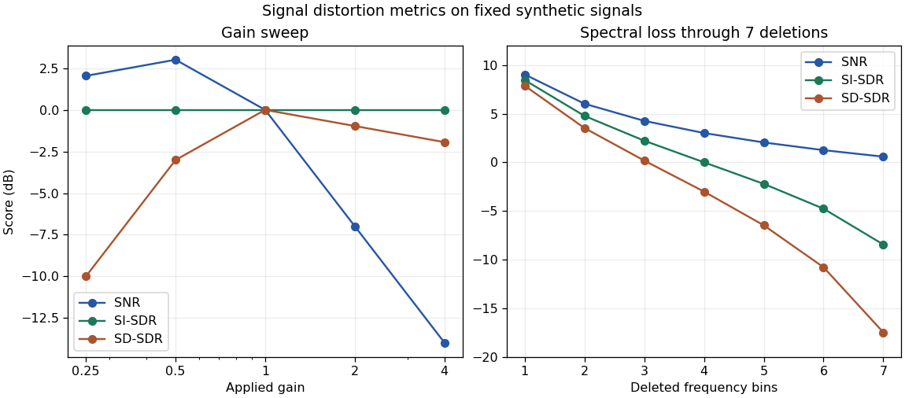
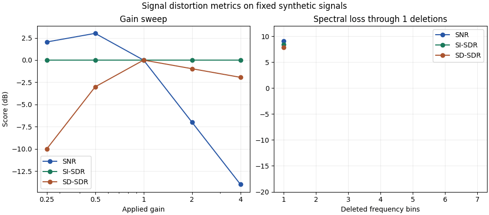
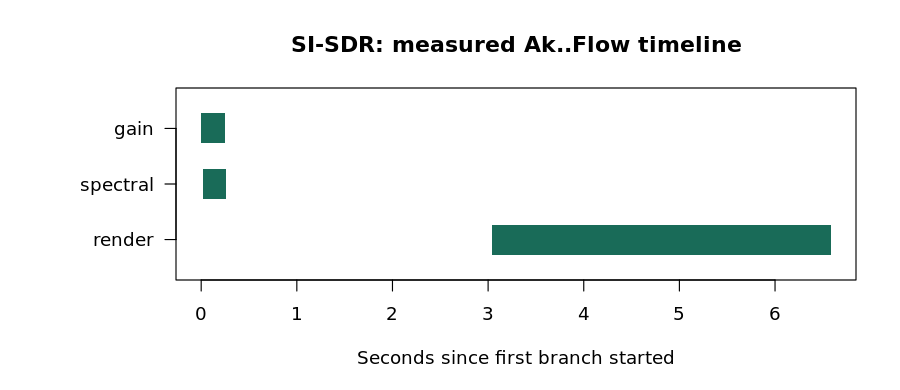

# SI-SDR gain invariance and spectral loss audit

This workflow measures how three distortion scores respond to changing gain
and removing frequency components. It reproduces the paper's equal-energy
orthogonal gain example and adapts its spectral-deletion test to fixed
synthetic audio.

## Paper and authors

Jonathan Le Roux, Scott Wisdom, Hakan Erdogan, and John R. Hershey,
*SDR – Half-baked or Well Done?*, IEEE ICASSP 2019, pp. 626–630.
[DOI](https://doi.org/10.1109/ICASSP.2019.8683855)
[Author's paper](https://www.jonathanleroux.org/pdf/LeRoux2019ICASSP05sdr.pdf)

The implementation and synthetic inputs were created for the AkôFlow Community
Explorer. The workflow uses no source speech, checkpoint, or paper figure.

## Scenario and workflow

Two independent CPU activities calculate the gain sweep and the spectral
deletion sweep. The gain branch scales an equal-energy target-plus-interference
mixture by 0.25, 0.5, 1, 2, and 4. The spectral branch uses one second at
16 kHz with eight real tones from 200 Hz to 1,600 Hz. It uses an orthonormal
real FFT and removes the highest remaining frequency pair at each step.

Both activities check results against exact energy-based expressions within
one millionth of a decibel. At half gain, SNR rises to 3.0103 dB while SI-SDR
stays at 0 dB and SD-SDR falls to −3.0103 dB. Removing one through seven tones
makes SI-SDR decline from 8.4510 to −8.4510 dB. Positive-gain controls verify
the invariance of SI-SDR at each truncation. Undefined and infinite endpoints
are explicit in the JSON report.

The downstream activity combines both branches into a CSV, a two-panel PNG
and a seven-frame GIF. The GIF shows the measured spectral loss as the
frequencies are removed. The validation report records the artifact digests.

## Build and run

```sh
docker build -f docker/Dockerfile -t community-sisdr-audit:v1 .
./run.sh
AKOFLOW_SUBMIT=1 ./run.sh
```

The workflow carries a portable recipe with a digest-pinned Python base image
and versioned NumPy, Matplotlib, and Pillow.

## Limitations

The spectral experiment shows agreement with the analytic projection model
on orthogonal tones. Its numbers apply to this controlled signal. The
original paper's speech-plus-noise experiment has different inputs.

## Recorded execution and gallery

Run `community-sisdr-run-v1` completed all three activities and passed
validation. The gain and spectral calculations overlapped by 0.231 seconds
on two CPU slots.







[Scores CSV](outputs/si-sdr-scores.csv) ·
[Validation and digests](evidence/validation.json) ·
[Execution timings](evidence/daemon-run.json)
