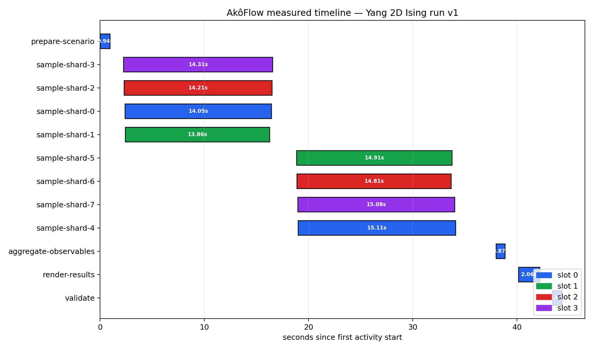
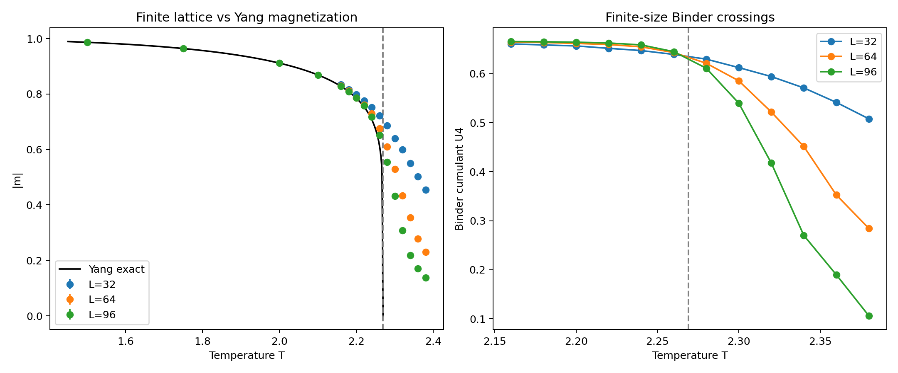
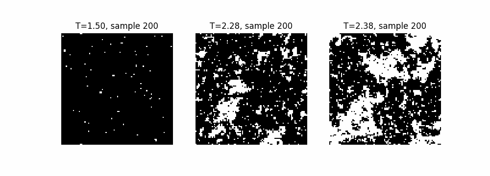

# Yang 2D Ising spontaneous-magnetization curve

This CPU-only workflow reproduces a bounded result from C. N. Yang's exact solution of the zero-field square-lattice Ising model. Independent Wolff-cluster ensembles estimate finite-lattice magnetization and Binder cumulants; the workflow compares the `L=96` low-temperature curve with Yang's thermodynamic-limit formula and locates the transition from adjacent-size Binder crossings.

## Scientific reference and scope

C. N. Yang, “The Spontaneous Magnetization of a Two-Dimensional Ising Model,” *Physical Review* **85**, 808 (1952), DOI [10.1103/PhysRev.85.808](https://doi.org/10.1103/PhysRev.85.808).

For `J=k_B=1`, the exact result is `M(T)=[1-sinh(2/T)^(-4)]^(1/8)` below `Tc=2/ln(1+sqrt(2))=2.269185314213022`, and zero above it. Scientific attribution belongs to Yang. The AkôFlow packaging and finite-lattice validation were prepared by Community Explorer contributors. This does not reproduce Yang's proof or claim an exact finite-size solution.

## Pinned scenario and licenses

Periodic lattices `L=[32,64,96]` use four SHA-256-derived PCG64DXSM streams at each critical-grid temperature `2.16,2.18,…,2.38`; `L=96` additionally samples `1.50,1.75,2.00,2.10`. (`2.20` occurs once because it belongs to both grids.) Every one of the 160 branches performs 500 burn-in and 2,000 measured sweep-equivalents, summarized with 20 block means. Eight independent 20-branch shards expose scientific concurrency.

The source is BSD-3-Clause. NumPy, Numba, and llvmlite use BSD licenses, Matplotlib uses its PSF-based license, and Pillow uses HPND; see `THIRD_PARTY_NOTICES.md`. There is no external dataset. The pinned image is `akoflow/community-ising-yang@sha256:fcbb7e3c7455e9d703cbaf665f97b28e85e152afa63c5e2ec2f6a5d202cc681b` on `linux/amd64`.

## Measured AkôFlow execution

The daemon run `community-ising-yang-run-v1`, workflow `community-ising-yang-v1`, completed all 12 activities on the four-slot local Docker environment. Measured makespan was 44.3017 s, compute time 121.0963 s, and artifact transfer time 12.0049 s (32,990,606 bytes). The first four sampling shards had 13.8606 s of four-way measured overlap; the second four had 14.6870 s. This proves concurrent scientific activity, not speedup: no matched one-slot benchmark was performed.

## Validated results

The daemon validator passed branch completeness, physical bounds, sample counts, exact-reference evaluation, magnetization residuals, Binder crossings, and required artifact checks. The adjacent-size crossings were `2.2662316437` (`L=32/64`) and `2.2631127580` (`L=64/96`); their mean is within 0.0046 of exact `Tc`, well inside the fixed 0.05 tolerance. The largest `L=96` magnetization error was 0.002224 at `T=2.20`, against the fixed 0.03 floor.

The gallery animation [`spin-configurations.gif`](outputs/daemon-v1/spin-configurations.gif) uses actual saved `L=96` Monte Carlo states at ordered, near-critical, and disordered temperatures. Sampling order is not physical time or spin dynamics.

## Reproduce and limitations

Run `./build.sh`, then `./preflight.sh` for two isolated deterministic executions. `./run.sh` registers the definitions and performs daemon preflight; set `AKOFLOW_SUBMIT=1` to submit the idempotent run ID. Scientific containers run with no network, Hub credentials, or host Docker socket.

Finite lattices round and shift the transition; `|m|` is used because a finite zero-field lattice tunnels between symmetry-related states. Linear interpolation on a 0.02 temperature grid is a bounded transition estimate, not a precision determination of `Tc`. Block standard errors diagnose finite sampling but do not eliminate every autocorrelation or finite-size effect. Machine-readable evidence, hashes, and validated outputs are in `evidence/` and `outputs/daemon-v1/`.

## Animation

