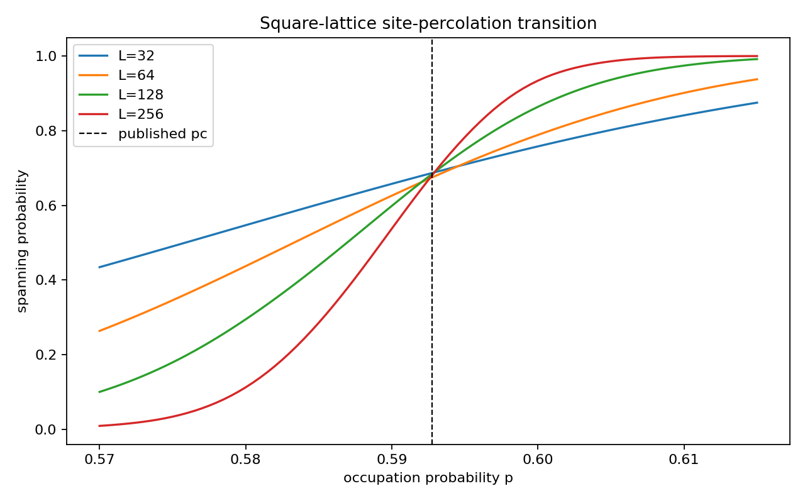
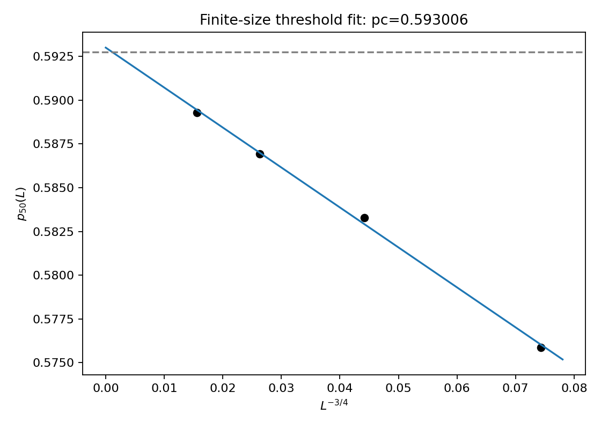
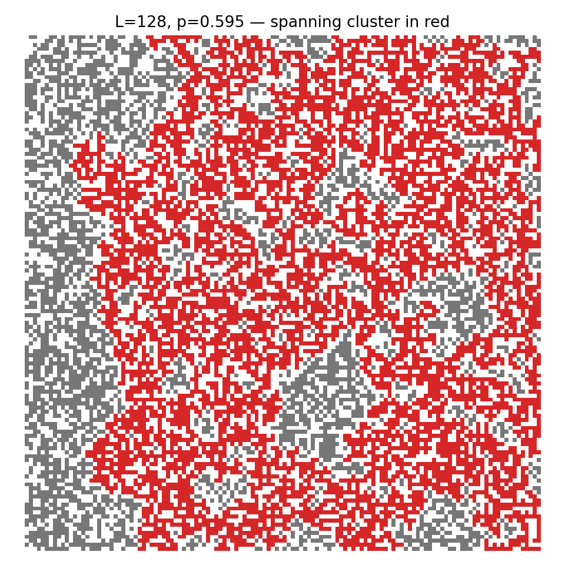
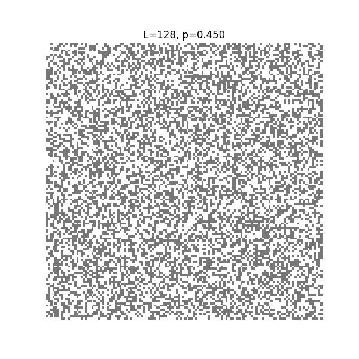
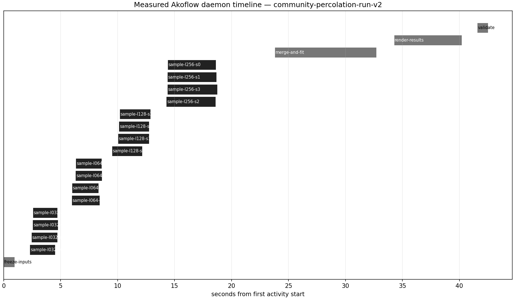

# Newman–Ziff square-lattice site-percolation audit

This deterministic CPU workflow uses incremental Newman–Ziff site occupation and union–find cluster growth to recover the square-lattice percolation transition. It evaluates 4,096 independent realizations at each of `L = 32, 64, 128, 256`, converts first-spanning counts to canonical spanning probabilities by binomial convolution, and fits the fixed finite-size form `p50(L) = pc + a L^(-3/4)`.



*Canonical either-axis spanning probability for four open square lattices. Larger lattices sharpen around the published threshold.*



*The fixed `L^(-3/4)` extrapolation gives `pc = 0.5930064082`; the dashed line is Newman and Ziff's published `0.59274621` reference.*



*An actual state from the predeclared `L=128`, shard-0, realization-0 sequence. A boundary-spanning component is highlighted in red when present.*



*The 61-frame result-bearing animation follows the same frozen realization from `p=0.45` to `0.75`; occupied sites and the first spanning component are computed from the retained incremental states.*

## Validated result

The fit returned `pc = 0.5930064082343227`, an absolute difference of `0.0002601982343227` from the paper value and well inside the predeclared `0.003` tolerance. Its deterministic 2,000-resample bootstrap interval is `[0.5924430114693832, 0.5935772518614784]`. The paper value lies inside this interval without using the allowed guard band.

| L | p50(L) | central slope |
|---:|---:|---:|
| 32 | 0.5758554123 | 11.28526787 |
| 64 | 0.5832967225 | 19.06983333 |
| 128 | 0.5869317294 | 31.83378734 |
| 256 | 0.5892992405 | 52.71966308 |

The L256/L32 slope ratio is `4.6715`, exceeding the fixed factor-of-two sharpening gate. All 16,384 permutations produced valid first-spanning counts; every canonical curve was finite, bounded, monotone, and bracketed 0.5. Union–find agreed with an independent breadth-first flood fill on all 64 predeclared audit snapshots. Two complete offline preflights produced byte-identical JSON, CSV, NPY, PNG, and 61-frame GIF results.

## Reproduce

```sh
./build.sh
./preflight.sh
./run.sh
AKOFLOW_SUBMIT=1 ./run.sh
AKOFLOW_PLAN_FILE=plan-one-slot.yaml AKOFLOW_RUN_ID=community-percolation-one-slot-run-v2 AKOFLOW_SUBMIT=1 ./run.sh
```

Scientific execution is offline, CPU-only, and receives neither Hub credentials nor the host Docker socket. Image preparation is separate. A local helper run is deterministic preflight, not Akoflow execution evidence.

## Measured Akoflow execution

Daemon run `community-percolation-run-v2` completed all 20 activities in `42.511762619018555 s`. The four scientifically independent L256 shards had `4.19141960144043 s` of common measured overlap. The matching one-slot run `community-percolation-one-slot-run-v2` completed in `91.00967335700989 s`, a same-host measured ratio of `2.140811571908212`. This is not a generalized performance claim.



*Persisted daemon start and finish timestamps show four-way overlap in each realization-shard quartet before deterministic merge, rendering, and validation.*

- Image: `akoflow/community-percolation:v1@sha256:c9d1717d594b991cc6d04ea04abacef3cf502f0d65333888dc59275fb1c5ceb8`
- Workflow version: `community-newman-ziff-percolation-v2-v1`
- Reference run: `community-percolation-run-v2`
- One-slot control: `community-percolation-one-slot-run-v2`
- The daemon's final workspace agrees with 41 common deterministic reference files, with zero digest mismatches.

## Scientific scope and limitations

This is independent site percolation on finite open square lattices with nearest-neighbor connectivity and either-axis spanning. It is not correlated, continuum, or bond percolation, transport conductivity, an experimental porous material, or an epidemic model. The exact two-dimensional exponent `nu=4/3` is fixed rather than estimated. Four bounded sizes and open boundaries omit correction-to-scaling and alternative-boundary analyses. The workflow reproduces the transition at a deliberately coarse three-decimal level and does not claim the paper's high-precision uncertainty. The animation is one declared realization, not the ensemble estimate itself.

## Citation, authorship, and licenses

Primary source: M. E. J. Newman and R. M. Ziff, “Efficient Monte Carlo Algorithm and High-Precision Results for Percolation,” *Physical Review Letters* 85, 4104–4107 (2000), [DOI 10.1103/PhysRevLett.85.4104](https://doi.org/10.1103/PhysRevLett.85.4104).

Method detail: M. E. J. Newman and R. M. Ziff, “Fast Monte Carlo algorithm for site or bond percolation,” *Physical Review E* 64, 016706 (2001), [DOI 10.1103/PhysRevE.64.016706](https://doi.org/10.1103/PhysRevE.64.016706).

The independent workflow implementation and generated artifacts are maintained by UFFeScience for Akoflow Community Explorer and licensed under the MIT License. The papers are cited, not redistributed. Python, NumPy, SciPy, Numba, llvmlite, Matplotlib, Pillow, and transitive packages retain their upstream licenses; see `THIRD_PARTY_NOTICES.md`.
