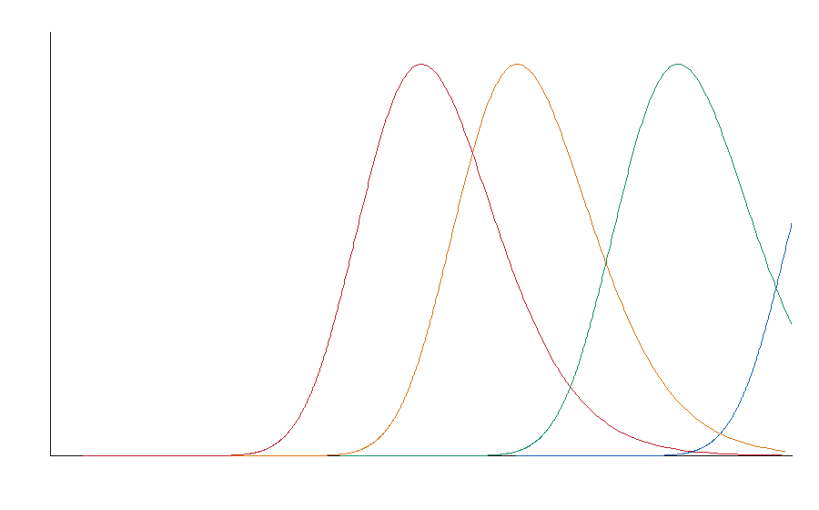
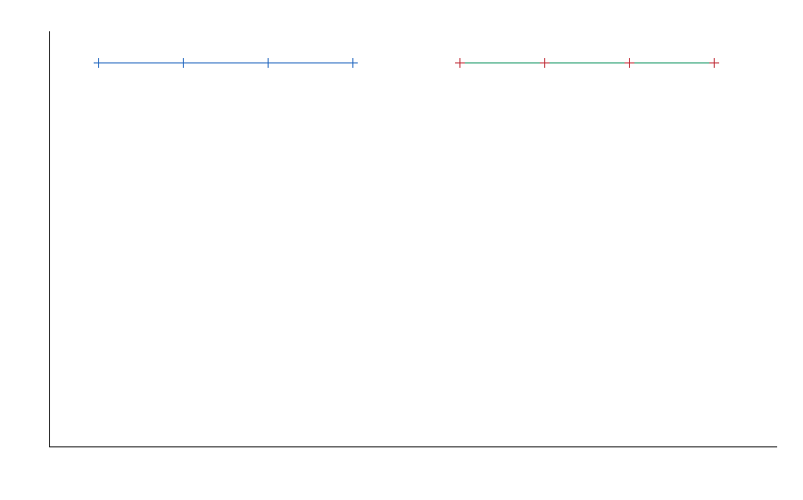
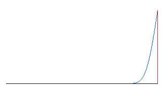
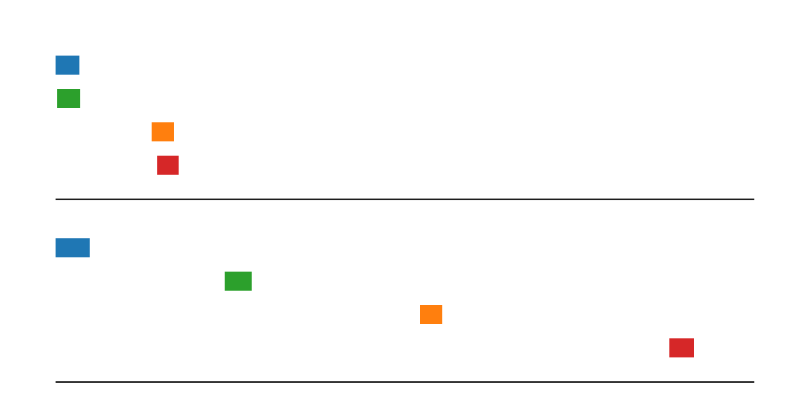

# Planck blackbody spectrum and radiation-law audit

This CPU-only AkôFlow workflow evaluates Max Planck's wavelength-domain blackbody law at 300, 1000, 3000, and 5778 K. Four independent temperature activities locate the wavelength peak and numerically integrate hemispherical spectral exitance. Aggregation tests Wien displacement (`lambda_max T = constant`) and Stefan–Boltzmann scaling (`M = sigma T^4`).

*Wavelength-domain spectral exitance from the committed numerical branch artifacts. Increasing temperature shifts the peak to shorter wavelength and raises total radiative flux.*

*Independent branch results normalized by the analytic Wien displacement and Stefan–Boltzmann laws. Crosses mark the four fixed temperatures; agreement is evaluated from the numeric JSON artifacts rather than image pixels.*

*Result-bearing temperature evolution. Each frame recomputes the Planck law and its wavelength peak for a declared temperature; it is not decorative interpolation.*

*Measured daemon branch timelines on a common 100-second horizontal scale. The upper four rows are the four-slot run; the lower four rows are the one-slot control. The parallel run measured 3.174 s of overlap between the 1000 K and 3000 K branches and 2.347 s between the 5778 K and 300 K branches. The one-slot branches are strictly sequential.*

The reference scenario uses exact SI values `h = 6.62607015e-34 J s`, `c = 299792458 m s^-1`, and `k_B = 1.380649e-23 J K^-1`. The numerical peak root is `4.965114231744277`; the resulting Wien constant is `2.8977719551851722e-3 m K`. The independently integrated dimensionless Planck integral is checked against `pi^4/15`, and the derived Stefan–Boltzmann constant is checked against `5.670374419e-8 W m^-2 K^-4`.

## Reproduce

`workflow.yaml` resolves every activity from AkôFlow portable build `recipe-build-1a91e496195bfe2098db527452c50c9984c119a79003d2963629ff43d2e4363c`. The embedded context digest is `sha256:05e48f00d0f48e73d797a6bb8a99e306dd45dddf656efde42d2c6c5ed61bcef5` and the Dockerfile digest is `sha256:7219c30ff8bbac2ae3ead8687e6967ffc819311ca964687515e8bf65eac4be67`. Its base image is pinned by digest, all `COPY` sources are versioned inside the registered context, and no build step uses the network. `run.sh` imports the environment, scope, topology, workflow, and selected plan; creates a daemon preflight; attaches the preflight ID; and submits only when `AKOFLOW_SUBMIT=1`.

The parallel `plan.yaml` assigns the four temperature branches to four local Docker slots. `plan-one-slot.yaml` assigns the identical scientific activities sequentially to slot 0. Parallel speedup is not claimed unless completed daemon timestamps prove branch overlap and the matching one-slot run is recorded.

The completed reference run is `community-planck-run-v4d`; the matched control is `community-planck-one-slot-run-v4`. Their scientific artifacts are byte-identical. The measured end-to-end makespans were 240.032 s and 218.210 s respectively on a heavily contended shared host, so no speedup claim is made. The evidence file records exact activity timestamps, output equality, image digest `sha256:83b5238f59243701062da3c375e945816249d7fe30088f626be6370ff59ab139`, build digests, and the timeline checksum.

Clean-machine verification imported the portable YAML into a fresh isolated AkôFlow daemon with separate BuildKit and Docker-in-Docker state. Preflight reported `Build required` for every activity, the daemon reconstructed the image without Hub credentials or the host Docker socket, and `community-planck-fresh-clean-run-v4` completed all eight activities in 19.999 s. Every recorded output checksum is identical to the reference run; the independent reconstruction receipt and image digest are in `evidence/daemon-runs.json`.

## Provenance and limitations

Primary citation: Max Planck, “Ueber das Gesetz der Energieverteilung im Normalspectrum,” *Annalen der Physik* 309(3), 553–563 (1901), DOI [10.1002/andp.19013090310](https://doi.org/10.1002/andp.19013090310). Constants use NIST 2022 CODATA exact SI definitions. Original code is Apache-2.0; the authored input is CC0-1.0.

This is an ideal equilibrium blackbody calculation, not a measurement of a star or material. It omits emissivity, spectral lines, atmospheric transfer, detector response, and non-equilibrium effects. The wavelength-domain maximum is not interchangeable with the frequency-domain maximum.
